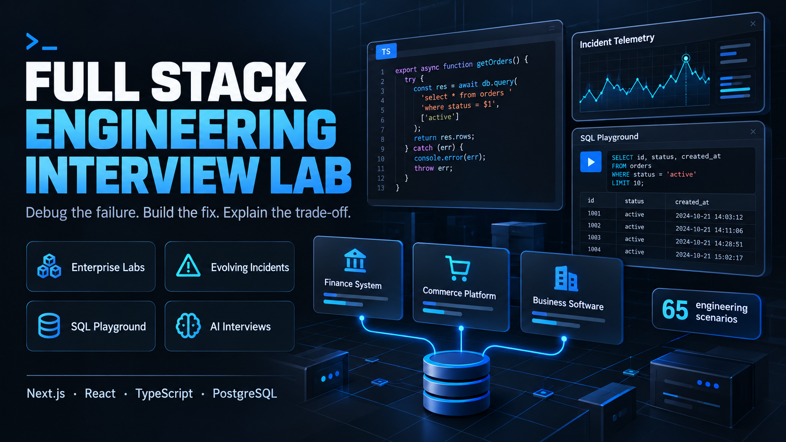
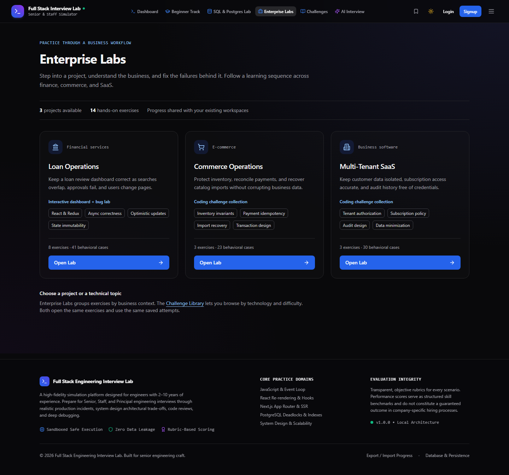
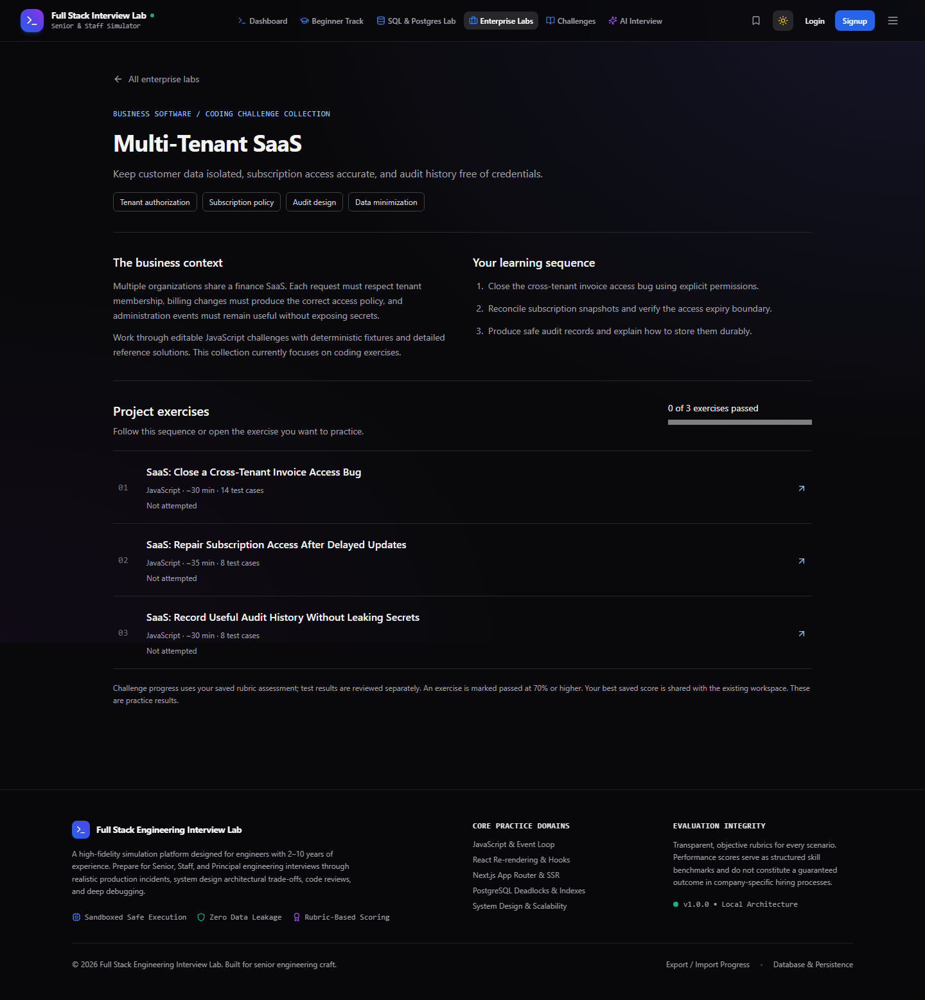
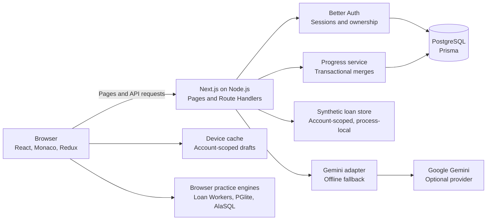
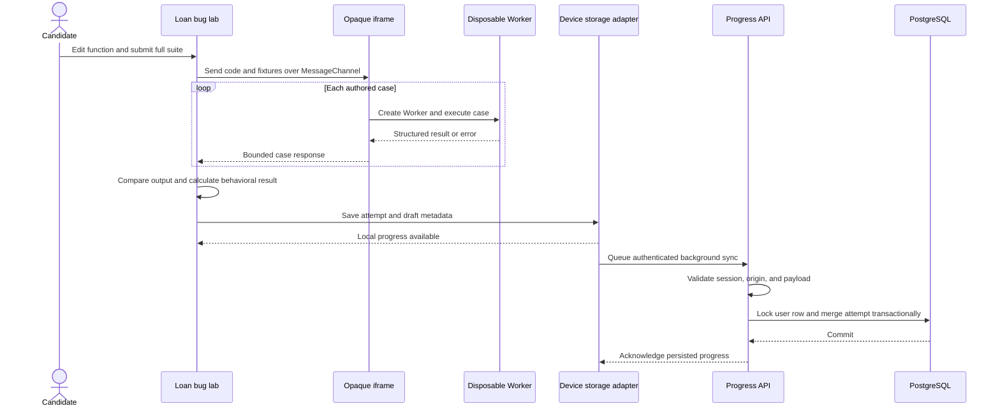
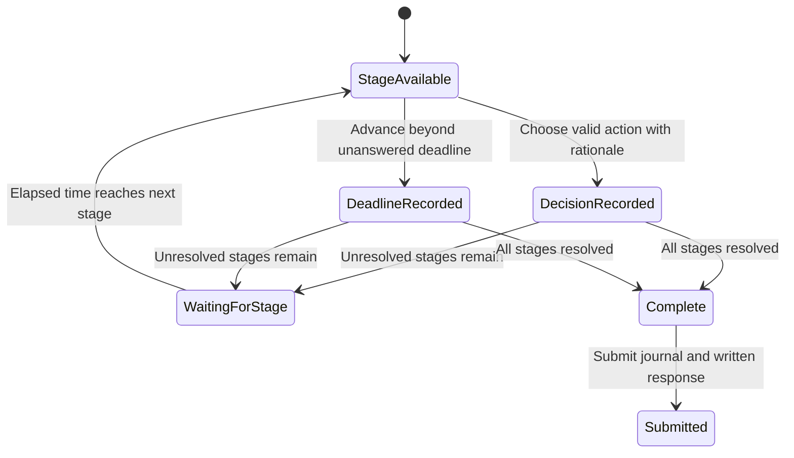
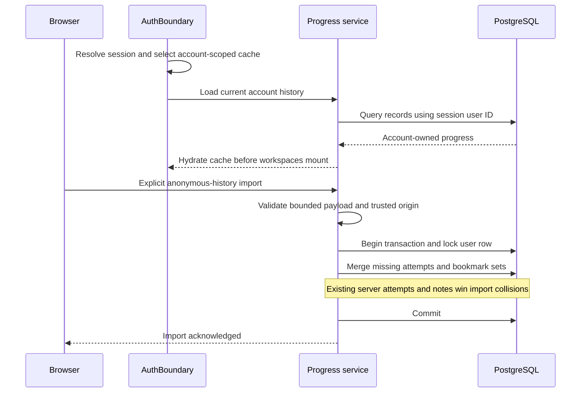
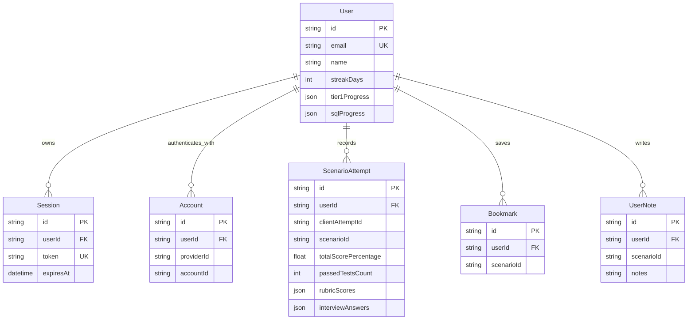

# Full Stack Engineering Interview Lab



**Debug the failure. Build the fix. Explain the trade-off.**

A full-stack learning platform for practicing the work behind senior engineering interviews: diagnosing production incidents, fixing concurrency bugs, reviewing code, querying PostgreSQL, and defending system-design decisions.

The project brings these experiences into one application with authenticated accounts, browser-based execution, persistent progress, and reproducible evaluation. Its engineering focus is **correctness under failure**: stale responses, failed optimistic updates, interrupted sessions, conflicting imports, and untrusted candidate code.

**81 engineering scenarios · 4 enterprise projects · 120 SQL questions · 8 evolving incidents**

**Live demo:** [engineering-interview-lab.vercel.app](https://engineering-interview-lab.vercel.app/)

[Product walkthrough](#a-five-minute-product-review) · [Features](#product-capabilities) · [HLD](#high-level-design-hld) · [LLD](#low-level-design-lld) · [Data model](#data-model) · [Tech stack](#technology-stack) · [Setup](#run-locally) · [Local IDE practice](#practice-in-vs-code-or-another-local-ide) · [Portfolio handoff](#portfolio-handoff)

The poster is a conceptual product visual from the earlier catalog, not a screenshot; current counts are listed above. Actual application screenshots appear below. This README is a self-contained product and engineering reference for reviewers and portfolio builders; implementation links provide deeper evidence.

**Documentation reviewed against the repository: 3 November 2026.** Recorded test results below retain their original verification date; a documentation review does not rerun those checks or establish that the deployed build matches every local change.

## Project at a glance

| Attribute | Current implementation |
|---|---|
| Product | A full-stack engineering practice simulator with guided learning, editable exercises, incident response, and interview preparation. |
| Audience | Developers building foundations and engineers preparing for senior/staff interviews. |
| Architecture | Modular monolith: one Next.js application, PostgreSQL persistence, browser execution engines, and an optional external AI provider. |
| Main catalog | 81 scenarios across 10 technical topics and six challenge formats, including eight beginner React UI exercises. |
| Enterprise Labs | Four project overviews grouping 22 exercises: eight loan, six commerce/SaaS, and eight collaboration exercises. |
| SQL track | 120 authored questions across four tiers, with executable, conceptual, and incident formats. |
| Evolving incidents | Eight simulations, 24 timed developments, and 72 response choices. |
| Executable business exercises | 41 loan-lab cases, 53 commerce/SaaS cases, and 61 collaboration cases. |
| Persistence | Account-owned history in PostgreSQL; account-scoped device caches and local drafts. |
| Current evidence | 282 unit tests across 21 suites; browser verification and qualifications recorded under [Verification](#verification). |

These counts describe different collections and must not be summed into one challenge count. The eight evolving incidents, six commerce/SaaS challenges, eight collaboration challenges, and eight React UI exercises are included in the 81-scenario catalog. Enterprise Labs reuses those six commerce/SaaS challenges, eight collaboration scenarios, and the eight separate loan exercises.

## A five-minute product review

After starting the application locally, these four paths show its core engineering depth:

| Experience | What to try | What to inspect |
|---|---|---|
| **Enterprise Labs** — `/enterprise-labs` | Choose Loan Operations, Commerce Operations, or Multi-Tenant SaaS. Follow a project learning sequence and open its existing exercises. | A typed project registry, shared account-scoped progress, and clear dashboard versus challenge-collection capabilities. |
| **Evolving incident response** — `/incidents` | Open the connection-storm scenario, choose a response, then advance the simulation. Compare the new briefing, telemetry, customer impact, and decision journal. | Pure state transitions, scheduled developments, consequence replay, and validated draft restoration. |
| **Hands-on bug fixing** — `/challenges/loan-management` | Sign in, choose **Start bug-fixing lab**, run the broken starter, edit the function in Monaco, and submit the fix. | Real behavioral tests, worker termination, request ownership, immutable state, and account-scoped submissions. |
| **SQL & PostgreSQL lab** — `/sql` | Execute a PostgreSQL-specific query in the playground, then compare the generic SQL engine. | PGlite WebAssembly execution, seeded datasets, result comparison, and explicit dialect boundaries. |

The loan lab is an editable exercise workspace. Each submission executes against fixtures and records test results; the dashboard also provides a working demonstration of the same engineering concerns.

<details>
<summary><strong>Product preview: Enterprise Labs and project learning sequences</strong></summary>





</details>

<details>
<summary><strong>Product preview: editable loan bug lab with verified test results</strong></summary>


</details>

## Product capabilities

| Area | Implemented behavior |
|---|---|
| **Scenario library** | 81 scenarios across JavaScript, TypeScript, React, Next.js, Node.js, databases, integrations, operations, system design, and security. Includes debugging, coding, incident response, code review, architecture, and interview exercises. |
| **React UI practice** | Eight original beginner JSX component exercises with interactive previews, 43 DOM journeys, references, hints, and follow-up answers. On-demand closable panels, current-code test requirements, and test-derived submission scores. Self-hosted React/ReactDOM/Sucrase runtime in opaque-origin iframes. [Workflow and execution limits](docs/REACT_UI_PRACTICE.md). |
| **E-commerce & SaaS** | Six editable challenges with 53 behavioral cases: inventory reservations, payment reconciliation, tenant authorization, subscription entitlements, resumable catalog imports, and safe audit history. [Learning sequence and model boundaries](docs/BUSINESS_CHALLENGES.md). |
| **Enterprise Labs** | Four business-project overviews grouping 22 exercises. Skills, learning sequences, direct workspace links, and best saved progress share the existing challenge and loan-lab history. [Project structure and progress rules](docs/ENTERPRISE_LABS.md). |
| **Real-Time Collaboration** | Eight editable challenges with 61 behavioral cases: message deduplication, reconnect cursors, read receipts, presence expiry, channel permissions, notification preferences, meeting signaling, and history pagination. [Contracts and production boundaries](docs/REAL_TIME_COLLABORATION.md). |
| **Evolving incidents** | Eight incidents with 24 timed developments and 72 response choices. Decisions change observations and subsequent briefings; missed deadlines record inaction. Solutions include containment, recovery gates, permanent corrections, regression tests, and rollback constraints. |
| **Loan bug-fixing lab** | Eight JavaScript exercises covering stale responses, duplicate requests, optimistic rollback, pagination, state mutation, selector memoization, stale closures, and error recovery. Two sample cases per exercise and 41 cases across the full suites. |
| **SQL practice** | Four preparation tiers, PostgreSQL execution through PGlite, generic execution through AlaSQL, conceptual questions, incident exercises, and mock interviews. |
| **Coding & interview practice** | Full-height Monaco challenge workspaces with on-demand, closable test results; sample/full submission flows, progressive hints, reference solutions, a foundational question track, and timed mock sessions. |
| **Code review** | Diff-based review workspaces with candidate comments and reference review guidance. |
| **System design** | Requirements, API/data/scaling/trade-off notes, and an architecture canvas with nodes and edges. |
| **Beginner track** | JavaScript, HTML/CSS, React, Redux Toolkit, TypeScript, and Node/API fundamentals; exploration, hints, short reference answers, and timed mock mode. |
| **Loan dashboard** | Search, status/type/risk filters, sorting, pagination, application details and timeline, dashboard statistics, optimistic status changes, and latency/failure/offline simulation controls. |
| **AI interviewer** | Server-side Gemini integration with contextual follow-ups, hints, and scorecards. A deterministic fallback supports practice when the provider is unavailable or unconfigured. |
| **Accounts & progress** | Email/password authentication, revocable database sessions, account-scoped history and drafts, bookmarks, notes, JSON import/export, and explicit anonymous-history import. |
| **Responsive session loading** | Navigation and public login/signup forms remain available during session checks. Background rechecks preserve an open visitor workspace; account changes still isolate and remount personal content. Session reads and cloud-history initialization have bounded waits, with device-history fallback for failed cloud reads. |
| **Analytics & usability** | Readiness estimates, topic breakdowns, activity/streak history, recommendations, dark/light themes, and responsive navigation. Scores are practice indicators. |
| **Local IDE practice** | A separate 278-exercise workspace covering every authored collection, with editable starters/answers, references, terminal tests, save-to-rerun mode, and a generated index. 69 exercises have automated runners, including eight React components in local Chromium; 209 use guided review. Website features and cloud progress remain separate. [Local practice guide](practice/README.md). |

The eight evolving incidents cover connection storms, cache stampedes, migration locks, regional failover, ambiguous payments, poison-message backlogs, restart cascades, and tenant-data exposure.

Coding scenarios at `/challenge/[id]` give Monaco the available workspace height. Test results stay hidden until **Run Tests**, and a close button restores the editor space while preserving the code and last result. The site footer is hidden on `/challenge/*` and `/challenges/*`; other pages retain it. Mobile layouts keep the specification and test controls accessible.

### Enterprise project experiences

| Project | What exists now | Exercises |
|---|---|---|
| **Loan Operations** | A working authenticated dashboard and a separate editable bug lab. Submitting a bug fix does not patch the live demonstration. | Stale search results, duplicate requests, optimistic rollback, pagination reset, immutable sorting, selector memoization, stale closures, and error recovery. |
| **Commerce Operations** | A coding challenge collection with deterministic fixtures and detailed solutions. | Inventory reservations, duplicate payment reconciliation, and resumable catalog imports. |
| **Multi-Tenant SaaS** | A coding challenge collection with deterministic fixtures and detailed solutions. | Tenant authorization, subscription entitlements, and safe audit history. |
| **Real-Time Collaboration** | A coding challenge collection with deterministic fixtures and reference fixes. | Message ordering, reconnect recovery, receipts, presence, channel permissions, notification delivery decisions, meeting signaling, and history pagination. |

Commerce and SaaS are practice domains inside this learning product. They are not standalone deployed stores, billing platforms, or organization-management products.

### Routes and access

| Route | Experience | Access |
|---|---|---|
| `/` | Engineering cockpit, readiness, and quick-start actions | Public; history depends on current account/device |
| `/enterprise-labs` | Enterprise project hub | Public |
| `/enterprise-labs/[project]` | Project context, learning sequence, exercise links, and best saved progress | Public; launched workspace rules still apply |
| `/library` | Search and filters for topic, difficulty, format, status, and bookmarks | Public |
| `/challenge/[id]` | Scenario-specific editor, incident, review, design, or interview workspace | Public practice; authenticated accounts can sync |
| `/incidents` | Evolving incident collection | Public |
| `/challenges/loan-management` | Loan dashboard and bug lab; `?bug=...` selects an exercise for signed-in users | Sign-in required |
| `/practice` | Standalone coding practice | Public |
| `/sql` | SQL learning tiers, playground, incidents, and mocks | Public practice; cloud AI feedback requires sign-in |
| `/interview` | Beginner practice, timed scenario tracks, and AI interviewing | Public tracks; AI interview operations require sign-in |
| `/progress` | Saved activity, topic analysis, and readiness | Current account/device history |
| `/settings`, `/account` | Account and persistence controls | Sign-in required |
| `/login`, `/signup` | Email/password account entry | Public |

## High-level design (HLD)

A modular Next.js application keeps presentation, scenario content, evaluation, and persistence in separate modules. It uses one deployable application while maintaining explicit boundaries around identity, data ownership, external AI calls, and code execution.



The worker boundary shown above belongs to the **loan bug lab**. Other practice modes have their own execution/evaluation paths; their guarantees should be reviewed independently.

### Runtime and deployment topology

The implemented topology is a browser, one Next.js Node.js deployment, and a PostgreSQL database. Gemini is optional. Turbopack builds the application; explicit Webpack commands provide a fallback. No separate code-execution server, worker fleet, queue broker, Redis cluster, or Kubernetes deployment is required by the current implementation.

Authored scenarios are version-controlled TypeScript data. Training SQL runs against seeded in-memory/WASM datasets, not the primary account database. Synthetic loan changes live in a per-account server-process store, while learning history lives durably in PostgreSQL.

The live demo is hosted on Vercel at the URL above. For deployment, configure a stable authentication secret, the public application origin, database connectivity/migrations, and a proxy that overwrites the trusted client-IP header. Set production `BETTER_AUTH_URL` to `https://engineering-interview-lab.vercel.app` for this deployment; keep the local development origin in local configuration. Process-local loan state and provider throttling do not coordinate across multiple application instances. A hosted demo does not establish production-scale performance or availability.

## Low-level design (LLD)

### Modules and contracts

| Module | Main contract / entry points | Responsibility and invariant |
|---|---|---|
| Scenario catalog | `Scenario`, `TestCase`, `RubricCriteria`; `allScenarios`, `getScenarioById` | Stable scenario IDs connect content, workspaces, references, and attempts. Type-specific assets describe coding, incidents, reviews, and designs. |
| Enterprise registry | `EnterpriseLab`, `EnterpriseLabExercise`; `getEnterpriseLab`, `getEnterpriseLabProgress` | Groups existing exercise IDs; derives best progress without creating another history store. |
| Incident engine | `IncidentSimulation`, `IncidentRun`, `IncidentDecision`; `advanceIncident`, `chooseIncidentAction`, `getIncidentView`, `restoreIncidentRun` | Deterministic transitions, scheduled stages, validated replay, immutable decisions, and consequence-derived telemetry. |
| Loan execution | `LoanLabExercise`, `runLoanLab`, `executeLoanLabCase`, `sameLoanLabOutput` | Chooses sample/full cases, runs fresh Workers, freezes fixtures, compares structured output, and cleans up on cancellation. |
| Loan dashboard | `applicationsSlice`, `dashboardSlice`, `uiSlice`, memoized selectors, `loanApiService` | Coordinates query/pagination state, request ownership, row-level pending updates, and rollback backups. |
| Persistence | `StorageAdapter`, `LocalStorageAdapter`, `progressRoute`, `mergeProgress` | Keeps immediate local work, synchronizes authenticated data, and applies explicit ownership/conflict rules. |
| Authentication | `AuthBoundary`, `requirePageSession`, `requireApiSession`, `consumeAiQuota` | Scopes device storage before mounting workspaces; derives API ownership from sessions; validates write origins and account quotas. |
| SQL engines | `runQueryAgainstDataset`, `evaluateExecutableSql`, `requestSqlEvaluation` | Chooses the declared SQL dialect; separates executable result comparison from conceptual/AI feedback. |
| AI adapter | `GeminiInterviewService`, prompt builders, offline fallbacks | Handles questions, response feedback, hints, and assessment requests; live credentials remain server-side. |

Source locations are listed under [Project map](#project-map). Detailed contracts remain in [scenario types](src/types/scenario.ts), [incident types](src/types/incident.ts), [loan-lab types](src/types/loanLab.ts), and [storage interface](src/lib/persistence/storageAdapter.ts).

### Flow 1: a loan bug submission



Code is sent as data, not interpolated into iframe HTML. The loan runner uses an opaque-origin `allow-scripts` iframe, restrictive CSP, private MessageChannel, and one disposable Worker per case. Limits include 100,000 source characters, a 1,500 ms Worker deadline, a 5,000 ms transport watchdog, and bounded JSON/log output. Cancellation removes the frame, channel resources, and active work.

Local save completion and remote database acknowledgment are different events. The UI can show a locally recorded result while cloud synchronization remains queued. Loan browser tests wait for server acknowledgments when asserting durable history.

### Flow 2: an evolving incident

The run stores only a version, elapsed time, and decision journal. Authored definitions hold stage timings, options, consequences, telemetry, and playbooks. Views are derived by replaying the journal, rather than storing an independently mutable dashboard state.



This diagram describes the logical workflow, not a persisted engine enum. The workspace controls the clock and dispatches time advances through the session hook; choices can be made while the clock is paused. Draft restoration validates decisions against the authored definition and restores paused. Effective/partial/harmful/timeout outcomes earn 2/1/0/0 points; written self-assessment is separate. A skipped deadline records inaction, and a decision cannot be rewritten after it is recorded. A large time advance can expire multiple unanswered stages in one transition.

### Flow 3: authenticated progress and imports



Account ownership comes from the session, not a submitted `userId`. Attempts have a per-user client-attempt uniqueness key; bookmarks and notes have per-user scenario uniqueness. The per-user row lock serializes JSON progress updates and imports. Repeating the same import does not duplicate existing history.

### Evaluation boundaries

| Experience | Evidence produced | What it does not establish |
|---|---|---|
| Loan bug lab | Full-suite behavioral scores, failure details, hints/assistance attribution | A tamper-proof examination result or a hard browser heap quota |
| Commerce/SaaS challenges | Executable fixture results plus saved rubric assessment | Real payment delivery, concurrent database safety, or deployed tenant isolation |
| Evolving incidents | Authored consequence replay and decision benchmark; written response | Real infrastructure control or measured production incident recovery |
| Code review / system design | Candidate annotations, design artifacts, and transparent rubrics | Automated semantic correctness certification |
| SQL practice | Dataset query results or conceptual/incident feedback, depending on question type | Execution against the account database or identical behavior between SQL dialects |
| AI interview | Provider-generated feedback or explicit offline fallback | Hiring prediction, provider correctness, or a measured external-service SLA |

Generic JavaScript/TypeScript practice uses older execution/comparison paths. It does not inherit the loan lab's iframe/Worker boundary; synchronous code can still block its page. Generic TypeScript support strips syntax rather than running a complete compiler. These distinctions matter when describing the product publicly.

## Data model



This is a selected-field ERD, not a replacement for [the Prisma schema](prisma/schema.prisma). `ScenarioAttempt` additionally stores timestamps, submitted code, root-cause/mitigation/testing notes, review comments, system-design artifacts, failed cases, and hint/time metadata. `interviewAnswers` also carries versioned incident journals and loan-lab attribution without adding a table for each exercise family.

`User.tier1Progress` and `User.sqlProgress` are JSON progress documents. Scenario definitions and project registries are source files rather than database entities. `Verification` and `RateLimit` are additional auth/quota utility tables. The auth `Account` model does not mean OAuth providers are enabled; the implemented sign-in method is email/password. User-owned relation records use cascading deletion in the schema.

There is no organization/tenant table or real commerce ledger in the application schema. Tenant authorization, subscriptions, stock reservations, and audit records in Enterprise Labs are exercise fixtures.

## API map

| Endpoint family | Methods | Purpose |
|---|---|---|
| `/api/auth/[...all]` | GET, POST | Better Auth session and email/password operations; POST body size handling is wrapped by the app. |
| `/api/progress` | GET | Read current account progress. |
| `/api/progress/attempt` | POST | Save a learning attempt through validated transactional merging. |
| `/api/progress/bookmark`, `/api/progress/notes` | POST | Update account-owned bookmarks and notes. |
| `/api/progress/import` | POST | Explicitly merge imported/anonymous progress. |
| `/api/progress/tier1`, `/api/progress/sql` | GET, POST, DELETE | Read, update, or reset the respective track. |
| `/api/progress/reset` | DELETE | Reset the current account's learning progress. |
| `/api/progress/status` | GET | Account-scoped persistence status and statistics. |
| `/api/applications`, `/api/applications/[id]` | GET | Query or inspect account-scoped synthetic loan applications. |
| `/api/applications/[id]/status` | PATCH | Simulate an account-scoped approval/status change. |
| `/api/dashboard/stats` | GET | Synthetic loan dashboard aggregates. |
| `/api/ai-interview` | GET, POST | Public configuration status; authenticated start/reply/hint/evaluate actions. |
| `/api/sql/evaluate` | POST | Authenticated conceptual/incident SQL feedback through the AI/fallback adapter. |

Except for public auth entry operations and the AI configuration GET, these application APIs require a session. Write handlers also validate the request origin and JSON content type; relevant routes apply bounded body reads and Zod validation. AI operations enforce a database-backed per-user quota, with an additional process-local guard in the provider adapter. Candidate JavaScript is not executed by an application API.

## Security and recovery design

Session cookies are HTTP-only, SameSite Lax, and secure in production; database-backed sessions can be revoked. Page guards protect private entry points, and API helpers independently enforce session ownership. Device cache scoping prevents one account's drafts from becoming another account's starting state.

Application headers include frame restrictions, MIME sniffing protection, a referrer policy, and non-cacheable API responses. The dedicated loan runner has a separate restrictive CSP. The app-level CSP is not a claim of complete script isolation across every practice mode.

Recovery is explicit: stale requests are ignored, failed optimistic writes restore row snapshots, incident drafts replay validated decisions, import collisions retain existing account data, and sync failures preserve local work with a retry notice. This is tested failure handling, not a claim that every failure is automatically retried or repaired.

## Engineering decisions

### State ownership follows the problem

Redux Toolkit manages the loan dashboard's coordinated filters, pagination, request lifecycle, and optimistic updates. Workspace-specific input stays in local React state. PostgreSQL owns authenticated history; account-scoped device caches keep drafts and immediate progress available while background synchronization runs.

This makes the responsibilities visible: transient UI state, recoverable local work, and durable account data have different lifecycles.

**Read the implementation:** [loan slices](src/lib/redux/slices), [workspace draft handling](src/components/loan/useLoanBugLab.ts), [persistence adapter](src/lib/persistence/localStorageAdapter.ts).

### Async correctness is observable and testable

The dashboard uses request-ID guards to prevent stale responses from replacing newer results. Optimistic updates retain backups and row-level pending state for rollback. The bug lab turns these behaviors into deterministic event sequences, so candidate fixes can be evaluated without relying on unpredictable network timing.

Selector exercises check result identity as well as contents. Sorting exercises freeze inputs to catch state mutation. Retry exercises verify that a failed request can leave loading state and recover.

**Read the implementation:** [exercise contracts and reference fixes](src/data/loanLabExercises.ts), [behavioral harness](src/lib/loanLab/harness.ts), [regression tests](tests/unit/loanBugLab.test.ts).

### Candidate execution has a dedicated boundary

Loan exercises run in disposable Workers created inside a sandboxed, opaque-origin iframe. A private MessageChannel carries input and results. The iframe's content security policy blocks network connections and external script loading; case timeouts terminate workers, and cancellation removes runner resources.

Results use structural equality rather than code-string matching. Reference reveal is recorded as assistance, and editing a draft clears old test feedback.

This approach supports focused browser exercises without adding a server-side execution service. It remains client-reported practice feedback, with browser resource limits rather than a hard memory quota.

**Read the implementation:** [isolated runner](src/lib/loanLab/runner.ts), [browser boundary tests](tests/e2e/loanBugLab.spec.ts), [execution details](docs/LOAN_BUG_LAB.md).

### Identity is enforced at the data boundary

Protected APIs derive account ownership from the server session. Client-supplied user IDs cannot select another account's progress. Better Auth provides password handling and database-backed sessions; application handlers add bounded request validation and ownership checks.

Device caches are scoped by account before workspaces mount. Signing in does not silently upload anonymous history: importing it is an explicit user action.

**Read the implementation:** [session/authorization helpers](src/lib/auth/server.ts), [authentication configuration](src/lib/auth.ts), [ownership and migration guide](docs/AUTHENTICATION.md).

### Persistence has explicit conflict rules

Progress imports run transactionally with a per-user row lock. Attempts are deduplicated within an account, existing server records win collisions, and bookmark/completion sets are merged. Repeating an import preserves existing history.

Background sync failures retain local work and surface a retry notice. The current design does not provide a durable background retry queue or general multi-device conflict resolution; these are deliberate boundaries of the implementation.

**Read the implementation:** [progress API](src/lib/persistence/progressServer.ts), [merge policy](src/lib/persistence/progressMerge.ts), [account-isolation tests](tests/e2e/auth.spec.ts).

### Evaluation distinguishes different kinds of evidence

Executable tests, authored decision benchmarks, self-assessed rubrics, and AI feedback are presented as different evaluation modes. Loan exercises remain in activity history while catalog completion and readiness averages include only registered scenario IDs.

The incident engine separates time advancement, action selection, telemetry derivation, and draft restoration. This keeps simulations reproducible and makes premature decisions, duplicate actions, missed deadlines, and fabricated drafts testable.

**Read the implementation:** [incident engine](src/lib/incidents/engine.ts), [incident tests](tests/unit/incidentEngine.test.ts), [readiness calculation](src/lib/evaluation/readinessCalculator.ts).

## Technology stack

| Layer | Technologies |
|---|---|
| Application | Next.js 16.4.3 App Router, React 19.3.1, TypeScript 5.9.3 |
| Build | Turbopack for development and production; explicit Webpack fallback commands |
| Interface | Tailwind CSS 3.4.19, Lucide icons, Monaco Editor, clsx, tailwind-merge |
| Dashboard state | Redux Toolkit 2.13.0, React Redux; local React state for focused workspaces |
| Authentication & persistence | Better Auth 1.7.15, Prisma 6.19.3, PostgreSQL, Zod 4 |
| SQL execution | PGlite 0.5.14 WebAssembly, AlaSQL 4.22.0 |
| AI integration | Google GenAI SDK 2.32.0, server-side Gemini adapter and deterministic fallbacks |
| Verification | Vitest, Playwright/Chromium, TypeScript, ESLint |

[Framework migration and recovery notes](docs/NEXTJS_UPGRADE.md) document the Next.js upgrade, bundler compatibility changes, and verified Webpack fallback.

Versions above are the lockfile snapshot reviewed on 3 November 2026, not a claim that these are the newest available releases. There is no vector database, RAG pipeline, agent framework, message broker, or microservice architecture in the implemented stack.

Styling already uses Tailwind utilities throughout the components. [The Tailwind configuration](tailwind.config.ts) defines class-based dark mode and shared theme tokens. [The global stylesheet](src/app/globals.css) supplies Tailwind directives, light/dark CSS variables, page backgrounds, glass surfaces, focus indicators, scrollbars, and a custom animation. A further conversion of those custom styles to utilities has not been implemented.

## Run locally

### Prerequisites

- Node.js: Next.js requires 20.9+. Use Node 22.13+ within the 22.x line, or another version satisfying the installed lint tooling's engine requirements.
- npm and a PostgreSQL database.
- An optional Gemini API key for live AI responses.

From the repository root:

```sh
npm ci
```

Create `.env.local` from [.env.example](.env.example) if you do not already have a local configuration. Set:

| Variable | Purpose |
|---|---|
| `DATABASE_URL` | PostgreSQL connection for accounts, sessions, and saved progress. |
| `BETTER_AUTH_SECRET` | A stable, cryptographically random secret of at least 32 characters. |
| `BETTER_AUTH_URL` | Application origin, such as `http://localhost:3000`. Use the public HTTPS origin for deployment. |
| `GEMINI_API_KEY` | Optional server-side key for live interviewing. |
| `GEMINI_MODEL` | Optional model override available to your Gemini project. |

Generate an authentication secret locally:

```sh
node -e "console.log(require('node:crypto').randomBytes(48).toString('base64url'))"
```

For a **new, empty database**:

```sh
npm run db:generate
npm run db:migrate
npm run dev
```

Open [localhost:3000](http://localhost:3000). Incident, coding, and SQL practice have public entry points. Sign up to use the protected loan dashboard, AI interview operations, and account synchronization.

For an existing database, follow the [baseline and migration procedure](docs/AUTHENTICATION.md#schema-and-safe-migration) before applying migrations. The checked-in `.npmrc` disables dependency lifecycle scripts; Prisma Client generation is therefore an explicit step.

### Commands

| Command | Purpose |
|---|---|
| `npm run dev` | Start Turbopack development. |
| `npm run typecheck` | Run standalone TypeScript checks. |
| `npm run lint` | Run ESLint against application source. |
| `npm test` | Run the unit suite. |
| `npm run build` / `npm start` | Build and serve production output. |
| `npm run test:e2e` | Run Playwright; requires built output or a configured external server. |
| `npm run dev:webpack` / `npm run build:webpack` | Use the retained Webpack configuration. |
| `npm run practice:list -- <search>` | Find local exercises by collection, ID, or title. |
| `npm run practice:test -- <collection/id>` | Run the selected local solution against authored cases. |
| `npm run practice:watch -- <collection/id>` | Rerun one executable exercise when its solution is saved. |
| `npm run practice:generate` | Refresh generated content while preserving existing solutions and answers. |
| `npm run practice:verify` | Verify local tooling, source coverage, preservation, and executable references. |

## Practice in VS Code or another local IDE

Open [the practice index](practice/INDEX.md) to choose from all **278 authored exercises**: 81 catalog scenarios, eight loan labs, 120 SQL questions, 63 beginner questions, and six standalone coding problems. Enterprise project sequences link to the same exercises. The eight React UI exercises, eight evolving incidents, and six commerce/SaaS scenarios remain included in the catalog count.

```sh
npm ci
npm run practice:list -- inventory
npm run practice:test -- catalog/commerce-inventory-reservations
npm run practice:watch -- catalog/commerce-inventory-reservations
```

Edit the exercise's `solution.*` file and record your reasoning in `answer.md`. Each folder includes instructions, full authored task data, cases, and separate reference material. Broken starters are expected to fail. The 69 executable exercises use JavaScript/TypeScript, loan harnesses, SQL engines, local Chromium for React UI, or the optional local Python interpreter. React tests require `npx playwright install chromium` and `npm run react:runtime`. The other 209 exercises include review, UI snippets, architecture, incidents, interviews, and foundational questions; use their answer files and reference rubrics rather than treating them as automated passes.

The local workflow needs no Next.js server, account database, authentication, or AI credentials. It does not update website progress or patch app exercises. Practice code is excluded from the application's TypeScript build, so unfinished solutions remain independent. [The practice guide](practice/README.md) explains dialect differences, manual review, process limits, and regeneration that preserves candidate work.

## Verification

**Latest recorded verification: 3 November 2026.** These are local verification results, not a CI badge or a claim about production traffic. Earlier browser journeys retain their recorded baseline; the React UI row records the latest targeted browser verification.

**Earlier local IDE workspace baseline: 3 November 2026.** Its independent suite passed **60 checks**, covering the original 262 exported exercises, preservation on refresh, the original 53 executable reference solutions, expected failures in the 14 business/loan starters, TypeScript/async execution, exact comparisons, and timeout behavior. The app unit suite passed **203 tests across 17 suites** at that stage. A recursive-category SQL fixture/reference was corrected with an explicit breadcrumb text cast after PostgreSQL execution exposed its type mismatch.

**Real-Time Collaboration update: 3 November 2026.** The full app suite passed **273 tests across 18 suites**, including all 61 new behavioral cases and eight failing-starter checks. The local suite passed **68 checks**, including all 61 executable reference exercises and coverage of all 270 exports. TypeScript, ESLint, and the Turbopack production build passed.

| Check | Recorded result |
|---|---|
| Unit tests | **282 passed across 21 suites** |
| React UI update | **27 Chromium journeys verified against the updated production build:** 26 passed in the combined run; the remaining score-persistence journey passed on a focused rerun after correcting an ambiguous alert selector. Covers all eight failing starters/passing references, mobile preview, malformed code/import errors, host-DOM isolation, native form events with blocked navigation, current-code submission checks, saved test scores, authentication, editor layout, and enterprise projects. TypeScript, ESLint, and the production build passed. |
| Local practice update | **76 checks passed**, covering all 278 exports, all 69 executable references (including 43 React DOM cases), candidate-file preservation, and existing execution regressions. |
| Session-loading update | **20 Chromium journeys passed against the updated production build**, including slow session/history requests, form/filter DOM preservation during refresh, rapid account changes, real authentication and API ownership, cloud progress, responsive navigation, and editor/results layout. TypeScript, ESLint, and the production build passed. |
| Real-Time Collaboration update | **15 targeted Chromium journeys passed against the updated production build**, covering all eight collaboration starters/references, mobile discovery, four-project navigation, both themes at 320–1440 px, existing commerce/SaaS execution, and closable full-height editor results. |
| Browser regression tests (previous full audit) | **34 Chromium journeys verified against the production build:** 33 passed in the full run; the remaining cloud-sync check passed in a focused rerun after correcting its save-completion wait. |
| Challenge workspace layout update | **Eight targeted Chromium journeys passed against the updated production build**, including full-height editor, on-demand results, close/rerun, mobile layout, and related SQL/incident/workspace flows. |
| Production build | Passed |
| TypeScript and ESLint | Passed |
| Loan exercise reference implementations | **All 41 authored cases passed** |
| E-commerce/SaaS reference implementations | **All 53 authored cases passed, including browser execution** |

Coverage includes authentication and account isolation, idempotent progress imports, stale-request handling, optimistic rollback, PostgreSQL/AlaSQL execution, real Monaco edits, incident deadlines and restoration, worker timeout/cancellation, and mobile exercise navigation.

The AI interview journey mocks live Gemini responses. This verifies application behavior without claiming to validate the external provider.

For the same isolated-account browser workflow used during development, install Chromium once:

```sh
npx playwright install chromium
```

Start the verification build/server in one terminal:

```sh
node scripts/auth-check.mjs build
node scripts/auth-check.mjs serve
```

Run the browser suite from a second PowerShell terminal:

```powershell
$env:PLAYWRIGHT_BASE_URL = 'http://localhost:3100'
$env:PLAYWRIGHT_EXTERNAL_SERVER = '1'
node node_modules/@playwright/test/cli.js test --workers=1
```

For a POSIX shell:

```sh
PLAYWRIGHT_BASE_URL=http://localhost:3100 PLAYWRIGHT_EXTERNAL_SERVER=1 node node_modules/@playwright/test/cli.js test --workers=1
```

The helper supplies a test-only ephemeral secret when needed. Browser tests create disposable accounts in the configured database; use a development/test database. Normal deployments require a persistent authentication secret.

## Project map

```text
src/
  app/                  Routes, protected pages, and API handlers
  components/           Workspaces, dashboard, loan lab, and account UI
  data/                 Scenario library, incident content, SQL datasets, exercises
  lib/
    auth/               Session checks, validation, and account quotas
    evaluation/         Rubrics, readiness, SQL evaluation, legacy practice execution
    incidents/          Deterministic incident transitions and replay
    loanLab/            Exercise harness, isolated runner, drafts, progress metadata
    persistence/        Device cache, authenticated sync, merge rules
    redux/              Loan dashboard state and selectors
    gemini/             Provider adapter, prompts, and fallback responses
  types/                Shared domain contracts
prisma/                 PostgreSQL schema and migration history
tests/unit/             Domain, validation, execution, and regression tests
tests/e2e/              Browser journeys and account-isolation checks
docs/                   Feature guides, migration notes, and screenshots
practice/               All authored exercises, editable local solutions, references, index
scripts/practice/       Source-driven generator, CLI, and local execution adapters
tests/practice/         Independent local-workspace and reference checks
```

## Scope and trade-offs

- **Synthetic operations:** incident telemetry and loan records are training data. Loan simulation state is account-scoped and process-local; it resets when the server restarts.
- **Execution scope:** the loan lab evaluates extracted JavaScript functions. Generic TypeScript practice strips syntax; it is not a full TypeScript compiler/type-checking service. Python, Go, and Rust execution services are not configured.
- **Assessment scope:** deterministic tests, rubrics, and AI feedback support practice. Scores are not hiring predictions or tamper-proof certification.
- **Account lifecycle:** email/password sessions are implemented; password recovery, email verification, OAuth, and MFA are not implemented.
- **Scale evidence:** the repository demonstrates failure handling through simulations and tests. Scenario traffic volumes are exercise assumptions, not measured application throughput.

## Portfolio handoff

This section is ready to use as the factual basis of a portfolio project page. The product overview, capabilities, HLD, LLD, schema, API map, stack, and verification above describe the implemented application. A portfolio can summarize them without inventing additional systems or claiming ownership details that have not been supplied.

### Project card copy

**Title:** Full Stack Engineering Interview Lab

**Category:** Full-stack developer tools / engineering education

**Live demo:** [Engineering Interview Lab on Vercel](https://engineering-interview-lab.vercel.app/)

**Headline:** Practice the engineering decisions behind production software.

**Short description:** A Next.js and TypeScript practice platform combining enterprise project labs, editable bug exercises, evolving production incidents, browser SQL execution, and AI-assisted interviews, with authenticated progress and reproducible evaluation.

**Case-study summary:** The platform brings code debugging, incident response, SQL investigation, code review, and system-design practice into one learning workflow. Four Enterprise Labs organize exercises around loan operations, commerce, multi-tenant SaaS, and real-time collaboration. Timed incidents respond to candidate decisions, while Monaco-based workspaces make fixes executable against authored cases.

Its engineering depth is in explicit failure boundaries: stale-response guards, optimistic rollback, deterministic incident replay, a dedicated iframe/Worker boundary for loan exercises, account-scoped cache hydration, and transactional progress merging. PostgreSQL stores identity and history; browser engines execute training SQL; a server-side Gemini adapter provides optional feedback with offline fallbacks. The project demonstrates these behaviors through local verification rather than claims about commercial usage or production scale.

### Engineering highlights for a case study

- A modular Next.js App Router application with clear boundaries between content, state, evaluation, identity, and persistence.
- Four enterprise project overviews reusing 22 exercises and their existing progress IDs, without duplicating history.
- Eight evolving incidents whose timing, decisions, consequences, and restored drafts are deterministic and testable.
- A dedicated loan code-execution boundary using an opaque iframe, private channel, per-case Workers, timeout termination, and structured comparisons.
- Authenticated ownership checks and per-user transactional imports, including idempotent replay and explicit conflict rules.
- Separate SQL dialects and distinct evaluation modes, with transparent limits around rubrics, AI feedback, and generic execution.

These describe the repository's implementation. Author name, individual contribution, team size, employer/client context, build duration, repository URL, and licensing information must be supplied by the owner before publishing. The live demo URL is provided above. No user counts, revenue, production SLAs, benchmark scores, or performance improvements are established here.

### Visual assets and presentation

| Asset | Role | Accuracy / usage |
|---|---|---|
| [Project poster](docs/assets/project-poster.png) | Hero image or project-card cover | Generated conceptual illustration; not proof of runtime UI. |
| [Enterprise Labs screenshot](docs/screenshots/16_enterprise_labs.png) | Product overview gallery | Earlier desktop hub showing the original three projects; the current app also includes Real-Time Collaboration. |
| [Project overview screenshot](docs/screenshots/17_enterprise_project.png) | Workflow gallery | Actual SaaS project context, sequence, exercise links, and progress. |
| [Collaboration overview screenshot](docs/screenshots/18_collaboration_project.png) | Communication & chat gallery | Actual project overview with eight exercises, learning sequence, and shared progress. |
| [Loan bug lab screenshot](docs/screenshots/15_loan_bug_lab.png) | Hands-on execution gallery | Actual editable workspace with passing authored tests. |
| [Poster generation prompt](docs/assets/project-poster.prompt.md) | Asset provenance | Exact prompt and generation method for future variants. |

For a portfolio page, lead with the poster and short description; follow with product workflows, engineering highlights, grouped technologies, architecture, verification evidence, and actual screenshots. Preserve the difference between the implemented simulator and the business systems described by its exercises.

Supply the image files alongside this README to a portfolio builder; relative image paths cannot transfer the binary assets by themselves. Mermaid diagrams carry the architecture in text and can be rendered directly or recreated faithfully by the portfolio site. Use `https://engineering-interview-lab.vercel.app` as the origin for the application routes listed above when linking to the live demo.

### Future extensions, not implemented features

Possible next stages include interactive commerce/SaaS dashboards, durable loan simulation storage, a durable background synchronization queue, stronger generic language execution, additional account recovery/sign-in methods, and deployment observability. They should appear as a roadmap only if the owner chooses to pursue them, not as shipped capabilities.

## Further reading

- [Authentication, ownership, and database migration](docs/AUTHENTICATION.md)
- [Evolving incidents: behavior, scenarios, and verification](docs/EVOLVING_INCIDENTS.md)
- [Loan bug lab: contracts, execution model, and verification](docs/LOAN_BUG_LAB.md)
- [Real-Time Collaboration: contracts and scope](docs/REAL_TIME_COLLABORATION.md)
- [Enterprise Labs: project registry, shared progress, and extension points](docs/ENTERPRISE_LABS.md)
- [E-commerce and SaaS: exercise sequence and model boundaries](docs/BUSINESS_CHALLENGES.md)
- [Next.js 16 and Turbopack migration](docs/NEXTJS_UPGRADE.md)
