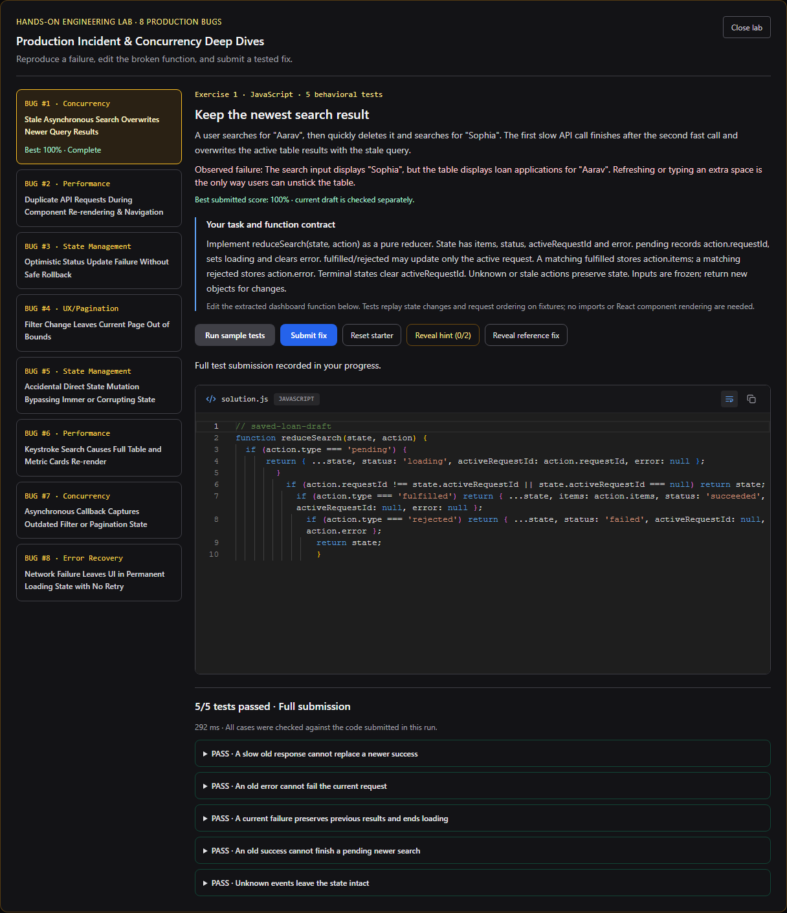
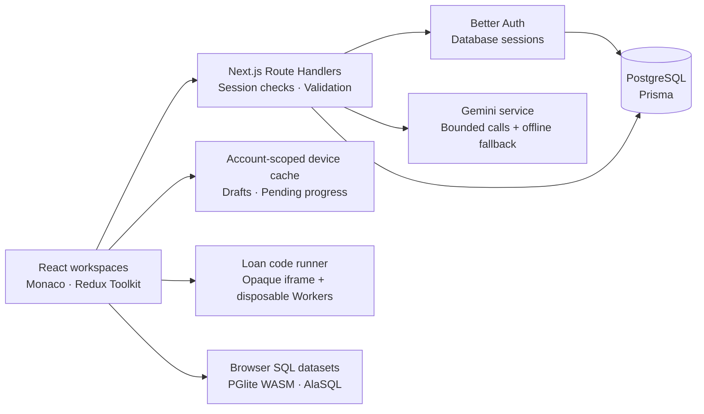

# Full Stack Engineering Interview Lab

**Debug the failure. Build the fix. Explain the trade-off.**

A full-stack learning platform for practicing the work behind senior engineering interviews: diagnosing production incidents, fixing concurrency bugs, reviewing code, querying PostgreSQL, and defending system-design decisions.

The project brings these experiences into one application with authenticated accounts, browser-based execution, persistent progress, and reproducible evaluation. Its engineering focus is **correctness under failure**: stale responses, failed optimistic updates, interrupted sessions, conflicting imports, and untrusted candidate code.

**59 engineering scenarios · 8 evolving incidents · 8 editable bug exercises · 41 bug-lab test cases**

[Review the product](#a-five-minute-product-review) · [Architecture](#architecture) · [Engineering decisions](#engineering-decisions) · [Run locally](#run-locally) · [Verification](#verification)

## A five-minute product review

After starting the application locally, these three paths show its core engineering depth:

| Experience | What to try | What to inspect |
|---|---|---|
| **Evolving incident response** — `/incidents` | Open the connection-storm scenario, choose a response, then advance the simulation. Compare the new briefing, telemetry, customer impact, and decision journal. | Pure state transitions, scheduled developments, consequence replay, and validated draft restoration. |
| **Hands-on bug fixing** — `/challenges/loan-management` | Sign in, choose **Start bug-fixing lab**, run the broken starter, edit the function in Monaco, and submit the fix. | Real behavioral tests, worker termination, request ownership, immutable state, and account-scoped submissions. |
| **SQL & PostgreSQL lab** — `/sql` | Execute a PostgreSQL-specific query in the playground, then compare the generic SQL engine. | PGlite WebAssembly execution, seeded datasets, result comparison, and explicit dialect boundaries. |

The loan lab is an editable exercise workspace. Each submission executes against fixtures and records test results; the dashboard also provides a working demonstration of the same engineering concerns.

<details>
<summary><strong>Product preview: editable loan bug lab with verified test results</strong></summary>



</details>

## Product capabilities

| Area | Implemented behavior |
|---|---|
| **Scenario library** | 59 scenarios across JavaScript, TypeScript, React, Next.js, Node.js, databases, integrations, operations, system design, and security. Includes debugging, coding, incident response, code review, architecture, and interview exercises. |
| **Evolving incidents** | Eight incidents with 24 timed developments and 72 response choices. Decisions change observations and subsequent briefings; missed deadlines record inaction. Solutions include containment, recovery gates, permanent corrections, regression tests, and rollback constraints. |
| **Loan bug-fixing lab** | Eight JavaScript exercises covering stale responses, duplicate requests, optimistic rollback, pagination, state mutation, selector memoization, stale closures, and error recovery. Two sample cases per exercise and 41 cases across the full suites. |
| **SQL practice** | Four preparation tiers, PostgreSQL execution through PGlite, generic execution through AlaSQL, conceptual questions, incident exercises, and mock interviews. |
| **Coding & interview practice** | Monaco workspaces, sample/full submission flows, progressive hints, reference solutions, a foundational question track, and timed mock sessions. |
| **AI interviewer** | Server-side Gemini integration with contextual follow-ups, hints, and scorecards. A deterministic fallback supports practice when the provider is unavailable or unconfigured. |
| **Accounts & progress** | Email/password authentication, revocable database sessions, account-scoped history and drafts, bookmarks, notes, JSON import/export, and explicit anonymous-history import. |

The eight evolving incidents cover connection storms, cache stampedes, migration locks, regional failover, ambiguous payments, poison-message backlogs, restart cascades, and tenant-data exposure.

## Architecture

A modular Next.js application keeps presentation, scenario content, evaluation, and persistence in separate modules. It uses one deployable application while maintaining explicit boundaries around identity, data ownership, external AI calls, and code execution.



The worker boundary shown above belongs to the **loan bug lab**. Other practice modes have their own execution/evaluation paths; their guarantees should be reviewed independently.

## Engineering decisions

### State ownership follows the problem

Redux Toolkit manages the loan dashboard's coordinated filters, pagination, request lifecycle, and optimistic updates. Workspace-specific input stays in local React state. PostgreSQL owns authenticated history; account-scoped device caches keep drafts and immediate progress available while background synchronization runs.

This makes the responsibilities visible: transient UI state, recoverable local work, and durable account data have different lifecycles.

**Read the implementation:** [loan slices](src/lib/redux/slices), [workspace draft handling](src/components/loan/useLoanBugLab.ts), [persistence adapter](src/lib/persistence/localStorageAdapter.ts).

### Async correctness is observable and testable

The dashboard uses request-ID guards to prevent stale responses from replacing newer results. Optimistic updates retain backups and row-level pending state for rollback. The bug lab turns these behaviors into deterministic event sequences, so candidate fixes can be evaluated without relying on unpredictable network timing.

Selector exercises check result identity as well as contents. Sorting exercises freeze inputs to catch state mutation. Retry exercises verify that a failed request can leave loading state and recover.

**Read the implementation:** [exercise contracts and reference fixes](src/data/loanLabExercises.ts), [behavioral harness](src/lib/loanLab/harness.ts), [regression tests](tests/unit/loanBugLab.test.ts).

### Candidate execution has a dedicated boundary

Loan exercises run in disposable Workers created inside a sandboxed, opaque-origin iframe. A private MessageChannel carries input and results. The iframe's content security policy blocks network connections and external script loading; case timeouts terminate workers, and cancellation removes runner resources.

Results use structural equality rather than code-string matching. Reference reveal is recorded as assistance, and editing a draft clears old test feedback.

This approach supports focused browser exercises without adding a server-side execution service. It remains client-reported practice feedback, with browser resource limits rather than a hard memory quota.

**Read the implementation:** [isolated runner](src/lib/loanLab/runner.ts), [browser boundary tests](tests/e2e/loanBugLab.spec.ts), [execution details](docs/LOAN_BUG_LAB.md).

### Identity is enforced at the data boundary

Protected APIs derive account ownership from the server session. Client-supplied user IDs cannot select another account's progress. Better Auth provides password handling and database-backed sessions; application handlers add bounded request validation and ownership checks.

Device caches are scoped by account before workspaces mount. Signing in does not silently upload anonymous history: importing it is an explicit user action.

**Read the implementation:** [session/authorization helpers](src/lib/auth/server.ts), [authentication configuration](src/lib/auth.ts), [ownership and migration guide](docs/AUTHENTICATION.md).

### Persistence has explicit conflict rules

Progress imports run transactionally with a per-user row lock. Attempts are deduplicated within an account, existing server records win collisions, and bookmark/completion sets are merged. Repeating an import preserves existing history.

Background sync failures retain local work and surface a retry notice. The current design does not provide a durable background retry queue or general multi-device conflict resolution; these are deliberate boundaries of the implementation.

**Read the implementation:** [progress API](src/lib/persistence/progressServer.ts), [merge policy](src/lib/persistence/progressMerge.ts), [account-isolation tests](tests/e2e/auth.spec.ts).

### Evaluation distinguishes different kinds of evidence

Executable tests, authored decision benchmarks, self-assessed rubrics, and AI feedback are presented as different evaluation modes. Loan exercises remain in activity history while catalog completion and readiness averages include only registered scenario IDs.

The incident engine separates time advancement, action selection, telemetry derivation, and draft restoration. This keeps simulations reproducible and makes premature decisions, duplicate actions, missed deadlines, and fabricated drafts testable.

**Read the implementation:** [incident engine](src/lib/incidents/engine.ts), [incident tests](tests/unit/incidentEngine.test.ts), [readiness calculation](src/lib/evaluation/readinessCalculator.ts).

## Technology stack

| Layer | Technologies |
|---|---|
| Application | Next.js 16.4.3, App Router, React 19, TypeScript |
| Build | Turbopack for development and production; explicit Webpack fallback commands |
| Interface | Tailwind CSS, Lucide icons, Monaco Editor |
| Dashboard state | Redux Toolkit, React Redux |
| Authentication & persistence | Better Auth 1.7.15, Prisma 6, PostgreSQL, Zod |
| SQL execution | PGlite WebAssembly, AlaSQL |
| AI integration | Google GenAI SDK, server-side Gemini adapter |
| Verification | Vitest, Playwright/Chromium, TypeScript, ESLint |

[Framework migration and recovery notes](docs/NEXTJS_UPGRADE.md) document the Next.js upgrade, bundler compatibility changes, and verified Webpack fallback.

## Run locally

### Prerequisites

- Node.js: Next.js requires 20.9+. Use Node 22.13+ within the 22.x line, or another version satisfying the installed lint tooling's engine requirements.
- npm and a PostgreSQL database.
- An optional Gemini API key for live AI responses.

From the repository root:

```sh
npm ci
```

Create `.env.local` from [.env.example](.env.example) if you do not already have a local configuration. Set:

| Variable | Purpose |
|---|---|
| `DATABASE_URL` | PostgreSQL connection for accounts, sessions, and saved progress. |
| `BETTER_AUTH_SECRET` | A stable, cryptographically random secret of at least 32 characters. |
| `BETTER_AUTH_URL` | Application origin, such as `http://localhost:3000`. Use the public HTTPS origin for deployment. |
| `GEMINI_API_KEY` | Optional server-side key for live interviewing. |
| `GEMINI_MODEL` | Optional model override available to your Gemini project. |

Generate an authentication secret locally:

```sh
node -e "console.log(require('node:crypto').randomBytes(48).toString('base64url'))"
```

For a **new, empty database**:

```sh
npm run db:generate
npm run db:migrate
npm run dev
```

Open [localhost:3000](http://localhost:3000). Incident, coding, and SQL practice have public entry points. Sign up to use the protected loan dashboard, AI interview operations, and account synchronization.

For an existing database, follow the [baseline and migration procedure](docs/AUTHENTICATION.md#schema-and-safe-migration) before applying migrations. The checked-in `.npmrc` disables dependency lifecycle scripts; Prisma Client generation is therefore an explicit step.

### Commands

| Command | Purpose |
|---|---|
| `npm run dev` | Start Turbopack development. |
| `npm run typecheck` | Run standalone TypeScript checks. |
| `npm run lint` | Run ESLint against application source. |
| `npm test` | Run the unit suite. |
| `npm run build` / `npm start` | Build and serve production output. |
| `npm run test:e2e` | Run Playwright; requires built output or a configured external server. |
| `npm run dev:webpack` / `npm run build:webpack` | Use the retained Webpack configuration. |

## Verification

**Latest recorded verification: 2 November 2026.** These are local verification results, not a CI badge or a claim about production traffic.

| Check | Recorded result |
|---|---|
| Unit tests | **137 passed across 15 suites** |
| Browser regression tests | **28 passed against the final Turbopack production build** |
| Production build | Passed |
| TypeScript and ESLint | Passed |
| Loan exercise reference implementations | **All 41 authored cases passed** |

Coverage includes authentication and account isolation, idempotent progress imports, stale-request handling, optimistic rollback, PostgreSQL/AlaSQL execution, real Monaco edits, incident deadlines and restoration, worker timeout/cancellation, and mobile exercise navigation.

The AI interview journey mocks live Gemini responses. This verifies application behavior without claiming to validate the external provider.

For the same isolated-account browser workflow used during development, install Chromium once:

```sh
npx playwright install chromium
```

Start the verification build/server in one terminal:

```sh
node scripts/auth-check.mjs build
node scripts/auth-check.mjs serve
```

Run the browser suite from a second PowerShell terminal:

```powershell
$env:PLAYWRIGHT_BASE_URL = 'http://localhost:3100'
$env:PLAYWRIGHT_EXTERNAL_SERVER = '1'
node node_modules/@playwright/test/cli.js test --workers=1
```

For a POSIX shell:

```sh
PLAYWRIGHT_BASE_URL=http://localhost:3100 PLAYWRIGHT_EXTERNAL_SERVER=1 node node_modules/@playwright/test/cli.js test --workers=1
```

The helper supplies a test-only ephemeral secret when needed. Browser tests create disposable accounts in the configured database; use a development/test database. Normal deployments require a persistent authentication secret.

## Project map

```text
src/
  app/                  Routes, protected pages, and API handlers
  components/           Workspaces, dashboard, loan lab, and account UI
  data/                 Scenario library, incident content, SQL datasets, exercises
  lib/
    auth/               Session checks, validation, and account quotas
    evaluation/         Rubrics, readiness, SQL evaluation, legacy practice execution
    incidents/          Deterministic incident transitions and replay
    loanLab/            Exercise harness, isolated runner, drafts, progress metadata
    persistence/        Device cache, authenticated sync, merge rules
    redux/              Loan dashboard state and selectors
    gemini/             Provider adapter, prompts, and fallback responses
  types/                Shared domain contracts
prisma/                 PostgreSQL schema and migration history
tests/unit/             Domain, validation, execution, and regression tests
tests/e2e/              Browser journeys and account-isolation checks
docs/                   Feature guides, migration notes, and screenshots
```

## Scope and trade-offs

- **Synthetic operations:** incident telemetry and loan records are training data. Loan simulation state is account-scoped and process-local; it resets when the server restarts.
- **Execution scope:** the loan lab evaluates extracted JavaScript functions. Generic TypeScript practice strips syntax; it is not a full TypeScript compiler/type-checking service. Python, Go, and Rust execution services are not configured.
- **Assessment scope:** deterministic tests, rubrics, and AI feedback support practice. Scores are not hiring predictions or tamper-proof certification.
- **Account lifecycle:** email/password sessions are implemented; password recovery, email verification, OAuth, and MFA are not implemented.
- **Scale evidence:** the repository demonstrates failure handling through simulations and tests. Scenario traffic volumes are exercise assumptions, not measured application throughput.

## Further reading

- [Authentication, ownership, and database migration](docs/AUTHENTICATION.md)
- [Evolving incidents: behavior, scenarios, and verification](docs/EVOLVING_INCIDENTS.md)
- [Loan bug lab: contracts, execution model, and verification](docs/LOAN_BUG_LAB.md)
- [Next.js 16 and Turbopack migration](docs/NEXTJS_UPGRADE.md)
