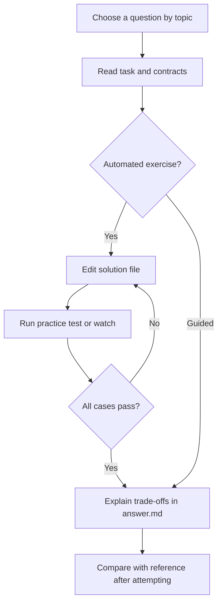

# Local practice index

Search titles and topics in VS Code, or run `npm run practice:list -- "<topic words>"`. Opaque beginner and SQL folder names now include the question title; original IDs and old command paths remain accepted.

- [Application Challenges](catalog/README.md) (499)
- [Loan Dashboard Debugging](loan/README.md) (8)
- [SQL and PostgreSQL](sql/README.md) (120)
- [Beginner Foundations](beginner/README.md) (63)
- [Standalone Coding Problems](coding/README.md) (6)

## Practice workflow

Choose a question, read its README and visible cases, and edit its solution or answer file.

Mermaid renders in supported Markdown viewers. In VS Code use a Mermaid-capable Markdown preview; all instructions also remain available as text.

## Application Challenges

### Databases

- [Flash Sale Cart Reservation PostgreSQL Transaction Deadlock](catalog/db-deadlock-inventory-reservation/README.md) - `db-deadlock-inventory-reservation` | Senior | guided
- [E-Commerce Order History Endpoint N+1 Query & Composite Index Optimization](catalog/db-n-plus-one-query-plan/README.md) - `db-n-plus-one-query-plan` | Senior | guided
- [Financial Ledger Wallet Balance Anomaly & Isolation Levels](catalog/db-isolation-levels-phantom-read/README.md) - `db-isolation-levels-phantom-read` | Senior | guided
- [CRM Million-Row Activity Log OFFSET Pagination Degradation](catalog/db-keyset-pagination-performance/README.md) - `db-keyset-pagination-performance` | Senior | guided
- [50M-Row User Schema Column Rename Zero-Downtime Migration](catalog/db-zero-downtime-migration/README.md) - `db-zero-downtime-migration` | Senior | guided
- [Connection Storm: Autoscaling Makes Checkout Worse](catalog/incident-db-connection-storm/README.md) - `incident-db-connection-storm` | Senior | guided
- [Migration Lock: A Small DDL Change Stops Orders](catalog/incident-migration-lock/README.md) - `incident-migration-lock` | Staff/Principal | guided
- [E-commerce: Stop Overselling the Last Item](catalog/commerce-inventory-reservations/README.md) - `commerce-inventory-reservations` | Senior | javascript

### Engineering Operations

- [Production Incident: Node.js Container OOMKilled Memory Leak](catalog/ops-production-memory-leak-debug/README.md) - `ops-production-memory-leak-debug` | Senior | guided
- [Production Incident: Cloud Provider IAM & Stripe Key Leak in CI Logs](catalog/ops-secrets-leak-incident/README.md) - `ops-secrets-leak-incident` | Senior | guided
- [Canary Deployment 5xx Spike & Automated Rollback Analysis](catalog/ops-canary-rollback-metrics/README.md) - `ops-canary-rollback-metrics` | Senior | guided
- [OpenTelemetry Trace Bottleneck Analysis in Microservice Mesh](catalog/ops-distributed-tracing-bottleneck/README.md) - `ops-distributed-tracing-bottleneck` | Senior | guided
- [Lead Engineer Interview: 45-Minute Outage Facilitation & Blameless Post-Mortem](catalog/interview-lead-incident-postmortem/README.md) - `interview-lead-incident-postmortem` | Staff/Principal | guided
- [Zero-Downtime Database Secret Rotation with HashiCorp Vault](catalog/ops-secrets-rotation-vault/README.md) - `ops-secrets-rotation-vault` | Senior | guided
- [Cache Stampede: The Five-Minute Expiry Cliff](catalog/incident-cache-stampede/README.md) - `incident-cache-stampede` | Senior | guided
- [Restart Cascade: A Database Blip Kills Every Pod](catalog/incident-kubernetes-probes/README.md) - `incident-kubernetes-probes` | Mid-Level | guided

### Integrations

- [Stripe Payment Webhook Replay & Duplicate Credit Crediting](catalog/integ-webhook-idempotency-replay/README.md) - `integ-webhook-idempotency-replay` | Senior | guided
- [Resilient Multi-Provider WhatsApp & SMS Fallback Orchestrator](catalog/integ-whatsapp-sms-fallback/README.md) - `integ-whatsapp-sms-fallback` | Senior | guided
- [Bi-Directional CRM Sync Out-of-Order Customer Data Rollback](catalog/integ-crm-sync-out-of-order/README.md) - `integ-crm-sync-out-of-order` | Senior | guided
- [Third-Party Shipping API Retry Storm & Thundering Herd Incident](catalog/integ-exponential-backoff-jitter/README.md) - `integ-exponential-backoff-jitter` | Senior | guided
- [Automated Nightly Payment Gateway Reconciliation & Variance Ledger](catalog/integ-payment-reconciliation-ledger/README.md) - `integ-payment-reconciliation-ledger` | Senior | guided
- [Payment Timeout: Did the Customer Already Pay?](catalog/incident-payment-ambiguity/README.md) - `incident-payment-ambiguity` | Senior | guided
- [Consumer Backlog: One Poison Event Blocks Fulfillment](catalog/incident-kafka-poison-message/README.md) - `incident-kafka-poison-message` | Senior | guided
- [E-commerce: Reconcile Duplicate Payment Notifications](catalog/commerce-payment-reconciliation/README.md) - `commerce-payment-reconciliation` | Senior | javascript
- [SaaS: Repair Subscription Access After Delayed Updates](catalog/saas-subscription-entitlements/README.md) - `saas-subscription-entitlements` | Senior | javascript
- [Collaboration: Deduplicate and Order Retried Messages](catalog/collab-message-ordering/README.md) - `collab-message-ordering` | Senior | javascript
- [Collaboration: Resume a Conversation After Disconnection](catalog/collab-reconnect-cursor/README.md) - `collab-reconnect-cursor` | Senior | javascript
- [Collaboration: Keep Read Receipts Monotonic Across Devices](catalog/collab-read-receipts/README.md) - `collab-read-receipts` | Senior | javascript
- [Collaboration: Expire Presence Without Disconnecting Other Tabs](catalog/collab-presence-expiry/README.md) - `collab-presence-expiry` | Senior | javascript
- [Collaboration: Authorize Channel Reads and Sends](catalog/collab-channel-permissions/README.md) - `collab-channel-permissions` | Senior | javascript
- [Collaboration: Deduplicate Notifications and Respect Preferences](catalog/collab-notification-delivery/README.md) - `collab-notification-delivery` | Senior | javascript
- [Collaboration: Reject Stale Meeting Signaling After Reconnect](catalog/collab-meeting-signaling/README.md) - `collab-meeting-signaling` | Senior | javascript
- [Collaboration: Page Chat History Without Gaps or Repeats](catalog/collab-history-pagination/README.md) - `collab-history-pagination` | Senior | javascript

### JavaScript

- [Flash-Sale Batch Processor Microtask Queue Starvation](catalog/js-event-loop-microtasks/README.md) - `js-event-loop-microtasks` | Senior | guided
- [SSE Connection Manager Request Context Closure Leak](catalog/js-closures-memory-leak/README.md) - `js-closures-memory-leak` | Senior | guided
- [Multi-Tab Wallet Checkout Balance Debit Race Condition](catalog/js-promise-race-condition/README.md) - `js-promise-race-condition` | Senior | guided
- [Background Reconciliation Pipeline Unhandled Rejection Crash](catalog/js-async-error-propagation/README.md) - `js-async-error-propagation` | Senior | guided
- [High-Throughput Metrics Aggregator Garbage Collection Latency Spikes](catalog/js-perf-object-allocation/README.md) - `js-perf-object-allocation` | Senior | guided
- [Frontend: Find Missing Number](catalog/frontend-find-missing-number/README.md) - `frontend-find-missing-number` | Beginner | frontend-js
- [Frontend: Max SubArray](catalog/frontend-max-subarray/README.md) - `frontend-max-subarray` | Beginner | frontend-js
- [Frontend: Make Counter](catalog/frontend-make-counter/README.md) - `frontend-make-counter` | Beginner | frontend-js
- [Frontend: Power of Two](catalog/frontend-power-of-two/README.md) - `frontend-power-of-two` | Beginner | frontend-js
- [Frontend: sum()](catalog/frontend-sum/README.md) - `frontend-sum` | Beginner | frontend-js
- [Frontend: Get Result By Path](catalog/frontend-get-result-by-path/README.md) - `frontend-get-result-by-path` | Beginner | frontend-js
- [Frontend: Find smallest number](catalog/frontend-find-smallest-number/README.md) - `frontend-find-smallest-number` | Beginner | frontend-js
- [Frontend: Power of Three](catalog/frontend-power-of-three/README.md) - `frontend-power-of-three` | Beginner | frontend-js
- [Frontend: Count Negative](catalog/frontend-count-negative/README.md) - `frontend-count-negative` | Beginner | frontend-js
- [Frontend: Find largest number](catalog/frontend-find-largest-number/README.md) - `frontend-find-largest-number` | Beginner | frontend-js
- [Frontend: Loop A to Z](catalog/frontend-loop-a-to-z/README.md) - `frontend-loop-a-to-z` | Beginner | frontend-js
- [Frontend: Custom Sort](catalog/frontend-custom-sort/README.md) - `frontend-custom-sort` | Beginner | frontend-js
- [Frontend: implement curry()](catalog/frontend-implement-curry/README.md) - `frontend-implement-curry` | Beginner | frontend-js
- [Frontend: once(fn)](catalog/frontend-oncefn/README.md) - `frontend-oncefn` | Beginner | frontend-js
- [Frontend: groupBy(arr, key)](catalog/frontend-groupbyarr-key/README.md) - `frontend-groupbyarr-key` | Beginner | frontend-js
- [Frontend: Remove Duplicates from Array](catalog/frontend-remove-duplicates-from-array/README.md) - `frontend-remove-duplicates-from-array` | Beginner | frontend-js
- [Frontend: Voting Eligibility](catalog/frontend-voting-eligibility/README.md) - `frontend-voting-eligibility` | Beginner | frontend-js
- [Frontend: Validate Palindrome](catalog/frontend-validate-palindrome/README.md) - `frontend-validate-palindrome` | Beginner | frontend-js
- [Frontend: Implement a Stack](catalog/frontend-implement-a-stack/README.md) - `frontend-implement-a-stack` | Beginner | frontend-js
- [Frontend: Power of Four](catalog/frontend-power-of-four/README.md) - `frontend-power-of-four` | Beginner | frontend-js
- [Frontend: Count even numbers](catalog/frontend-count-even-numbers/README.md) - `frontend-count-even-numbers` | Beginner | frontend-js
- [Frontend: Capitalize Words](catalog/frontend-capitalize-words/README.md) - `frontend-capitalize-words` | Beginner | frontend-js
- [Frontend: Count Vowels](catalog/frontend-count-vowels/README.md) - `frontend-count-vowels` | Beginner | frontend-js
- [Frontend: Sum of all numbers in an array](catalog/frontend-sum-of-all-numbers-in-an-array/README.md) - `frontend-sum-of-all-numbers-in-an-array` | Beginner | frontend-js
- [Frontend: Anagram Checker](catalog/frontend-anagram-checker/README.md) - `frontend-anagram-checker` | Beginner | frontend-js
- [Frontend: findMaxNumber](catalog/frontend-findmaxnumber/README.md) - `frontend-findmaxnumber` | Beginner | frontend-js
- [Frontend: Factorial of a number](catalog/frontend-factorial-of-a-number/README.md) - `frontend-factorial-of-a-number` | Beginner | frontend-js
- [Frontend: Fibonacci Series](catalog/frontend-fibonacci-series/README.md) - `frontend-fibonacci-series` | Beginner | frontend-js
- [Frontend: Secret Code Shuffler](catalog/frontend-secret-code-shuffler/README.md) - `frontend-secret-code-shuffler` | Beginner | frontend-js
- [Frontend: Flatten Nested Array](catalog/frontend-flatten-nested-array/README.md) - `frontend-flatten-nested-array` | Beginner | frontend-js
- [Frontend: shuffle()](catalog/frontend-shuffle/README.md) - `frontend-shuffle` | Beginner | frontend-js
- [Frontend: Largest number formed](catalog/frontend-largest-number-formed/README.md) - `frontend-largest-number-formed` | Beginner | frontend-js
- [Frontend: Array Chunking](catalog/frontend-array-chunking/README.md) - `frontend-array-chunking` | Beginner | frontend-js
- [Frontend: Sum of n natural numbers](catalog/frontend-sum-of-n-natural-numbers/README.md) - `frontend-sum-of-n-natural-numbers` | Beginner | frontend-js
- [Frontend: Array.prototype.reduce](catalog/frontend-arrayprototypereduce/README.md) - `frontend-arrayprototypereduce` | Beginner | frontend-js
- [Frontend: ReverseWords](catalog/frontend-reversewords/README.md) - `frontend-reversewords` | Beginner | frontend-js
- [Frontend: Flatten Nested Objects](catalog/frontend-flatten-nested-objects/README.md) - `frontend-flatten-nested-objects` | Mid-Level | frontend-js
- [Frontend: Flatten Deep Object](catalog/frontend-flatten-deep-object/README.md) - `frontend-flatten-deep-object` | Mid-Level | frontend-js
- [Frontend: Compress String with Limited Repetition](catalog/frontend-compress-string-with-limited-repetition/README.md) - `frontend-compress-string-with-limited-repetition` | Mid-Level | frontend-js
- [Frontend: Rate Limiter](catalog/frontend-rate-limiter/README.md) - `frontend-rate-limiter` | Mid-Level | frontend-js
- [Frontend: JSON.stringify](catalog/frontend-jsonstringify/README.md) - `frontend-jsonstringify` | Mid-Level | frontend-js
- [Frontend: Word Search](catalog/frontend-word-search/README.md) - `frontend-word-search` | Mid-Level | frontend-js
- [Frontend: Topological Sort (DFS)](catalog/frontend-topological-sort-dfs/README.md) - `frontend-topological-sort-dfs` | Mid-Level | frontend-js
- [Frontend: Detect Cycle in an Undirected Connected Graph (DFS)](catalog/frontend-detect-cycle-in-an-undirected-connected-graph-dfs/README.md) - `frontend-detect-cycle-in-an-undirected-connected-graph-dfs` | Mid-Level | frontend-js
- [Frontend: Throttle](catalog/frontend-throttle/README.md) - `frontend-throttle` | Mid-Level | frontend-js
- [Frontend: PromiseAll With Concurrency Limit](catalog/frontend-promiseall-with-concurrency-limit/README.md) - `frontend-promiseall-with-concurrency-limit` | Mid-Level | frontend-js
- [Frontend: Priority Queue](catalog/frontend-priority-queue/README.md) - `frontend-priority-queue` | Mid-Level | frontend-js
- [Frontend: Memoization](catalog/frontend-memoization/README.md) - `frontend-memoization` | Mid-Level | frontend-js
- [Frontend: Sum of Consecutive Integers](catalog/frontend-sum-of-consecutive-integers/README.md) - `frontend-sum-of-consecutive-integers` | Mid-Level | frontend-js
- [Frontend: Deep Clone Object](catalog/frontend-deep-clone-object/README.md) - `frontend-deep-clone-object` | Mid-Level | frontend-js
- [Frontend: Debounce](catalog/frontend-debounce/README.md) - `frontend-debounce` | Mid-Level | frontend-js
- [Frontend: Spiral Matrix Pathfinder](catalog/frontend-spiral-matrix-pathfinder/README.md) - `frontend-spiral-matrix-pathfinder` | Mid-Level | frontend-js
- [Frontend: Lazy Evaluation](catalog/frontend-lazy-evaluation/README.md) - `frontend-lazy-evaluation` | Mid-Level | frontend-js
- [Frontend: Longest Substring No Repeats](catalog/frontend-longest-substring-no-repeats/README.md) - `frontend-longest-substring-no-repeats` | Mid-Level | frontend-js
- [Frontend: Concurrency Limited Task Scheduler](catalog/frontend-concurrency-limited-task-scheduler/README.md) - `frontend-concurrency-limited-task-scheduler` | Mid-Level | frontend-js
- [Frontend: Find the Single Element in a Sorted Array](catalog/frontend-find-the-single-element-in-a-sorted-array/README.md) - `frontend-find-the-single-element-in-a-sorted-array` | Mid-Level | frontend-js
- [Frontend: Event Emitter](catalog/frontend-event-emitter/README.md) - `frontend-event-emitter` | Mid-Level | frontend-js
- [Frontend: List Format](catalog/frontend-list-format/README.md) - `frontend-list-format` | Mid-Level | frontend-js
- [Frontend: Map Async Limit](catalog/frontend-map-async-limit/README.md) - `frontend-map-async-limit` | Mid-Level | frontend-js
- [Frontend: Deep Omit](catalog/frontend-deep-omit/README.md) - `frontend-deep-omit` | Mid-Level | frontend-js
- [Frontend: Shortest Distance from Source (BFS)](catalog/frontend-shortest-distance-from-source-bfs/README.md) - `frontend-shortest-distance-from-source-bfs` | Mid-Level | frontend-js
- [Frontend: Topological Sort (BFS)](catalog/frontend-topological-sort-bfs/README.md) - `frontend-topological-sort-bfs` | Mid-Level | frontend-js
- [Frontend: Sum of Subarray Minimum](catalog/frontend-sum-of-subarray-minimum/README.md) - `frontend-sum-of-subarray-minimum` | Mid-Level | frontend-js
- [Frontend: Search Rotated Array](catalog/frontend-search-rotated-array/README.md) - `frontend-search-rotated-array` | Mid-Level | frontend-js
- [Frontend: Combination Sum](catalog/frontend-combination-sum/README.md) - `frontend-combination-sum` | Mid-Level | frontend-js
- [Frontend: Implement Promise Race](catalog/frontend-implement-promise-race/README.md) - `frontend-implement-promise-race` | Mid-Level | frontend-js
- [Frontend: Reverse Words in a String](catalog/frontend-reverse-words-in-a-string/README.md) - `frontend-reverse-words-in-a-string` | Mid-Level | frontend-js
- [Frontend: Oranges Rotting](catalog/frontend-oranges-rotting/README.md) - `frontend-oranges-rotting` | Mid-Level | frontend-js
- [Frontend: Object.assign()](catalog/frontend-objectassign/README.md) - `frontend-objectassign` | Mid-Level | frontend-js
- [Frontend: Merge Array](catalog/frontend-merge-array/README.md) - `frontend-merge-array` | Mid-Level | frontend-js
- [Frontend: pyramid pattern](catalog/frontend-pyramid-pattern/README.md) - `frontend-pyramid-pattern` | Mid-Level | frontend-js
- [Frontend: Search in a 2D Sorted Matrix](catalog/frontend-search-in-a-2d-sorted-matrix/README.md) - `frontend-search-in-a-2d-sorted-matrix` | Mid-Level | frontend-js
- [Frontend: Detect data type in JS](catalog/frontend-detect-data-type-in-js/README.md) - `frontend-detect-data-type-in-js` | Mid-Level | frontend-js
- [Frontend: Prim's MST Algorithm](catalog/frontend-prims-mst-algorithm/README.md) - `frontend-prims-mst-algorithm` | Senior | frontend-js
- [Frontend: Longest Valid Parentheses](catalog/frontend-longest-valid-parentheses/README.md) - `frontend-longest-valid-parentheses` | Senior | frontend-js
- [Frontend: Chinese Remainder Theorem](catalog/frontend-chinese-remainder-theorem/README.md) - `frontend-chinese-remainder-theorem` | Senior | frontend-js
- [Frontend: Kruskal's MST Algorithm](catalog/frontend-kruskals-mst-algorithm/README.md) - `frontend-kruskals-mst-algorithm` | Senior | frontend-js
- [Frontend: Implement LRUCache](catalog/frontend-implement-lrucache/README.md) - `frontend-implement-lrucache` | Senior | frontend-js
- [Frontend: Implement a Queue using Stack](catalog/frontend-implement-a-queue-using-stack/README.md) - `frontend-implement-a-queue-using-stack` | Senior | frontend-js
- [Frontend: Median of Two Sorted Arrays](catalog/frontend-median-of-two-sorted-arrays/README.md) - `frontend-median-of-two-sorted-arrays` | Senior | frontend-js
- [Frontend: Create Task Scheduler With Dependencies](catalog/frontend-create-task-scheduler-with-dependencies/README.md) - `frontend-create-task-scheduler-with-dependencies` | Senior | frontend-js
- [Frontend: All Pairs Shortest Path (Floyd-Warshall Algorithm)](catalog/frontend-all-pairs-shortest-path-floyd-warshall-algorithm/README.md) - `frontend-all-pairs-shortest-path-floyd-warshall-algorithm` | Senior | frontend-js
- [Frontend: Shortest Distance from Source (Bellman-Ford Algorithm)](catalog/frontend-shortest-distance-from-source-bellman-ford-algorithm/README.md) - `frontend-shortest-distance-from-source-bellman-ford-algorithm` | Senior | frontend-js
- [Frontend: Sliding Window Maximum](catalog/frontend-sliding-window-maximum/README.md) - `frontend-sliding-window-maximum` | Senior | frontend-js
- [Frontend: Worker Pool](catalog/frontend-worker-pool/README.md) - `frontend-worker-pool` | Senior | frontend-js
- [Frontend: First Missing Positive](catalog/frontend-first-missing-positive/README.md) - `frontend-first-missing-positive` | Senior | frontend-js
- [Frontend: Design Autocomplete](catalog/frontend-design-autocomplete/README.md) - `frontend-design-autocomplete` | Senior | frontend-js
- [Frontend: Shortest Distance from Source (Dijkstra's Algorithm)](catalog/frontend-shortest-distance-from-source-dijkstras-algorithm/README.md) - `frontend-shortest-distance-from-source-dijkstras-algorithm` | Senior | frontend-js
- [Frontend: Fibonacci Modulo (Pisano Period)](catalog/frontend-fibonacci-modulo-pisano-period/README.md) - `frontend-fibonacci-modulo-pisano-period` | Senior | frontend-js
- [Frontend: Implement Garbage Collector](catalog/frontend-implement-garbage-collector/README.md) - `frontend-implement-garbage-collector` | Senior | frontend-js

### Next.js

- [Secret Key Leakage Across Next.js Server-Client Boundary](catalog/nextjs-server-client-boundary/README.md) - `nextjs-server-client-boundary` | Senior | guided
- [Multi-Timezone Scheduling Hydration Mismatch & Layout Shift](catalog/nextjs-hydration-mismatch-clock/README.md) - `nextjs-hydration-mismatch-clock` | Senior | guided
- [Product Catalog High-Traffic ISR Cache Stampede / Dog-Piling](catalog/nextjs-isr-cache-stampede/README.md) - `nextjs-isr-cache-stampede` | Senior | guided
- [Edge Middleware JWT Validation Infinite Redirect Loop](catalog/nextjs-auth-middleware-session/README.md) - `nextjs-auth-middleware-session` | Senior | guided
- [AI Streaming Assistant Suspense & Localized Error Boundary Fallback](catalog/nextjs-stream-suspense-error-boundary/README.md) - `nextjs-stream-suspense-error-boundary` | Senior | guided
- [Normalize searchParams pagination without coercion surprises](catalog/next-lab-query-pagination/README.md) - `next-lab-query-pagination` | Beginner | frontend-js
- [Validate a post-login return path](catalog/next-lab-safe-return-path/README.md) - `next-lab-safe-return-path` | Beginner | frontend-js
- [Build a catch-all path from validated segments](catalog/next-lab-catch-all-segments/README.md) - `next-lab-catch-all-segments` | Beginner | frontend-js
- [Update URL filters while preserving unrelated query values](catalog/next-lab-query-filter-state/README.md) - `next-lab-query-filter-state` | Beginner | frontend-js
- [Project a browser-safe configuration DTO](catalog/next-lab-public-config-dto/README.md) - `next-lab-public-config-dto` | Beginner | frontend-js
- [Apply a deterministic metadata title template](catalog/next-lab-metadata-title-policy/README.md) - `next-lab-metadata-title-policy` | Beginner | frontend-js
- [Repair the App Router root layout](catalog/next-lab-root-layout/README.md) - `next-lab-root-layout` | Beginner | guided
- [Move interactivity into a small Client Component](catalog/next-lab-client-island/README.md) - `next-lab-client-island` | Beginner | guided
- [Migrate dynamic route params from 15 compatibility to 16](catalog/next-lab-async-route-params/README.md) - `next-lab-async-route-params` | Beginner | guided
- [Read and validate server searchParams](catalog/next-lab-async-search-params/README.md) - `next-lab-async-search-params` | Beginner | guided
- [Read request cookies on the server](catalog/next-lab-async-cookies/README.md) - `next-lab-async-cookies` | Beginner | guided
- [Replace a non-serializable event prop across the boundary](catalog/next-lab-client-prop-contract/README.md) - `next-lab-client-prop-contract` | Beginner | guided
- [Terminate a missing resource with notFound](catalog/next-lab-not-found-control-flow/README.md) - `next-lab-not-found-control-flow` | Beginner | guided
- [Build a retryable route error boundary](catalog/next-lab-error-boundary/README.md) - `next-lab-error-boundary` | Beginner | guided
- [Place Suspense before the slow work](catalog/next-lab-suspense-loading/README.md) - `next-lab-suspense-loading` | Beginner | guided
- [Preserve accessible client navigation with Link](catalog/next-lab-link-navigation/README.md) - `next-lab-link-navigation` | Beginner | guided
- [Match generateStaticParams to the dynamic segment](catalog/next-lab-generate-static-params/README.md) - `next-lab-generate-static-params` | Beginner | guided
- [Keep metadata exports in a Server Component](catalog/next-lab-metadata-server-boundary/README.md) - `next-lab-metadata-server-boundary` | Beginner | guided
- [Reserve image space and constrain remote sources](catalog/next-lab-image-dimensions/README.md) - `next-lab-image-dimensions` | Beginner | guided
- [Load a font once in the root layout](catalog/next-lab-font-ownership/README.md) - `next-lab-font-ownership` | Beginner | guided
- [Keep Pages Router SSR props serializable and public](catalog/next-lab-pages-ssr-dto/README.md) - `next-lab-pages-ssr-dto` | Beginner | guided
- [Choose Pages Router fallback and revalidation explicitly](catalog/next-lab-pages-static-paths/README.md) - `next-lab-pages-static-paths` | Beginner | guided
- [Partition a shared cache key by tenant and locale](catalog/next-lab-tenant-cache-key/README.md) - `next-lab-tenant-cache-key` | Mid-Level | frontend-js
- [Deduplicate cache invalidation tags without losing order](catalog/next-lab-invalidation-tags/README.md) - `next-lab-invalidation-tags` | Mid-Level | frontend-js
- [Model cache freshness at exact time boundaries](catalog/next-lab-cache-freshness-model/README.md) - `next-lab-cache-freshness-model` | Mid-Level | frontend-js
- [Choose distinct visible routes within a prefetch budget](catalog/next-lab-prefetch-budget/README.md) - `next-lab-prefetch-budget` | Mid-Level | frontend-js
- [Ignore stale mutation results in an optimistic UI](catalog/next-lab-optimistic-result-owner/README.md) - `next-lab-optimistic-result-owner` | Mid-Level | frontend-js
- [Validate a Server Action payload before mutation](catalog/next-lab-action-field-validation/README.md) - `next-lab-action-field-validation` | Mid-Level | frontend-js
- [Deduplicate a bounded webhook event batch](catalog/next-lab-duplicate-webhook-events/README.md) - `next-lab-duplicate-webhook-events` | Mid-Level | frontend-js
- [Check upload count, size and MIME type](catalog/next-lab-upload-admission/README.md) - `next-lab-upload-admission` | Mid-Level | frontend-js
- [Scope a component style without global collisions](catalog/next-lab-scoped-css/README.md) - `next-lab-scoped-css` | Mid-Level | guided
- [Detect colliding URLs hidden by route groups](catalog/next-lab-route-group-collision/README.md) - `next-lab-route-group-collision` | Mid-Level | guided
- [Provide a hard-navigation fallback for a parallel slot](catalog/next-lab-parallel-slot-default/README.md) - `next-lab-parallel-slot-default` | Mid-Level | guided
- [Close a route modal using navigation semantics](catalog/next-lab-intercepted-modal/README.md) - `next-lab-intercepted-modal` | Mid-Level | guided
- [Contain a client useSearchParams read with Suspense](catalog/next-lab-client-search-suspense/README.md) - `next-lab-client-search-suspense` | Mid-Level | guided
- [Compose server-fetched content through a client slot](catalog/next-lab-server-content-slot/README.md) - `next-lab-server-content-slot` | Mid-Level | guided
- [Remove the Server Component HTTP round trip to its own API](catalog/next-lab-server-data-direct/README.md) - `next-lab-server-data-direct` | Mid-Level | guided
- [Start independent server reads before awaiting them](catalog/next-lab-parallel-data/README.md) - `next-lab-parallel-data` | Mid-Level | guided
- [Separate React request memoization from persistent caching](catalog/next-lab-request-memoization/README.md) - `next-lab-request-memoization` | Mid-Level | guided
- [Make Next.js 15 fetch freshness explicit](catalog/next-lab-fetch-cache-default/README.md) - `next-lab-fetch-cache-default` | Mid-Level | guided
- [Keep a personalized GET handler out of shared caches](catalog/next-lab-get-handler-caching/README.md) - `next-lab-get-handler-caching` | Mid-Level | guided
- [Set a deliberate ISR window without contradictory fetch options](catalog/next-lab-isr-revalidate/README.md) - `next-lab-isr-revalidate` | Mid-Level | guided
- [Adopt Cache Components as an explicit rendering change](catalog/next-lab-cache-components-opt-in/README.md) - `next-lab-cache-components-opt-in` | Mid-Level | guided
- [Keep request reads outside a shared use cache scope](catalog/next-lab-cached-function-arguments/README.md) - `next-lab-cached-function-arguments` | Mid-Level | guided
- [Place cacheLife inside the cached function](catalog/next-lab-cache-life-scope/README.md) - `next-lab-cache-life-scope` | Mid-Level | guided
- [Assign the same tags that later invalidation targets](catalog/next-lab-cache-tag-assignment/README.md) - `next-lab-cache-tag-assignment` | Mid-Level | guided
- [Choose stale-while-revalidate rather than accidental immediate expiry](catalog/next-lab-revalidate-tag-max/README.md) - `next-lab-revalidate-tag-max` | Mid-Level | guided
- [Move updateTag out of a Route Handler](catalog/next-lab-update-tag-context/README.md) - `next-lab-update-tag-context` | Mid-Level | guided
- [Distinguish router.refresh from server data invalidation](catalog/next-lab-router-refresh-vs-data/README.md) - `next-lab-router-refresh-vs-data` | Mid-Level | guided
- [Authorize every exported Server Action invocation](catalog/next-lab-server-action-auth/README.md) - `next-lab-server-action-auth` | Mid-Level | guided
- [Return validation state through React 19 useActionState](catalog/next-lab-use-action-state/README.md) - `next-lab-use-action-state` | Mid-Level | guided
- [Place useFormStatus inside the form it observes](catalog/next-lab-form-status-parent/README.md) - `next-lab-form-status-parent` | Mid-Level | guided
- [Preserve HTTP semantics in a Pages API route](catalog/next-lab-pages-api-methods/README.md) - `next-lab-pages-api-methods` | Mid-Level | guided
- [Migrate a route while App and Pages routers coexist](catalog/next-lab-router-coexistence/README.md) - `next-lab-router-coexistence` | Mid-Level | guided
- [Admit a locale before loading a server dictionary](catalog/next-lab-locale-admission/README.md) - `next-lab-locale-admission` | Mid-Level | guided
- [Reject server-only requirements from a static export plan](catalog/next-lab-static-export-boundaries/README.md) - `next-lab-static-export-boundaries` | Mid-Level | guided
- [Publish canonical public sitemap entries without exposing private resources](catalog/next-lab-sitemap-private-routes/README.md) - `next-lab-sitemap-private-routes` | Mid-Level | guided
- [Authorize tenant-scoped resource operations](catalog/next-lab-authorization-matrix/README.md) - `next-lab-authorization-matrix` | Senior | frontend-js
- [Classify public and protected paths using segment boundaries](catalog/next-lab-proxy-path-classifier/README.md) - `next-lab-proxy-path-classifier` | Senior | frontend-js
- [Bound retries by attempts, deadline and idempotency](catalog/next-lab-retry-budget/README.md) - `next-lab-retry-budget` | Senior | frontend-js
- [Audit Next.js 15-to-16 migration blockers](catalog/next-lab-migration-audit/README.md) - `next-lab-migration-audit` | Senior | frontend-js
- [Reject late stream chunks after cancellation](catalog/next-lab-stream-event-reducer/README.md) - `next-lab-stream-event-reducer` | Senior | frontend-js
- [Prevent shared caching of authenticated responses](catalog/next-lab-private-response-policy/README.md) - `next-lab-private-response-policy` | Senior | frontend-js
- [Keep optimistic presentation separate from authoritative state](catalog/next-lab-optimistic-state/README.md) - `next-lab-optimistic-state` | Senior | guided
- [Do not swallow redirect control flow in a catch block](catalog/next-lab-redirect-catch/README.md) - `next-lab-redirect-catch` | Senior | guided
- [Validate JSON Route Handler requests without leaking exceptions](catalog/next-lab-route-handler-validation/README.md) - `next-lab-route-handler-validation` | Senior | guided
- [Verify a webhook signature over its original bytes](catalog/next-lab-webhook-raw-body/README.md) - `next-lab-webhook-raw-body` | Senior | guided
- [Preserve a streaming response through the deployment proxy](catalog/next-lab-stream-buffering/README.md) - `next-lab-stream-buffering` | Senior | guided
- [Rename Middleware to Proxy without changing routing intent](catalog/next-lab-proxy-migration/README.md) - `next-lab-proxy-migration` | Senior | guided
- [Keep authorization when a Proxy matcher excludes an action path](catalog/next-lab-matcher-security/README.md) - `next-lab-matcher-security` | Senior | guided
- [Choose a runtime compatible with a native database driver](catalog/next-lab-runtime-driver/README.md) - `next-lab-runtime-driver` | Senior | guided
- [Keep ssr:false inside a client boundary](catalog/next-lab-lazy-browser-library/README.md) - `next-lab-lazy-browser-library` | Senior | guided
- [Migrate a critical image loading hint with measured intent](catalog/next-lab-image-preload-16/README.md) - `next-lab-image-preload-16` | Senior | guided
- [Audit a custom Webpack hook before a Turbopack build](catalog/next-lab-turbopack-webpack-config/README.md) - `next-lab-turbopack-webpack-config` | Senior | guided
- [Preserve lint as an explicit quality gate after next lint removal](catalog/next-lab-eslint-cli-migration/README.md) - `next-lab-eslint-cli-migration` | Senior | guided
- [Defer per-request randomness under Cache Components](catalog/next-lab-request-time-randomness/README.md) - `next-lab-request-time-randomness` | Senior | guided
- [Diagnose slow metadata without forcing every page fully dynamic](catalog/next-lab-streaming-metadata/README.md) - `next-lab-streaming-metadata` | Senior | guided
- [Await the generated image id during the 16 migration](catalog/next-lab-async-image-id/README.md) - `next-lab-async-image-id` | Senior | guided
- [Bound an upstream request and propagate failure deliberately](catalog/next-lab-bounded-upstream-fetch/README.md) - `next-lab-bounded-upstream-fetch` | Senior | guided
- [Reject a cross-tenant cache read before lookup](catalog/next-lab-tenant-cache-poisoning/README.md) - `next-lab-tenant-cache-poisoning` | Senior | guided
- [Plan nonce-based CSP without assuming static HTML can vary per request](catalog/next-lab-csp-nonce/README.md) - `next-lab-csp-nonce` | Senior | guided
- [Authenticate draft-mode activation and constrain its destination](catalog/next-lab-draft-mode-entry/README.md) - `next-lab-draft-mode-entry` | Senior | guided
- [Load server instrumentation in its supported runtime](catalog/next-lab-instrumentation-runtime/README.md) - `next-lab-instrumentation-runtime` | Senior | guided
- [Use after for bounded telemetry rather than durable fulfillment](catalog/next-lab-after-not-a-queue/README.md) - `next-lab-after-not-a-queue` | Senior | guided
- [Choose a real-server test for async Server Component behavior](catalog/next-lab-async-rsc-test-strategy/README.md) - `next-lab-async-rsc-test-strategy` | Senior | guided
- [Ship a standalone deployment with its required static assets](catalog/next-lab-standalone-output/README.md) - `next-lab-standalone-output` | Senior | guided
- [Adopt modern partial prefetching without losing the initial UI](catalog/next-lab-partial-prefetching/README.md) - `next-lab-partial-prefetching` | Senior | guided
- [Distinguish build-time public environment values from runtime secrets](catalog/next-lab-public-env-freeze/README.md) - `next-lab-public-env-freeze` | Senior | guided
- [Adopt React Compiler with dependency and purity checks](catalog/next-lab-react-compiler-adoption/README.md) - `next-lab-react-compiler-adoption` | Senior | guided
- [Constrain reverse-proxy action origins and payload limits](catalog/next-lab-server-action-origins/README.md) - `next-lab-server-action-origins` | Senior | guided
- [Architect an isolated multi-tenant Next.js SaaS](catalog/next-lab-tenant-platform/README.md) - `next-lab-tenant-platform` | Staff/Principal | guided
- [Design cross-instance cache consistency and invalidation](catalog/next-lab-distributed-cache/README.md) - `next-lab-distributed-cache` | Staff/Principal | guided
- [Separate a cached storefront from authoritative checkout](catalog/next-lab-commerce-consistency/README.md) - `next-lab-commerce-consistency` | Staff/Principal | guided
- [Plan a reversible Next.js 15-to-16 production migration](catalog/next-lab-migration-program/README.md) - `next-lab-migration-program` | Staff/Principal | guided
- [Design a streaming path through CDN, proxy and server](catalog/next-lab-streaming-edge-path/README.md) - `next-lab-streaming-edge-path` | Staff/Principal | guided
- [Design an auditable RSC data-exposure boundary](catalog/next-lab-rsc-data-boundary/README.md) - `next-lab-rsc-data-boundary` | Staff/Principal | guided
- [Plan regional rendering around data residency and latency](catalog/next-lab-regional-data-residency/README.md) - `next-lab-regional-data-residency` | Staff/Principal | guided
- [Design a Next.js backend-for-frontend with bounded ownership](catalog/next-lab-bff-contract/README.md) - `next-lab-bff-contract` | Staff/Principal | guided
- [Protect the origin during cold-cache and invalidation storms](catalog/next-lab-cache-stampede/README.md) - `next-lab-cache-stampede` | Staff/Principal | guided
- [Design session verification, rotation and account switching](catalog/next-lab-authentication-lifecycle/README.md) - `next-lab-authentication-lifecycle` | Staff/Principal | guided
- [Handle rolling-deployment client/server version skew](catalog/next-lab-deployment-skew/README.md) - `next-lab-deployment-skew` | Staff/Principal | guided
- [Build an actionable Next.js latency and reliability SLO](catalog/next-lab-observability-slo/README.md) - `next-lab-observability-slo` | Staff/Principal | guided
- [Design CMS publishing with draft isolation and bounded freshness](catalog/next-lab-cms-publishing/README.md) - `next-lab-cms-publishing` | Staff/Principal | guided
- [Control build cost for a million-page catalog](catalog/next-lab-large-catalog-build/README.md) - `next-lab-large-catalog-build` | Staff/Principal | guided
- [Combine a server-rendered dashboard with live client updates](catalog/next-lab-realtime-dashboard/README.md) - `next-lab-realtime-dashboard` | Staff/Principal | guided
- [Define Server Action ownership and throughput boundaries](catalog/next-lab-server-action-capacity/README.md) - `next-lab-server-action-capacity` | Staff/Principal | guided
- [Design URL-driven search with safe caching and indexing lag](catalog/next-lab-search-architecture/README.md) - `next-lab-search-architecture` | Staff/Principal | guided
- [Partition route failures without hiding data integrity errors](catalog/next-lab-failure-isolation/README.md) - `next-lab-failure-isolation` | Staff/Principal | guided
- [Reduce JavaScript and prefetch cost without weakening features](catalog/next-lab-frontend-delivery-budget/README.md) - `next-lab-frontend-delivery-budget` | Staff/Principal | guided
- [Design a versioned Next.js regression and release matrix](catalog/next-lab-test-pyramid-versions/README.md) - `next-lab-test-pyramid-versions` | Staff/Principal | guided

### Node.js

- [Auth Gateway Event-Loop Freezing on CPU-Intensive Hashing](catalog/nodejs-event-loop-blocking-crypto/README.md) - `nodejs-event-loop-blocking-crypto` | Senior | guided
- [Express Asynchronous Error Swallowing & Hanging Socket Leak](catalog/nodejs-express-error-middleware/README.md) - `nodejs-express-error-middleware` | Senior | guided
- [Distributed Sliding Window Rate Limiter with Redis Race Conditions](catalog/nodejs-rate-limiting-redis/README.md) - `nodejs-rate-limiting-redis` | Senior | guided
- [Multi-Gigabyte Financial Audit CSV Export Out-of-Memory (OOM) Crash](catalog/nodejs-stream-backpressure/README.md) - `nodejs-stream-backpressure` | Senior | guided
- [Kubernetes Rolling Deployment Background Transaction Data Loss](catalog/nodejs-graceful-shutdown-worker/README.md) - `nodejs-graceful-shutdown-worker` | Senior | guided
- [High-Throughput REST Ingestion & Zod Schema Validation Guard](catalog/node-rest-api-validation-zod/README.md) - `node-rest-api-validation-zod` | Senior | guided
- [E-commerce: Resume a Catalog Import Without Corrupting Prices](catalog/commerce-resumable-catalog-import/README.md) - `commerce-resumable-catalog-import` | Senior | javascript

### React

- [Order-Book Live Ticker Stale Closure Hook Bug](catalog/react-stale-closure-interval/README.md) - `react-stale-closure-interval` | Senior | guided
- [10,000-Row Logistics Inventory Table Cascading Re-Render Freeze](catalog/react-rerender-cascade-table/README.md) - `react-rerender-cascade-table` | Senior | guided
- [Customer Support CRM Search Out-of-Order Response Overwrite](catalog/react-race-condition-autocomplete/README.md) - `react-race-condition-autocomplete` | Senior | guided
- [Accessible ARIA 1.2 Enterprise Multi-Select Combobox](catalog/react-accessible-combobox/README.md) - `react-accessible-combobox` | Senior | guided
- [E-Commerce Cart Optimistic Mutation Hook with Rollback](catalog/react-custom-hook-optimistic-mutation/README.md) - `react-custom-hook-optimistic-mutation` | Senior | guided
- [Enterprise Loan Management Dashboard (React & Redux Toolkit)](catalog/enterprise-loan-management/README.md) - `enterprise-loan-management` | Senior | guided
- [React UI: Account Password Feedback](catalog/react-ui-password-feedback/README.md) - `react-ui-password-feedback` | Beginner | react
- [React UI: Web Address Inspector](catalog/react-ui-web-address/README.md) - `react-ui-web-address` | Beginner | react
- [React UI: Team Tag Editor](catalog/react-ui-tag-editor/README.md) - `react-ui-tag-editor` | Beginner | react
- [React UI: Project Completion Meter](catalog/react-ui-project-progress/README.md) - `react-ui-project-progress` | Beginner | react
- [React UI: Monthly Loan Estimator](catalog/react-ui-loan-estimator/README.md) - `react-ui-loan-estimator` | Beginner | react
- [React UI: Expandable Support Answers](catalog/react-ui-help-panels/README.md) - `react-ui-help-panels` | Beginner | react
- [React UI: Scoped Appearance Switch](catalog/react-ui-theme-switch/README.md) - `react-ui-theme-switch` | Beginner | react
- [React UI: Searchable Kitchen Cards](catalog/react-ui-recipe-browser/README.md) - `react-ui-recipe-browser` | Beginner | react
- [Frontend: Back To Top](catalog/frontend-back-to-top/README.md) - `frontend-back-to-top` | Beginner | react
- [Frontend: Copy to Clipboard](catalog/frontend-copy-to-clipboard/README.md) - `frontend-copy-to-clipboard` | Beginner | react
- [Frontend: Contact Form](catalog/frontend-contact-form/README.md) - `frontend-contact-form` | Beginner | react
- [Frontend: Array to Zigzag String Converter](catalog/frontend-array-to-zigzag-string-converter/README.md) - `frontend-array-to-zigzag-string-converter` | Beginner | react
- [Frontend: Auto Save Text](catalog/frontend-auto-save-text/README.md) - `frontend-auto-save-text` | Beginner | react
- [Frontend: Counter Using React](catalog/frontend-counter-using-react/README.md) - `frontend-counter-using-react` | Beginner | react
- [Frontend: Tooltip](catalog/frontend-tooltip/README.md) - `frontend-tooltip` | Beginner | react
- [Frontend: Guess the number](catalog/frontend-guess-the-number/README.md) - `frontend-guess-the-number` | Beginner | react
- [Frontend: Toggle button with custom hook](catalog/frontend-toggle-button-with-custom-hook/README.md) - `frontend-toggle-button-with-custom-hook` | Beginner | react
- [Frontend: Leap year](catalog/frontend-leap-year/README.md) - `frontend-leap-year` | Beginner | react
- [Frontend: Blog Post](catalog/frontend-blog-post/README.md) - `frontend-blog-post` | Beginner | react
- [Frontend: Even or odd](catalog/frontend-even-or-odd/README.md) - `frontend-even-or-odd` | Beginner | react
- [Frontend: Read More](catalog/frontend-read-more/README.md) - `frontend-read-more` | Beginner | react
- [Frontend: Acronym Generator](catalog/frontend-acronym-generator/README.md) - `frontend-acronym-generator` | Beginner | react
- [Frontend: Character Counter](catalog/frontend-character-counter/README.md) - `frontend-character-counter` | Beginner | react
- [Frontend: Dynamic Greeting App](catalog/frontend-dynamic-greeting-app/README.md) - `frontend-dynamic-greeting-app` | Beginner | react
- [Frontend: Get Weekday](catalog/frontend-get-weekday/README.md) - `frontend-get-weekday` | Beginner | react
- [Frontend: Focus Input](catalog/frontend-focus-input/README.md) - `frontend-focus-input` | Beginner | react
- [Frontend: Authentication](catalog/frontend-authentication/README.md) - `frontend-authentication` | Beginner | react
- [Frontend: Navbar](catalog/frontend-navbar/README.md) - `frontend-navbar` | Beginner | react
- [Frontend: Color Explorer](catalog/frontend-color-explorer/README.md) - `frontend-color-explorer` | Beginner | react
- [Frontend: Confirmation Modal](catalog/frontend-confirmation-modal/README.md) - `frontend-confirmation-modal` | Beginner | react
- [Frontend: Toggle password](catalog/frontend-toggle-password/README.md) - `frontend-toggle-password` | Beginner | react
- [Frontend: Tab Switcher](catalog/frontend-tab-switcher/README.md) - `frontend-tab-switcher` | Beginner | react
- [Frontend: usePreviousHook](catalog/frontend-useprevioushook/README.md) - `frontend-useprevioushook` | Beginner | react
- [Frontend: Holy Grail](catalog/frontend-holy-grail/README.md) - `frontend-holy-grail` | Beginner | react
- [Frontend: User profile](catalog/frontend-user-profile/README.md) - `frontend-user-profile` | Beginner | react
- [Frontend: Age calculator](catalog/frontend-age-calculator/README.md) - `frontend-age-calculator` | Beginner | react
- [Frontend: Frequently Asked Questions](catalog/frontend-frequently-asked-questions/README.md) - `frontend-frequently-asked-questions` | Beginner | react
- [Frontend: Asterisk Field Validation](catalog/frontend-asterisk-field-validation/README.md) - `frontend-asterisk-field-validation` | Beginner | react
- [Frontend: Sidebar](catalog/frontend-sidebar/README.md) - `frontend-sidebar` | Beginner | react
- [Frontend: Todo List](catalog/frontend-todo-list/README.md) - `frontend-todo-list` | Mid-Level | react
- [Frontend: Todo List II](catalog/frontend-todo-list-ii/README.md) - `frontend-todo-list-ii` | Mid-Level | react
- [Frontend: Billing Counter](catalog/frontend-billing-counter/README.md) - `frontend-billing-counter` | Mid-Level | react
- [Frontend: Resizable Split Pane](catalog/frontend-resizable-split-pane/README.md) - `frontend-resizable-split-pane` | Mid-Level | react
- [Frontend: Kanban Board](catalog/frontend-kanban-board/README.md) - `frontend-kanban-board` | Mid-Level | react
- [Frontend: Tabs Component](catalog/frontend-tabs-component/README.md) - `frontend-tabs-component` | Mid-Level | react
- [Frontend: Drag And Drop II](catalog/frontend-drag-and-drop-ii/README.md) - `frontend-drag-and-drop-ii` | Mid-Level | react
- [Frontend: Image Carousel](catalog/frontend-image-carousel/README.md) - `frontend-image-carousel` | Mid-Level | react
- [Frontend: Paginated Article Bookmark Viewer](catalog/frontend-paginated-article-bookmark-viewer/README.md) - `frontend-paginated-article-bookmark-viewer` | Mid-Level | react
- [Frontend: Price Range Slider](catalog/frontend-price-range-slider/README.md) - `frontend-price-range-slider` | Mid-Level | react
- [Frontend: Transfer List](catalog/frontend-transfer-list/README.md) - `frontend-transfer-list` | Mid-Level | react
- [Frontend: Star Rating](catalog/frontend-star-rating/README.md) - `frontend-star-rating` | Mid-Level | react
- [Frontend: Expense Tracker](catalog/frontend-expense-tracker/README.md) - `frontend-expense-tracker` | Mid-Level | react
- [Frontend: Social Share](catalog/frontend-social-share/README.md) - `frontend-social-share` | Mid-Level | react
- [Frontend: Sortable List](catalog/frontend-sortable-list/README.md) - `frontend-sortable-list` | Mid-Level | react
- [Frontend: Word Counter](catalog/frontend-word-counter/README.md) - `frontend-word-counter` | Mid-Level | react
- [Frontend: Dice Roller](catalog/frontend-dice-roller/README.md) - `frontend-dice-roller` | Mid-Level | react
- [Frontend: Draw Circles](catalog/frontend-draw-circles/README.md) - `frontend-draw-circles` | Mid-Level | react
- [Frontend: Grid Lights II](catalog/frontend-grid-lights-ii/README.md) - `frontend-grid-lights-ii` | Mid-Level | react
- [Frontend: Pin Items](catalog/frontend-pin-items/README.md) - `frontend-pin-items` | Mid-Level | react
- [Frontend: Notification Bell](catalog/frontend-notification-bell/README.md) - `frontend-notification-bell` | Mid-Level | react
- [Frontend: Emoji Replacer](catalog/frontend-emoji-replacer/README.md) - `frontend-emoji-replacer` | Mid-Level | react
- [Frontend: Searchable Dropdown](catalog/frontend-searchable-dropdown/README.md) - `frontend-searchable-dropdown` | Mid-Level | react
- [Frontend: Grid Lights](catalog/frontend-grid-lights/README.md) - `frontend-grid-lights` | Mid-Level | react
- [Frontend: Pawn Moves](catalog/frontend-pawn-moves/README.md) - `frontend-pawn-moves` | Mid-Level | react
- [Frontend: Cinema Hall](catalog/frontend-cinema-hall/README.md) - `frontend-cinema-hall` | Mid-Level | react
- [Frontend: Reusable Toast](catalog/frontend-reusable-toast/README.md) - `frontend-reusable-toast` | Mid-Level | react
- [Frontend: Product Rating Heatmap](catalog/frontend-product-rating-heatmap/README.md) - `frontend-product-rating-heatmap` | Mid-Level | react
- [Frontend: Slugify a String](catalog/frontend-slugify-a-string/README.md) - `frontend-slugify-a-string` | Mid-Level | react
- [Frontend: List Sorter](catalog/frontend-list-sorter/README.md) - `frontend-list-sorter` | Mid-Level | react
- [Frontend: Knight Moves](catalog/frontend-knight-moves/README.md) - `frontend-knight-moves` | Mid-Level | react
- [Frontend: Queen Moves](catalog/frontend-queen-moves/README.md) - `frontend-queen-moves` | Mid-Level | react
- [Frontend: BMI Calculator](catalog/frontend-bmi-calculator/README.md) - `frontend-bmi-calculator` | Mid-Level | react
- [Frontend: Traffic Lights](catalog/frontend-traffic-lights/README.md) - `frontend-traffic-lights` | Mid-Level | react
- [Frontend: Cards Carousel](catalog/frontend-cards-carousel/README.md) - `frontend-cards-carousel` | Mid-Level | react
- [Frontend: Rock Paper Scissor](catalog/frontend-rock-paper-scissor/README.md) - `frontend-rock-paper-scissor` | Mid-Level | react
- [Frontend: Undo Redo](catalog/frontend-undo-redo/README.md) - `frontend-undo-redo` | Mid-Level | react
- [Frontend: Color Code Game](catalog/frontend-color-code-game/README.md) - `frontend-color-code-game` | Mid-Level | react
- [Frontend: Stopwatch](catalog/frontend-stopwatch/README.md) - `frontend-stopwatch` | Mid-Level | react
- [Frontend: Rook Moves](catalog/frontend-rook-moves/README.md) - `frontend-rook-moves` | Mid-Level | react
- [Frontend: Modal In React](catalog/frontend-modal-in-react/README.md) - `frontend-modal-in-react` | Mid-Level | react
- [Frontend: Image Gallery](catalog/frontend-image-gallery/README.md) - `frontend-image-gallery` | Mid-Level | react
- [Frontend: Typewriter Message](catalog/frontend-typewriter-message/README.md) - `frontend-typewriter-message` | Mid-Level | react
- [Frontend: Generate Password](catalog/frontend-generate-password/README.md) - `frontend-generate-password` | Mid-Level | react
- [Frontend: Tic Tac Toe](catalog/frontend-tic-tac-toe/README.md) - `frontend-tic-tac-toe` | Mid-Level | react
- [Frontend: Temperature Convertor](catalog/frontend-temperature-convertor/README.md) - `frontend-temperature-convertor` | Mid-Level | react
- [Frontend: Multiselect dropdown](catalog/frontend-multiselect-dropdown/README.md) - `frontend-multiselect-dropdown` | Mid-Level | react
- [Frontend: Captcha Generator](catalog/frontend-captcha-generator/README.md) - `frontend-captcha-generator` | Mid-Level | react
- [Frontend: Confetti Animation](catalog/frontend-confetti-animation/README.md) - `frontend-confetti-animation` | Mid-Level | react
- [Frontend: Lucky Number](catalog/frontend-lucky-number/README.md) - `frontend-lucky-number` | Mid-Level | react
- [Frontend: Calculator](catalog/frontend-calculator/README.md) - `frontend-calculator` | Mid-Level | react
- [Frontend: Markdown Editor](catalog/frontend-markdown-editor/README.md) - `frontend-markdown-editor` | Mid-Level | react
- [Frontend: Animated Loading Skeleton](catalog/frontend-animated-loading-skeleton/README.md) - `frontend-animated-loading-skeleton` | Mid-Level | react
- [Frontend: Auto Save Form](catalog/frontend-auto-save-form/README.md) - `frontend-auto-save-form` | Mid-Level | react
- [Frontend: Drag and Drop](catalog/frontend-drag-and-drop/README.md) - `frontend-drag-and-drop` | Mid-Level | react
- [Frontend: Progress Bar II](catalog/frontend-progress-bar-ii/README.md) - `frontend-progress-bar-ii` | Mid-Level | react
- [Frontend: JSON Formatter and Validator](catalog/frontend-json-formatter-and-validator/README.md) - `frontend-json-formatter-and-validator` | Mid-Level | react
- [Frontend: Quiz App](catalog/frontend-quiz-app/README.md) - `frontend-quiz-app` | Mid-Level | react
- [Frontend: King Moves](catalog/frontend-king-moves/README.md) - `frontend-king-moves` | Mid-Level | react
- [Frontend: Bishop Moves](catalog/frontend-bishop-moves/README.md) - `frontend-bishop-moves` | Mid-Level | react
- [Frontend: Pagination](catalog/frontend-pagination/README.md) - `frontend-pagination` | Senior | react
- [Frontend: Nested Checkbox](catalog/frontend-nested-checkbox/README.md) - `frontend-nested-checkbox` | Senior | react
- [Frontend: File Explorer](catalog/frontend-file-explorer/README.md) - `frontend-file-explorer` | Senior | react
- [Frontend: StickyNotes Component](catalog/frontend-stickynotes-component/README.md) - `frontend-stickynotes-component` | Senior | react
- [Frontend: 24 Game](catalog/frontend-24-game/README.md) - `frontend-24-game` | Senior | react
- [Frontend: OTP Input Component](catalog/frontend-otp-input-component/README.md) - `frontend-otp-input-component` | Senior | react
- [Frontend: Event Management](catalog/frontend-event-management/README.md) - `frontend-event-management` | Senior | react
- [Frontend: Tree Navigation](catalog/frontend-tree-navigation/README.md) - `frontend-tree-navigation` | Senior | react
- [Frontend: Product Cart with Discounts](catalog/frontend-product-cart-with-discounts/README.md) - `frontend-product-cart-with-discounts` | Senior | react
- [Frontend: Data Table](catalog/frontend-data-table/README.md) - `frontend-data-table` | Senior | react
- [Frontend: Match Pair Game](catalog/frontend-match-pair-game/README.md) - `frontend-match-pair-game` | Senior | react
- [Frontend: Nested Comments](catalog/frontend-nested-comments/README.md) - `frontend-nested-comments` | Senior | react
- [Frontend: Rick And Morty Characters Viewer](catalog/frontend-rick-and-morty-characters-viewer/README.md) - `frontend-rick-and-morty-characters-viewer` | Senior | react
- [Frontend: Product Store](catalog/frontend-product-store/README.md) - `frontend-product-store` | Senior | react

### Security

- [Code Review PR #412: Marketplace Payout Split & Transfer Engine](catalog/review-pr-payment-split/README.md) - `review-pr-payment-split` | Senior | guided
- [Code Review PR #589: Distributed Redis Session Invalidation](catalog/review-pr-session-revocation/README.md) - `review-pr-session-revocation` | Senior | guided
- [Custom Webhook Dispatcher AWS Metadata SSRF Vulnerability](catalog/sec-ssrf-webhook-metadata/README.md) - `sec-ssrf-webhook-metadata` | Senior | guided
- [Tenant Isolation: A CDN Serves Another Customer’s Invoice](catalog/incident-tenant-cache-leak/README.md) - `incident-tenant-cache-leak` | Staff/Principal | guided
- [SaaS: Close a Cross-Tenant Invoice Access Bug](catalog/saas-tenant-authorization/README.md) - `saas-tenant-authorization` | Senior | javascript
- [SaaS: Record Useful Audit History Without Leaking Secrets](catalog/saas-safe-audit-history/README.md) - `saas-safe-audit-history` | Senior | javascript

### System Design

- [Global Multi-Channel Notification Platform (50M Events/Day)](catalog/sysdesign-scalable-notification-engine/README.md) - `sysdesign-scalable-notification-engine` | Staff/Principal | guided
- [High-Volume Idempotent Checkout & Order Processing System](catalog/sysdesign-idempotent-checkout-service/README.md) - `sysdesign-idempotent-checkout-service` | Staff/Principal | guided
- [Real-Time Multi-Tenant CRM Analytics & Aggregation Engine](catalog/sysdesign-multi-tenant-crm-analytics/README.md) - `sysdesign-multi-tenant-crm-analytics` | Staff/Principal | guided
- [Distributed Cron & Delayed Job Scheduler (At-Least-Once Delivery)](catalog/sysdesign-distributed-job-scheduler/README.md) - `sysdesign-distributed-job-scheduler` | Senior | guided
- [Staff Architect Interview: Legacy Monolith Modernization to Event-Driven Architecture](catalog/interview-staff-architect-modernization/README.md) - `interview-staff-architect-modernization` | Staff/Principal | guided
- [E-Commerce Real-Time Full-Text Search & Faceted Filtering](catalog/sysdesign-distributed-search-engine/README.md) - `sysdesign-distributed-search-engine` | Staff/Principal | guided
- [Regional Failover: The Replica Is Ninety Seconds Behind](catalog/incident-regional-failover/README.md) - `incident-regional-failover` | Staff/Principal | guided

### TypeScript

- [Multi-Gateway Webhook Event Normalization & Exhaustive Narrowing](catalog/ts-discriminated-unions-events/README.md) - `ts-discriminated-unions-events` | Senior | guided
- [Type-Safe RPC/REST Client with Path Parameter Inference](catalog/ts-generics-api-client/README.md) - `ts-generics-api-client` | Senior | guided
- [Enterprise Multi-Tenant RBAC Authorization Type Narrowing](catalog/ts-type-narrowing-rbac/README.md) - `ts-type-narrowing-rbac` | Senior | guided
- [Deep Readonly State Container with Lens-Based Immutability](catalog/ts-deep-immutability-state/README.md) - `ts-deep-immutability-state` | Senior | guided
- [React + TypeScript: Password Strength](catalog/react-ts-password-strength/README.md) - `react-ts-password-strength` | Beginner | react
- [React + TypeScript: URL Validator](catalog/react-ts-url-validator/README.md) - `react-ts-url-validator` | Beginner | react
- [React + TypeScript: Chips Input](catalog/react-ts-chips-input/README.md) - `react-ts-chips-input` | Beginner | react
- [React + TypeScript: Progress Bar](catalog/react-ts-progress-bar/README.md) - `react-ts-progress-bar` | Beginner | react
- [React + TypeScript: Mortgage Calculator](catalog/react-ts-mortgage-calculator/README.md) - `react-ts-mortgage-calculator` | Beginner | react
- [React + TypeScript: Accordion](catalog/react-ts-accordion/README.md) - `react-ts-accordion` | Beginner | react
- [React + TypeScript: Dark Mode](catalog/react-ts-dark-mode/README.md) - `react-ts-dark-mode` | Beginner | react
- [React + TypeScript: Filter Recipes](catalog/react-ts-filter-recipes/README.md) - `react-ts-filter-recipes` | Beginner | react
- [React + TypeScript: Back To Top](catalog/react-ts-back-to-top/README.md) - `react-ts-back-to-top` | Beginner | react
- [React + TypeScript: Copy to Clipboard](catalog/react-ts-copy-to-clipboard/README.md) - `react-ts-copy-to-clipboard` | Beginner | react
- [React + TypeScript: Contact Form](catalog/react-ts-contact-form/README.md) - `react-ts-contact-form` | Beginner | react
- [React + TypeScript: Array to Zigzag String Converter](catalog/react-ts-array-to-zigzag-string-converter/README.md) - `react-ts-array-to-zigzag-string-converter` | Beginner | react
- [React + TypeScript: Auto Save Text](catalog/react-ts-auto-save-text/README.md) - `react-ts-auto-save-text` | Beginner | react
- [React + TypeScript: Counter Using React](catalog/react-ts-counter-using-react/README.md) - `react-ts-counter-using-react` | Beginner | react
- [React + TypeScript: Tooltip](catalog/react-ts-tooltip/README.md) - `react-ts-tooltip` | Beginner | react
- [React + TypeScript: Guess the number](catalog/react-ts-guess-the-number/README.md) - `react-ts-guess-the-number` | Beginner | react
- [React + TypeScript: Toggle button with custom hook](catalog/react-ts-toggle-button-with-custom-hook/README.md) - `react-ts-toggle-button-with-custom-hook` | Beginner | react
- [React + TypeScript: Leap year](catalog/react-ts-leap-year/README.md) - `react-ts-leap-year` | Beginner | react
- [React + TypeScript: Blog Post](catalog/react-ts-blog-post/README.md) - `react-ts-blog-post` | Beginner | react
- [React + TypeScript: Even or odd](catalog/react-ts-even-or-odd/README.md) - `react-ts-even-or-odd` | Beginner | react
- [React + TypeScript: Read More](catalog/react-ts-read-more/README.md) - `react-ts-read-more` | Beginner | react
- [React + TypeScript: Acronym Generator](catalog/react-ts-acronym-generator/README.md) - `react-ts-acronym-generator` | Beginner | react
- [React + TypeScript: Character Counter](catalog/react-ts-character-counter/README.md) - `react-ts-character-counter` | Beginner | react
- [React + TypeScript: Dynamic Greeting App](catalog/react-ts-dynamic-greeting-app/README.md) - `react-ts-dynamic-greeting-app` | Beginner | react
- [React + TypeScript: Get Weekday](catalog/react-ts-get-weekday/README.md) - `react-ts-get-weekday` | Beginner | react
- [React + TypeScript: Focus Input](catalog/react-ts-focus-input/README.md) - `react-ts-focus-input` | Beginner | react
- [React + TypeScript: Authentication](catalog/react-ts-authentication/README.md) - `react-ts-authentication` | Beginner | react
- [React + TypeScript: Navbar](catalog/react-ts-navbar/README.md) - `react-ts-navbar` | Beginner | react
- [React + TypeScript: Color Explorer](catalog/react-ts-color-explorer/README.md) - `react-ts-color-explorer` | Beginner | react
- [React + TypeScript: Confirmation Modal](catalog/react-ts-confirmation-modal/README.md) - `react-ts-confirmation-modal` | Beginner | react
- [React + TypeScript: Toggle password](catalog/react-ts-toggle-password/README.md) - `react-ts-toggle-password` | Beginner | react
- [React + TypeScript: Tab Switcher](catalog/react-ts-tab-switcher/README.md) - `react-ts-tab-switcher` | Beginner | react
- [React + TypeScript: usePreviousHook](catalog/react-ts-useprevioushook/README.md) - `react-ts-useprevioushook` | Beginner | react
- [React + TypeScript: Holy Grail](catalog/react-ts-holy-grail/README.md) - `react-ts-holy-grail` | Beginner | react
- [React + TypeScript: User profile](catalog/react-ts-user-profile/README.md) - `react-ts-user-profile` | Beginner | react
- [React + TypeScript: Age calculator](catalog/react-ts-age-calculator/README.md) - `react-ts-age-calculator` | Beginner | react
- [React + TypeScript: Frequently Asked Questions](catalog/react-ts-frequently-asked-questions/README.md) - `react-ts-frequently-asked-questions` | Beginner | react
- [React + TypeScript: Asterisk Field Validation](catalog/react-ts-asterisk-field-validation/README.md) - `react-ts-asterisk-field-validation` | Beginner | react
- [React + TypeScript: Sidebar](catalog/react-ts-sidebar/README.md) - `react-ts-sidebar` | Beginner | react
- [React + TypeScript: Todo List](catalog/react-ts-todo-list/README.md) - `react-ts-todo-list` | Mid-Level | react
- [React + TypeScript: Todo List II](catalog/react-ts-todo-list-ii/README.md) - `react-ts-todo-list-ii` | Mid-Level | react
- [React + TypeScript: Billing Counter](catalog/react-ts-billing-counter/README.md) - `react-ts-billing-counter` | Mid-Level | react
- [React + TypeScript: Resizable Split Pane](catalog/react-ts-resizable-split-pane/README.md) - `react-ts-resizable-split-pane` | Mid-Level | react
- [React + TypeScript: Kanban Board](catalog/react-ts-kanban-board/README.md) - `react-ts-kanban-board` | Mid-Level | react
- [React + TypeScript: Tabs Component](catalog/react-ts-tabs-component/README.md) - `react-ts-tabs-component` | Mid-Level | react
- [React + TypeScript: Drag And Drop II](catalog/react-ts-drag-and-drop-ii/README.md) - `react-ts-drag-and-drop-ii` | Mid-Level | react
- [React + TypeScript: Image Carousel](catalog/react-ts-image-carousel/README.md) - `react-ts-image-carousel` | Mid-Level | react
- [React + TypeScript: Paginated Article Bookmark Viewer](catalog/react-ts-paginated-article-bookmark-viewer/README.md) - `react-ts-paginated-article-bookmark-viewer` | Mid-Level | react
- [React + TypeScript: Price Range Slider](catalog/react-ts-price-range-slider/README.md) - `react-ts-price-range-slider` | Mid-Level | react
- [React + TypeScript: Transfer List](catalog/react-ts-transfer-list/README.md) - `react-ts-transfer-list` | Mid-Level | react
- [React + TypeScript: Star Rating](catalog/react-ts-star-rating/README.md) - `react-ts-star-rating` | Mid-Level | react
- [React + TypeScript: Expense Tracker](catalog/react-ts-expense-tracker/README.md) - `react-ts-expense-tracker` | Mid-Level | react
- [React + TypeScript: Social Share](catalog/react-ts-social-share/README.md) - `react-ts-social-share` | Mid-Level | react
- [React + TypeScript: Sortable List](catalog/react-ts-sortable-list/README.md) - `react-ts-sortable-list` | Mid-Level | react
- [React + TypeScript: Word Counter](catalog/react-ts-word-counter/README.md) - `react-ts-word-counter` | Mid-Level | react
- [React + TypeScript: Dice Roller](catalog/react-ts-dice-roller/README.md) - `react-ts-dice-roller` | Mid-Level | react
- [React + TypeScript: Draw Circles](catalog/react-ts-draw-circles/README.md) - `react-ts-draw-circles` | Mid-Level | react
- [React + TypeScript: Grid Lights II](catalog/react-ts-grid-lights-ii/README.md) - `react-ts-grid-lights-ii` | Mid-Level | react
- [React + TypeScript: Pin Items](catalog/react-ts-pin-items/README.md) - `react-ts-pin-items` | Mid-Level | react
- [React + TypeScript: Notification Bell](catalog/react-ts-notification-bell/README.md) - `react-ts-notification-bell` | Mid-Level | react
- [React + TypeScript: Emoji Replacer](catalog/react-ts-emoji-replacer/README.md) - `react-ts-emoji-replacer` | Mid-Level | react
- [React + TypeScript: Searchable Dropdown](catalog/react-ts-searchable-dropdown/README.md) - `react-ts-searchable-dropdown` | Mid-Level | react
- [React + TypeScript: Grid Lights](catalog/react-ts-grid-lights/README.md) - `react-ts-grid-lights` | Mid-Level | react
- [React + TypeScript: Pawn Moves](catalog/react-ts-pawn-moves/README.md) - `react-ts-pawn-moves` | Mid-Level | react
- [React + TypeScript: Cinema Hall](catalog/react-ts-cinema-hall/README.md) - `react-ts-cinema-hall` | Mid-Level | react
- [React + TypeScript: Reusable Toast](catalog/react-ts-reusable-toast/README.md) - `react-ts-reusable-toast` | Mid-Level | react
- [React + TypeScript: Product Rating Heatmap](catalog/react-ts-product-rating-heatmap/README.md) - `react-ts-product-rating-heatmap` | Mid-Level | react
- [React + TypeScript: Slugify a String](catalog/react-ts-slugify-a-string/README.md) - `react-ts-slugify-a-string` | Mid-Level | react
- [React + TypeScript: List Sorter](catalog/react-ts-list-sorter/README.md) - `react-ts-list-sorter` | Mid-Level | react
- [React + TypeScript: Knight Moves](catalog/react-ts-knight-moves/README.md) - `react-ts-knight-moves` | Mid-Level | react
- [React + TypeScript: Queen Moves](catalog/react-ts-queen-moves/README.md) - `react-ts-queen-moves` | Mid-Level | react
- [React + TypeScript: BMI Calculator](catalog/react-ts-bmi-calculator/README.md) - `react-ts-bmi-calculator` | Mid-Level | react
- [React + TypeScript: Traffic Lights](catalog/react-ts-traffic-lights/README.md) - `react-ts-traffic-lights` | Mid-Level | react
- [React + TypeScript: Cards Carousel](catalog/react-ts-cards-carousel/README.md) - `react-ts-cards-carousel` | Mid-Level | react
- [React + TypeScript: Rock Paper Scissor](catalog/react-ts-rock-paper-scissor/README.md) - `react-ts-rock-paper-scissor` | Mid-Level | react
- [React + TypeScript: Undo Redo](catalog/react-ts-undo-redo/README.md) - `react-ts-undo-redo` | Mid-Level | react
- [React + TypeScript: Color Code Game](catalog/react-ts-color-code-game/README.md) - `react-ts-color-code-game` | Mid-Level | react
- [React + TypeScript: Stopwatch](catalog/react-ts-stopwatch/README.md) - `react-ts-stopwatch` | Mid-Level | react
- [React + TypeScript: Rook Moves](catalog/react-ts-rook-moves/README.md) - `react-ts-rook-moves` | Mid-Level | react
- [React + TypeScript: Modal In React](catalog/react-ts-modal-in-react/README.md) - `react-ts-modal-in-react` | Mid-Level | react
- [React + TypeScript: Image Gallery](catalog/react-ts-image-gallery/README.md) - `react-ts-image-gallery` | Mid-Level | react
- [React + TypeScript: Typewriter Message](catalog/react-ts-typewriter-message/README.md) - `react-ts-typewriter-message` | Mid-Level | react
- [React + TypeScript: Generate Password](catalog/react-ts-generate-password/README.md) - `react-ts-generate-password` | Mid-Level | react
- [React + TypeScript: Tic Tac Toe](catalog/react-ts-tic-tac-toe/README.md) - `react-ts-tic-tac-toe` | Mid-Level | react
- [React + TypeScript: Temperature Convertor](catalog/react-ts-temperature-convertor/README.md) - `react-ts-temperature-convertor` | Mid-Level | react
- [React + TypeScript: Multiselect dropdown](catalog/react-ts-multiselect-dropdown/README.md) - `react-ts-multiselect-dropdown` | Mid-Level | react
- [React + TypeScript: Captcha Generator](catalog/react-ts-captcha-generator/README.md) - `react-ts-captcha-generator` | Mid-Level | react
- [React + TypeScript: Confetti Animation](catalog/react-ts-confetti-animation/README.md) - `react-ts-confetti-animation` | Mid-Level | react
- [React + TypeScript: Lucky Number](catalog/react-ts-lucky-number/README.md) - `react-ts-lucky-number` | Mid-Level | react
- [React + TypeScript: Calculator](catalog/react-ts-calculator/README.md) - `react-ts-calculator` | Mid-Level | react
- [React + TypeScript: Markdown Editor](catalog/react-ts-markdown-editor/README.md) - `react-ts-markdown-editor` | Mid-Level | react
- [React + TypeScript: Animated Loading Skeleton](catalog/react-ts-animated-loading-skeleton/README.md) - `react-ts-animated-loading-skeleton` | Mid-Level | react
- [React + TypeScript: Auto Save Form](catalog/react-ts-auto-save-form/README.md) - `react-ts-auto-save-form` | Mid-Level | react
- [React + TypeScript: Drag and Drop](catalog/react-ts-drag-and-drop/README.md) - `react-ts-drag-and-drop` | Mid-Level | react
- [React + TypeScript: Progress Bar II](catalog/react-ts-progress-bar-ii/README.md) - `react-ts-progress-bar-ii` | Mid-Level | react
- [React + TypeScript: JSON Formatter and Validator](catalog/react-ts-json-formatter-and-validator/README.md) - `react-ts-json-formatter-and-validator` | Mid-Level | react
- [React + TypeScript: Quiz App](catalog/react-ts-quiz-app/README.md) - `react-ts-quiz-app` | Mid-Level | react
- [React + TypeScript: King Moves](catalog/react-ts-king-moves/README.md) - `react-ts-king-moves` | Mid-Level | react
- [React + TypeScript: Bishop Moves](catalog/react-ts-bishop-moves/README.md) - `react-ts-bishop-moves` | Mid-Level | react
- [React + TypeScript: Pagination](catalog/react-ts-pagination/README.md) - `react-ts-pagination` | Senior | react
- [React + TypeScript: Nested Checkbox](catalog/react-ts-nested-checkbox/README.md) - `react-ts-nested-checkbox` | Senior | react
- [React + TypeScript: File Explorer](catalog/react-ts-file-explorer/README.md) - `react-ts-file-explorer` | Senior | react
- [React + TypeScript: StickyNotes Component](catalog/react-ts-stickynotes-component/README.md) - `react-ts-stickynotes-component` | Senior | react
- [React + TypeScript: 24 Game](catalog/react-ts-24-game/README.md) - `react-ts-24-game` | Senior | react
- [React + TypeScript: OTP Input Component](catalog/react-ts-otp-input-component/README.md) - `react-ts-otp-input-component` | Senior | react
- [React + TypeScript: Event Management](catalog/react-ts-event-management/README.md) - `react-ts-event-management` | Senior | react
- [React + TypeScript: Tree Navigation](catalog/react-ts-tree-navigation/README.md) - `react-ts-tree-navigation` | Senior | react
- [React + TypeScript: Product Cart with Discounts](catalog/react-ts-product-cart-with-discounts/README.md) - `react-ts-product-cart-with-discounts` | Senior | react
- [React + TypeScript: Data Table](catalog/react-ts-data-table/README.md) - `react-ts-data-table` | Senior | react
- [React + TypeScript: Match Pair Game](catalog/react-ts-match-pair-game/README.md) - `react-ts-match-pair-game` | Senior | react
- [React + TypeScript: Nested Comments](catalog/react-ts-nested-comments/README.md) - `react-ts-nested-comments` | Senior | react
- [React + TypeScript: Rick And Morty Characters Viewer](catalog/react-ts-rick-and-morty-characters-viewer/README.md) - `react-ts-rick-and-morty-characters-viewer` | Senior | react
- [React + TypeScript: Product Store](catalog/react-ts-product-store/README.md) - `react-ts-product-store` | Senior | react

## Loan Dashboard Debugging

### loan

- [Keep the newest search result](loan/bug-1-race-condition/README.md) - `bug-1-race-condition` | Mixed | loan
- [Admit distinct queries, suppress duplicate in-flight work](loan/bug-2-duplicate-api-calls/README.md) - `bug-2-duplicate-api-calls` | Mixed | loan
- [Roll back the correct optimistic approval](loan/bug-3-optimistic-update-failure/README.md) - `bug-3-optimistic-update-failure` | Mixed | loan
- [Reset pagination when the query changes](loan/bug-4-incorrect-pagination/README.md) - `bug-4-incorrect-pagination` | Mixed | loan
- [Sort loans without mutating Redux state](loan/bug-5-redux-state-mutation/README.md) - `bug-5-redux-state-mutation` | Mixed | loan
- [Keep selector results stable for unrelated updates](loan/bug-6-excessive-re-renders/README.md) - `bug-6-excessive-re-renders` | Mixed | loan
- [Read current filters when a refresh actually runs](loan/bug-7-stale-closure/README.md) - `bug-7-stale-closure` | Mixed | loan
- [Leave loading and support retry after a failure](loan/bug-8-failed-request-recovery/README.md) - `bug-8-failed-request-recovery` | Mixed | loan

## SQL and PostgreSQL

### Backup, Recovery, and Replication

- [PostgreSQL Read Replicas and Replication Lag](sql/postgresql-read-replicas-and-replication-lag--sql-t2-27/README.md) - `sql-t2-27` | Intermediate | guided
- [Production Incident: Replication Lag Spike & Disk Exhaustion on Primary](sql/production-incident-replication-lag-spike-disk-exhaustion-on-primary--sql-tier4-003/README.md) - `sql-tier4-003` | Senior/Staff | guided
- [Point-In-Time Recovery (PITR) Disaster Recovery Architecture](sql/point-in-time-recovery-pitr-disaster-recovery-architecture--sql-tier4-006/README.md) - `sql-tier4-006` | Senior/Staff | guided
- [PostgreSQL Logical Decoding and Change Data Capture (CDC) Architecture](sql/postgresql-logical-decoding-and-change-data-capture-cdc-architecture--sql-tier4-018/README.md) - `sql-tier4-018` | Senior/Staff | guided
- [High-Availability Failover Architectures: Patroni, Raft Quorum, and Split-Brain Defense](sql/high-availability-failover-architectures-patroni-raft-quorum-and-split-brain--sql-tier4-022/README.md) - `sql-tier4-022` | Senior/Staff | guided
- [Production Incident: Replica WAL Replay Lag Induced by Long Standby Queries](sql/production-incident-replica-wal-replay-lag-induced-by-long-standby-queries--sql-tier4-026/README.md) - `sql-tier4-026` | Senior/Staff | guided
- [PostgreSQL Disaster Post-Mortem: Dropped Table Recovery Without Backup Restore](sql/postgresql-disaster-post-mortem-dropped-table-recovery-without-backup-restor--sql-tier4-030/README.md) - `sql-tier4-030` | Senior/Staff | guided

### Database Design and Normalization

- [Relational Database Keys: Primary Keys vs. Foreign Keys](sql/relational-database-keys-primary-keys-vs-foreign-keys--sql-t1-16/README.md) - `sql-t1-16` | Beginner | guided
- [First Normal Form (1NF) Fundamentals](sql/first-normal-form-1nf-fundamentals--sql-t1-17/README.md) - `sql-t1-17` | Beginner | guided
- [Second Normal Form (2NF) and Composite Keys](sql/second-normal-form-2nf-and-composite-keys--sql-t1-18/README.md) - `sql-t1-18` | Beginner | guided
- [Third Normal Form (3NF) and Transitive Dependencies](sql/third-normal-form-3nf-and-transitive-dependencies--sql-t1-19/README.md) - `sql-t1-19` | Beginner | guided
- [Database Constraints: NOT NULL, UNIQUE, and CHECK](sql/database-constraints-not-null-unique-and-check--sql-t1-25/README.md) - `sql-t1-25` | Beginner | guided
- [Surrogate Keys vs. Natural Keys](sql/surrogate-keys-vs-natural-keys--sql-t2-11/README.md) - `sql-t2-11` | Intermediate | guided
- [Foreign Key Cascade Behaviors: CASCADE, SET NULL, and RESTRICT](sql/foreign-key-cascade-behaviors-cascade-set-null-and-restrict--sql-t2-13/README.md) - `sql-t2-13` | Intermediate | guided
- [Database Normalization vs. Denormalization Trade-offs](sql/database-normalization-vs-denormalization-trade-offs--sql-t2-15/README.md) - `sql-t2-15` | Intermediate | guided
- [Soft Deletes vs. Hard Deletes: Architecture and Query Traps](sql/soft-deletes-vs-hard-deletes-architecture-and-query-traps--sql-t2-29/README.md) - `sql-t2-29` | Intermediate | guided
- [PostgreSQL Foreign Data Wrappers (postgres_fdw) and Pushdown](sql/postgresql-foreign-data-wrappers-postgres-fdw-and-pushdown--sql-tier3-021/README.md) - `sql-tier3-021` | Advanced | guided
- [Multi-Tenant Database Architectures: Trade-Off Analysis at Scale](sql/multi-tenant-database-architectures-trade-off-analysis-at-scale--sql-tier4-010/README.md) - `sql-tier4-010` | Senior/Staff | guided
- [PostgreSQL Foreign Keys with ON DELETE CASCADE: Lock Cascade Hazards](sql/postgresql-foreign-keys-with-on-delete-cascade-lock-cascade-hazards--sql-tier4-028/README.md) - `sql-tier4-028` | Senior/Staff | guided

### Database Security and Permissions

- [SQL Injection Prevention: Parameterized Queries vs String Concatenation](sql/sql-injection-prevention-parameterized-queries-vs-string-concatenation--sql-t1-26/README.md) - `sql-t1-26` | Beginner | guided
- [Row-Level Security (RLS) for Multi-Tenant Database Architecture](sql/row-level-security-rls-for-multi-tenant-database-architecture--sql-tier3-011/README.md) - `sql-tier3-011` | Advanced | guided
- [Database Security: Role Inheritance, Schema search_path Poisoning, and SECURITY DEFINER](sql/database-security-role-inheritance-schema-search-path-poisoning-and-security--sql-tier3-029/README.md) - `sql-tier3-029` | Advanced | guided
- [Database Security Hardening: SCRAM-SHA-256, Connection Quotas, and pgaudit](sql/database-security-hardening-scram-sha-256-connection-quotas-and-pgaudit--sql-tier4-020/README.md) - `sql-tier4-020` | Senior/Staff | guided

### Filtering, Sorting, and Aggregation

- [Pattern Matching with LIKE and Wildcards](sql/pattern-matching-with-like-and-wildcards--sql-t1-04/README.md) - `sql-t1-04` | Beginner | sql
- [Range Filtering with BETWEEN and Date Comparison](sql/range-filtering-with-between-and-date-comparison--sql-t1-05/README.md) - `sql-t1-05` | Beginner | sql
- [Membership Filtering with the IN Operator](sql/membership-filtering-with-the-in-operator--sql-t1-06/README.md) - `sql-t1-06` | Beginner | sql
- [Handling Missing Data with IS NULL and IS NOT NULL](sql/handling-missing-data-with-is-null-and-is-not-null--sql-t1-07/README.md) - `sql-t1-07` | Beginner | sql
- [Aggregating Totals with COUNT, SUM, and AVG](sql/aggregating-totals-with-count-sum-and-avg--sql-t1-08/README.md) - `sql-t1-08` | Beginner | sql
- [Grouping and Aggregating with GROUP BY](sql/grouping-and-aggregating-with-group-by--sql-t1-09/README.md) - `sql-t1-09` | Beginner | sql
- [Filtering Grouped Aggregates with HAVING](sql/filtering-grouped-aggregates-with-having--sql-t1-10/README.md) - `sql-t1-10` | Beginner | sql
- [Loan Approval Rates and Risk Categorization](sql/loan-approval-rates-and-risk-categorization--sql-t1-14/README.md) - `sql-t1-14` | Beginner | sql
- [Conditional Aggregation with CASE WHEN](sql/conditional-aggregation-with-case-when--sql-t1-15/README.md) - `sql-t1-15` | Beginner | sql

### Indexes and Query Planning

- [B-Tree Indexing Fundamentals](sql/b-tree-indexing-fundamentals--sql-t1-24/README.md) - `sql-t1-24` | Beginner | guided
- [Composite and Foreign Key Indexing Basics](sql/composite-and-foreign-key-indexing-basics--sql-t1-30/README.md) - `sql-t1-30` | Beginner | guided
- [Partial Indexes in PostgreSQL](sql/partial-indexes-in-postgresql--sql-t2-16/README.md) - `sql-t2-16` | Intermediate | guided
- [Expression / Functional Indexes in PostgreSQL](sql/expression-functional-indexes-in-postgresql--sql-t2-17/README.md) - `sql-t2-17` | Intermediate | guided
- [B-Tree Index Internals: Leaf Pages, Splits, and Fillfactor](sql/b-tree-index-internals-leaf-pages-splits-and-fillfactor--sql-tier3-001/README.md) - `sql-tier3-001` | Advanced | guided
- [EXPLAIN (ANALYZE, BUFFERS): Plan Reading & Scan Types](sql/analyze-buffers-plan-reading-scan-types--sql-tier3-002/README.md) - `sql-tier3-002` | Advanced | guided
- [GIN vs GiST vs BRIN Indexes: Architecture and Selection](sql/gin-vs-gist-vs-brin-indexes-architecture-and-selection--sql-tier3-003/README.md) - `sql-tier3-003` | Advanced | guided
- [Partial Indexes and Expression Indexes: Advanced Query Optimization](sql/partial-indexes-and-expression-indexes-advanced-query-optimization--sql-tier3-025/README.md) - `sql-tier3-025` | Advanced | sql
- [PostgreSQL NULLS FIRST / NULLS LAST Index Semantics](sql/postgresql-nulls-first-nulls-last-index-semantics--sql-tier3-028/README.md) - `sql-tier3-028` | Advanced | guided
- [Corrupt Index Remediation and REINDEX CONCURRENTLY Failures](sql/corrupt-index-remediation-and-reindex-concurrently-failures--sql-tier4-008/README.md) - `sql-tier4-008` | Senior/Staff | guided

### Isolation Levels and MVCC

- [PostgreSQL Read Committed vs. Repeatable Read Isolation Levels](sql/postgresql-read-committed-vs-repeatable-read-isolation-levels--sql-t2-20/README.md) - `sql-t2-20` | Intermediate | guided
- [Understanding PostgreSQL MVCC: Tuple Headers and xmin / xmax](sql/understanding-postgresql-mvcc-tuple-headers-and-xmin-xmax--sql-t2-23/README.md) - `sql-t2-23` | Intermediate | guided
- [PostgreSQL Autovacuum and Table Bloat](sql/postgresql-autovacuum-and-table-bloat--sql-t2-24/README.md) - `sql-t2-24` | Intermediate | guided
- [PostgreSQL MVCC Internals: Heap Tuples, xmin, xmax, and Hints](sql/postgresql-mvcc-internals-heap-tuples-xmin-xmax-and-hints--sql-tier3-004/README.md) - `sql-tier3-004` | Advanced | guided
- [PostgreSQL Transaction Isolation: Write Skew and Serializable Snapshot Isolation (SSI)](sql/postgresql-transaction-isolation-write-skew-and-serializable-snapshot-isolat--sql-tier3-008/README.md) - `sql-tier3-008` | Advanced | guided

### JSONB and PostgreSQL-specific features

- [PostgreSQL JSONB vs JSON Storage and Operators](sql/postgresql-jsonb-vs-json-storage-and-operators--sql-t2-18/README.md) - `sql-t2-18` | Intermediate | guided
- [PostgreSQL GIN (Generalized Inverted) Indexes on JSONB](sql/postgresql-gin-generalized-inverted-indexes-on-jsonb--sql-t2-19/README.md) - `sql-t2-19` | Intermediate | guided
- [PostgreSQL JSONB: Operators, jsonb_path_query, and GIN Indexing](sql/postgresql-jsonb-operators-jsonb-path-query-and-gin-indexing--sql-tier3-007/README.md) - `sql-tier3-007` | Advanced | guided

### Joins and Relationships

- [Basic INNER JOIN Across Two Relational Tables](sql/basic-inner-join-across-two-relational-tables--sql-t1-11/README.md) - `sql-t1-11` | Beginner | sql
- [Finding Inactive Records with LEFT JOIN and IS NULL](sql/finding-inactive-records-with-left-join-and-is-null--sql-t1-12/README.md) - `sql-t1-12` | Beginner | sql
- [Multi-Table Join: Order Items with Products and Customers](sql/multi-table-join-order-items-with-products-and-customers--sql-t1-13/README.md) - `sql-t1-13` | Beginner | sql
- [FULL OUTER JOIN for Data Reconciliation](sql/full-outer-join-for-data-reconciliation--sql-t2-08/README.md) - `sql-t2-08` | Intermediate | sql
- [Self-Joins for Hierarchical and Comparative Analysis](sql/self-joins-for-hierarchical-and-comparative-analysis--sql-t2-10/README.md) - `sql-t2-10` | Intermediate | guided

### Locks and Deadlocks

- [Row-Level Locking with SELECT FOR UPDATE](sql/row-level-locking-with-select-for-update--sql-t2-21/README.md) - `sql-t2-21` | Intermediate | guided
- [Database Deadlocks: Causes and Prevention](sql/database-deadlocks-causes-and-prevention--sql-t2-26/README.md) - `sql-t2-26` | Intermediate | guided
- [Advisory Locks: Application-Level Distributed Locking in Postgres](sql/advisory-locks-application-level-distributed-locking-in-postgres--sql-tier3-009/README.md) - `sql-tier3-009` | Advanced | guided
- [Advisory Locks vs FOR UPDATE SKIP LOCKED for Message Queues](sql/advisory-locks-vs-for-update-skip-locked-for-message-queues--sql-tier3-018/README.md) - `sql-tier3-018` | Advanced | sql
- [Advisory Locks for Distributed Idempotency and Rate Limiting](sql/advisory-locks-for-distributed-idempotency-and-rate-limiting--sql-tier3-030/README.md) - `sql-tier3-030` | Advanced | guided
- [Production Incident: Multi-Transaction Deadlock Graph & Lock Queue Analysis](sql/production-incident-multi-transaction-deadlock-graph-lock-queue-analysis--sql-tier4-001/README.md) - `sql-tier4-001` | Senior/Staff | guided
- [Production Incident: Cascading Lock Pileup Caused by Missing Foreign Key Index](sql/production-incident-cascading-lock-pileup-caused-by-missing-foreign-key-inde--sql-tier4-011/README.md) - `sql-tier4-011` | Senior/Staff | guided
- [Production Incident: Statement Timeout vs Lock Timeout Cascading Outage](sql/production-incident-statement-timeout-vs-lock-timeout-cascading-outage--sql-tier4-021/README.md) - `sql-tier4-021` | Senior/Staff | guided
- [PostgreSQL Advisory Locks for Queue Worker Deadlock Prevention](sql/postgresql-advisory-locks-for-queue-worker-deadlock-prevention--sql-tier4-025/README.md) - `sql-tier4-025` | Senior/Staff | sql

### Migrations and Schema Evolution

- [Zero-Downtime Schema Migrations: Safe Index Creation & Column Additions](sql/zero-downtime-schema-migrations-safe-index-creation-column-additions--sql-tier3-017/README.md) - `sql-tier3-017` | Advanced | guided
- [Audit Logging with Trigger Functions and pg_trigger_depth](sql/audit-logging-with-trigger-functions-and-pg-trigger-depth--sql-tier3-022/README.md) - `sql-tier3-022` | Advanced | guided
- [Zero-Downtime Column Rename and Type Migration in 24/7 Production](sql/zero-downtime-column-rename-and-type-migration-in-24-7-production--sql-tier4-002/README.md) - `sql-tier4-002` | Senior/Staff | guided
- [Zero-Downtime NOT NULL Constraint Addition on 100-Million Row Tables](sql/zero-downtime-not-null-constraint-addition-on-100-million-row-tables--sql-tier4-029/README.md) - `sql-tier4-029` | Senior/Staff | guided

### Partitioning and Large Tables

- [Declarative Partitioning: Range, List, and Hash Strategies](sql/declarative-partitioning-range-list-and-hash-strategies--sql-tier3-006/README.md) - `sql-tier3-006` | Advanced | guided
- [High-Throughput TimescaleDB / Hypertable Architecture vs Native Partitioning](sql/high-throughput-timescaledb-hypertable-architecture-vs-native-partitioning--sql-tier4-015/README.md) - `sql-tier4-015` | Senior/Staff | guided

### PostgreSQL Data Types

- [SQL Data Types: VARCHAR, CHAR, and TEXT in PostgreSQL](sql/sql-data-types-varchar-char-and-text-in-postgresql--sql-t1-20/README.md) - `sql-t1-20` | Beginner | guided
- [Date and Time Types: TIMESTAMP vs. TIMESTAMPTZ](sql/date-and-time-types-timestamp-vs-timestamptz--sql-t1-21/README.md) - `sql-t1-21` | Beginner | guided
- [Row Insertion and Returning Generated IDs with RETURNING](sql/row-insertion-and-returning-generated-ids-with-returning--sql-t1-29/README.md) - `sql-t1-29` | Beginner | guided
- [UUIDv4 vs. BIGINT / ULID for Primary Keys](sql/uuidv4-vs-bigint-ulid-for-primary-keys--sql-t2-12/README.md) - `sql-t2-12` | Intermediate | guided
- [PostgreSQL LISTEN and NOTIFY: Pub/Sub Architecture and Queue Hazards](sql/postgresql-listen-and-notify-pub-sub-architecture-and-queue-hazards--sql-tier3-013/README.md) - `sql-tier3-013` | Advanced | guided
- [PostgreSQL Full-Text Search: tsvector, tsquery, and GIN Indexing](sql/postgresql-full-text-search-tsvector-tsquery-and-gin-indexing--sql-tier3-019/README.md) - `sql-tier3-019` | Advanced | guided
- [Custom PostgreSQL Types: DOMAIN vs ENUM vs Composite Types](sql/custom-postgresql-types-domain-vs-enum-vs-composite-types--sql-tier3-024/README.md) - `sql-tier3-024` | Advanced | guided
- [Array Data Types and High-Performance Containment Queries](sql/array-data-types-and-high-performance-containment-queries--sql-tier3-027/README.md) - `sql-tier3-027` | Advanced | sql
- [High-Performance Unlogged Tables vs Temp Tables for Ephemeral Staging](sql/high-performance-unlogged-tables-vs-temp-tables-for-ephemeral-staging--sql-tier4-019/README.md) - `sql-tier4-019` | Senior/Staff | guided

### Production Debugging

- [Autovacuum Tuning, Table Bloat, and Freeze Wraparound](sql/autovacuum-tuning-table-bloat-and-freeze-wraparound--sql-tier3-005/README.md) - `sql-tier3-005` | Advanced | guided
- [PostgreSQL Extensions: pg_stat_statements and Performance Profiling](sql/postgresql-extensions-pg-stat-statements-and-performance-profiling--sql-tier3-023/README.md) - `sql-tier3-023` | Advanced | guided
- [Zero-Downtime Table Bloat Remediation: pg_repack vs VACUUM FULL](sql/zero-downtime-table-bloat-remediation-pg-repack-vs-vacuum-full--sql-tier4-004/README.md) - `sql-tier4-004` | Senior/Staff | guided
- [Production Incident: Stalled Autovacuum & Impending 2-Billion XID Wraparound](sql/production-incident-stalled-autovacuum-impending-2-billion-xid-wraparound--sql-tier4-007/README.md) - `sql-tier4-007` | Senior/Staff | guided
- [Linux OOM Killer Tuning, overcommit_memory, and PostgreSQL Work_mem](sql/linux-oom-killer-tuning-overcommit-memory-and-postgresql-work-mem--sql-tier4-013/README.md) - `sql-tier4-013` | Senior/Staff | guided

### Query Optimization

- [Keyset Pagination vs. OFFSET Pagination](sql/keyset-pagination-vs-offset-pagination--sql-t2-25/README.md) - `sql-t2-25` | Intermediate | guided
- [Materialized Views and Concurrent Refresh in PostgreSQL](sql/materialized-views-and-concurrent-refresh-in-postgresql--sql-t2-30/README.md) - `sql-t2-30` | Intermediate | guided
- [PgBouncer Connection Pooling: Session vs Transaction vs Statement Modes](sql/pgbouncer-connection-pooling-session-vs-transaction-vs-statement-modes--sql-tier3-012/README.md) - `sql-tier3-012` | Advanced | guided
- [Materialized Views with REFRESH CONCURRENTLY](sql/materialized-views-with-refresh-concurrently--sql-tier3-014/README.md) - `sql-tier3-014` | Advanced | guided
- [PostgreSQL Join Strategies: Nested Loop, Hash Join, and Merge Join](sql/postgresql-join-strategies-nested-loop-hash-join-and-merge-join--sql-tier3-016/README.md) - `sql-tier3-016` | Advanced | guided
- [PostgreSQL JIT Compilation: Overhead, Thresholds, and OLTP Regressions](sql/postgresql-jit-compilation-overhead-thresholds-and-oltp-regressions--sql-tier3-026/README.md) - `sql-tier3-026` | Advanced | guided
- [Checkpoint Tuning & WAL Generation Spikes: Eliminating I/O Spikes](sql/checkpoint-tuning-wal-generation-spikes-eliminating-i-o-spikes--sql-tier4-005/README.md) - `sql-tier4-005` | Senior/Staff | guided
- [Atomic Distributed Rate Limiting & Token Bucket in Pure PostgreSQL](sql/atomic-distributed-rate-limiting-token-bucket-in-pure-postgresql--sql-tier4-009/README.md) - `sql-tier4-009` | Senior/Staff | sql
- [Query Plan Regressions: Parameter Sniffing & Generic vs Custom Plans](sql/query-plan-regressions-parameter-sniffing-generic-vs-custom-plans--sql-tier4-014/README.md) - `sql-tier4-014` | Senior/Staff | guided
- [Zero-Downtime Deduplication of 50 Million Records Under Live Write Load](sql/zero-downtime-deduplication-of-50-million-records-under-live-write-load--sql-tier4-016/README.md) - `sql-tier4-016` | Senior/Staff | sql
- [Correlated Columns and Multi-Column Extended Statistics (CREATE STATISTICS)](sql/correlated-columns-and-multi-column-extended-statistics-create-statistics--sql-tier4-017/README.md) - `sql-tier4-017` | Senior/Staff | guided
- [Heap-Only Tuple (HOT) Optimization Failures and Write Amplification](sql/heap-only-tuple-hot-optimization-failures-and-write-amplification--sql-tier4-023/README.md) - `sql-tier4-023` | Senior/Staff | guided
- [PostgreSQL Memory Hierarchy: Shared Buffers, OS Page Cache, and Double Buffering](sql/postgresql-memory-hierarchy-shared-buffers-os-page-cache-and-double-bufferin--sql-tier4-024/README.md) - `sql-tier4-024` | Senior/Staff | guided
- [Keyset Pagination vs Deep OFFSET: Eliminating O(N) Query Degradation](sql/keyset-pagination-vs-deep-offset-eliminating-o-n-query-degradation--sql-tier4-027/README.md) - `sql-tier4-027` | Senior/Staff | sql

### SQL Fundamentals

- [Basic Column Projection and Row Limiting](sql/basic-column-projection-and-row-limiting--sql-t1-01/README.md) - `sql-t1-01` | Beginner | sql
- [Filtering Active Catalog Products with WHERE](sql/filtering-active-catalog-products-with-where--sql-t1-02/README.md) - `sql-t1-02` | Beginner | sql
- [Eliminating Duplicates with DISTINCT](sql/eliminating-duplicates-with-distinct--sql-t1-03/README.md) - `sql-t1-03` | Beginner | sql
- [Understanding Database Views](sql/understanding-database-views--sql-t1-27/README.md) - `sql-t1-27` | Beginner | guided
- [PostgreSQL Boolean Logic: COALESCE and NULLIF](sql/postgresql-boolean-logic-coalesce-and-nullif--sql-t1-28/README.md) - `sql-t1-28` | Beginner | guided
- [Combining Result Sets with UNION and UNION ALL](sql/combining-result-sets-with-union-and-union-all--sql-t2-09/README.md) - `sql-t2-09` | Intermediate | sql
- [SQL Upsert Patterns: INSERT ... ON CONFLICT DO UPDATE](sql/sql-upsert-patterns-insert-on-conflict-do-update--sql-t2-28/README.md) - `sql-t2-28` | Intermediate | guided

### Subqueries and CTEs

- [Filtering Above-Average Values with Scalar Subqueries](sql/filtering-above-average-values-with-scalar-subqueries--sql-t2-01/README.md) - `sql-t2-01` | Intermediate | sql
- [Correlated Subquery with EXISTS](sql/correlated-subquery-with-exists--sql-t2-02/README.md) - `sql-t2-02` | Intermediate | sql
- [Common Table Expressions (CTEs) for Multi-Step Aggregations](sql/common-table-expressions-ctes-for-multi-step-aggregations--sql-t2-03/README.md) - `sql-t2-03` | Intermediate | sql
- [Hierarchical Queries with Recursive CTEs (WITH RECURSIVE)](sql/hierarchical-queries-with-recursive-ctes-with-recursive--sql-tier3-010/README.md) - `sql-tier3-010` | Advanced | sql
- [CTEs in PostgreSQL 12+: MATERIALIZED vs NOT MATERIALIZED](sql/ctes-in-postgresql-12-materialized-vs-not-materialized--sql-tier3-020/README.md) - `sql-tier3-020` | Advanced | guided

### Transactions and ACID

- [ACID Properties in Relational Databases](sql/acid-properties-in-relational-databases--sql-t1-22/README.md) - `sql-t1-22` | Beginner | guided
- [Transactions with BEGIN, COMMIT, and ROLLBACK](sql/transactions-with-begin-commit-and-rollback--sql-t1-23/README.md) - `sql-t1-23` | Beginner | guided
- [The Transactional Outbox Pattern in Relational Databases](sql/the-transactional-outbox-pattern-in-relational-databases--sql-t2-14/README.md) - `sql-t2-14` | Intermediate | guided
- [Optimistic Locking with Version Columns](sql/optimistic-locking-with-version-columns--sql-t2-22/README.md) - `sql-t2-22` | Intermediate | guided
- [Two-Phase Commit (2PC) and Orphaned Prepared Transaction Disasters](sql/two-phase-commit-2pc-and-orphaned-prepared-transaction-disasters--sql-tier4-012/README.md) - `sql-tier4-012` | Senior/Staff | guided

### Window Functions

- [Ranking Products Within Categories Using DENSE_RANK()](sql/ranking-products-within-categories-using-dense-rank--sql-t2-04/README.md) - `sql-t2-04` | Intermediate | sql
- [Calculating Running Totals with Cumulative Window Aggregation](sql/calculating-running-totals-with-cumulative-window-aggregation--sql-t2-05/README.md) - `sql-t2-05` | Intermediate | sql
- [Prior Period Comparison with LAG()](sql/prior-period-comparison-with-lag--sql-t2-06/README.md) - `sql-t2-06` | Intermediate | sql
- [Top N Records Per Group Pattern](sql/top-n-records-per-group-pattern--sql-t2-07/README.md) - `sql-t2-07` | Intermediate | sql
- [Window Frame Specifications: ROWS vs RANGE vs GROUPS](sql/window-frame-specifications-rows-vs-range-vs-groups--sql-tier3-015/README.md) - `sql-tier3-015` | Advanced | sql

## Beginner Foundations

### HTML and CSS

- [What is semantic HTML and why is it important?](beginner/semantic-html-and-why-is-it-important--t1-hc-01/README.md) - `t1-hc-01` | Beginner | guided
- [How do HTML forms work, and why should inputs always have associated labels?](beginner/html-forms-work-and-why-should-inputs-always-have-associated-labels--t1-hc-02/README.md) - `t1-hc-02` | Beginner | guided
- [How does CSS specificity work and what are the main selector types?](beginner/css-specificity-work-and-what-are-the-main-selector-types--t1-hc-03/README.md) - `t1-hc-03` | Beginner | guided
- [What is the CSS Box Model and what does box-sizing: border-box do?](beginner/the-css-box-model-and-what-does-box-sizing-border-box-do--t1-hc-04/README.md) - `t1-hc-04` | Beginner | guided
- [What is Flexbox and what are its core container and item properties?](beginner/flexbox-and-what-are-its-core-container-and-item-properties--t1-hc-05/README.md) - `t1-hc-05` | Beginner | guided
- [What is CSS Grid and when would you choose it over Flexbox?](beginner/css-grid-and-when-would-you-choose-it-over-flexbox--t1-hc-06/README.md) - `t1-hc-06` | Beginner | guided
- [How do you create a responsive web design using media queries?](beginner/you-create-a-responsive-web-design-using-media-queries--t1-hc-07/README.md) - `t1-hc-07` | Beginner | guided
- [What is the difference between px, rem, em, and % units in CSS?](beginner/the-difference-between-px-rem-em-and-units-in-css--t1-hc-08/README.md) - `t1-hc-08` | Beginner | guided
- [How do the different CSS position values work (static, relative, absolute, fixed, sticky)?](beginner/the-different-css-position-values-work-static-relative-absolute-fixed-sticky--t1-hc-09/README.md) - `t1-hc-09` | Beginner | guided
- [What are the most reliable modern ways to center an element in CSS?](beginner/the-most-reliable-modern-ways-to-center-an-element-in-css--t1-hc-10/README.md) - `t1-hc-10` | Beginner | guided

### JavaScript Fundamentals

- [What is the difference between var, let, and const in JavaScript?](beginner/the-difference-between-var-let-and-const-in-javascript--t1-js-01/README.md) - `t1-js-01` | Beginner | guided
- [What are JavaScript data types and how does primitive vs reference comparison work?](beginner/javascript-data-types-and-how-does-primitive-vs-reference-comparison-work--t1-js-02/README.md) - `t1-js-02` | Beginner | guided
- [What is the difference between loose equality (==) and strict equality (===)?](beginner/the-difference-between-loose-equality-and-strict-equality--t1-js-03/README.md) - `t1-js-03` | Beginner | guided
- [How do if/else statements and switch statements differ in JavaScript?](beginner/if-else-statements-and-switch-statements-differ-in-javascript--t1-js-04/README.md) - `t1-js-04` | Beginner | guided
- [What are the differences between for, while, and for...of loops?](beginner/the-differences-between-for-while-and-for-of-loops--t1-js-05/README.md) - `t1-js-05` | Beginner | guided
- [What is the difference between a regular function and an arrow function?](beginner/the-difference-between-a-regular-function-and-an-arrow-function--t1-js-06/README.md) - `t1-js-06` | Beginner | guided
- [How do map, filter, and find work on JavaScript arrays?](beginner/map-filter-and-find-work-on-javascript-arrays--t1-js-07/README.md) - `t1-js-07` | Beginner | guided
- [How do you access, update, and destructure JavaScript object properties?](beginner/you-access-update-and-destructure-javascript-object-properties--t1-js-08/README.md) - `t1-js-08` | Beginner | guided
- [What is variable scope and what is a closure in simple terms?](beginner/variable-scope-and-what-is-a-closure-in-simple-terms--t1-js-09/README.md) - `t1-js-09` | Beginner | guided
- [What is hoisting in JavaScript?](beginner/hoisting-in-javascript--t1-js-10/README.md) - `t1-js-10` | Beginner | guided
- [What are Promises and how does async/await make handling them easier?](beginner/promises-and-how-does-async-await-make-handling-them-easier--t1-js-11/README.md) - `t1-js-11` | Beginner | guided
- [How does the JavaScript event loop work in simple terms?](beginner/the-javascript-event-loop-work-in-simple-terms--t1-js-12/README.md) - `t1-js-12` | Beginner | guided

### Node.js and API Fundamentals

- [What is Node.js and how does running JavaScript in Node differ from running it in a web browser?](beginner/node-js-and-how-does-running-javascript-in-node-differ-from-running-it-in-a--t1-node-01/README.md) - `t1-node-01` | Beginner | guided
- [What is meant by the "non-blocking, event-driven I/O" model in Node.js?](beginner/meant-by-the-non-blocking-event-driven-i-o-model-in-node-js--t1-node-02/README.md) - `t1-node-02` | Beginner | guided
- [What is a REST API and what are its core architectural principles?](beginner/a-rest-api-and-what-are-its-core-architectural-principles--t1-node-03/README.md) - `t1-node-03` | Beginner | guided
- [What are the main HTTP methods and how do their purposes differ?](beginner/the-main-http-methods-and-how-do-their-purposes-differ--t1-node-04/README.md) - `t1-node-04` | Beginner | guided
- [What are the most common HTTP status code ranges and their specific meanings?](beginner/the-most-common-http-status-code-ranges-and-their-specific-meanings--t1-node-05/README.md) - `t1-node-05` | Beginner | guided
- [How do you build a basic web server and define routes using Express.js?](beginner/you-build-a-basic-web-server-and-define-routes-using-express-js--t1-node-06/README.md) - `t1-node-06` | Beginner | guided
- [How do you extract data from req.params, req.query, and req.body in Express?](beginner/you-extract-data-from-req-params-req-query-and-req-body-in-express--t1-node-07/README.md) - `t1-node-07` | Beginner | guided
- [What is Express middleware and what is the role of the next() function?](beginner/express-middleware-and-what-is-the-role-of-the-next-function--t1-node-08/README.md) - `t1-node-08` | Beginner | guided
- [What are environment variables, process.env, and why must secret keys never be committed to Git?](beginner/environment-variables-process-env-and-why-must-secret-keys-never-be-committe--t1-node-09/README.md) - `t1-node-09` | Beginner | guided
- [What are the basic differences between Relational (SQL) and Document (NoSQL) databases for beginners?](beginner/the-basic-differences-between-relational-sql-and-document-nosql-databases-fo--t1-node-10/README.md) - `t1-node-10` | Beginner | guided

### React Fundamentals

- [What is React and why do engineers choose it over vanilla JavaScript for building UIs?](beginner/react-and-why-do-engineers-choose-it-over-vanilla-javascript-for-building-ui--t1-react-01/README.md) - `t1-react-01` | Beginner | guided
- [What is JSX and what are its key syntax rules in React?](beginner/jsx-and-what-are-its-key-syntax-rules-in-react--t1-react-02/README.md) - `t1-react-02` | Beginner | guided
- [What is the difference between props and state in React?](beginner/the-difference-between-props-and-state-in-react--t1-react-03/README.md) - `t1-react-03` | Beginner | guided
- [How does event handling work in React, and why should you pass a function reference instead of invoking it?](beginner/event-handling-work-in-react-and-why-should-you-pass-a-function-reference-in--t1-react-04/README.md) - `t1-react-04` | Beginner | guided
- [How do you conditionally render elements in React?](beginner/you-conditionally-render-elements-in-react--t1-react-05/README.md) - `t1-react-05` | Beginner | guided
- [How do you render lists in React, and why is the key prop strictly necessary?](beginner/you-render-lists-in-react-and-why-is-the-key-prop-strictly-necessary--t1-react-06/README.md) - `t1-react-06` | Beginner | guided
- [How does the useState hook work, and when should you use a functional state update?](beginner/the-usestate-hook-work-and-when-should-you-use-a-functional-state-update--t1-react-07/README.md) - `t1-react-07` | Beginner | guided
- [What is the useEffect hook, and how does its dependency array control execution?](beginner/the-useeffect-hook-and-how-does-its-dependency-array-control-execution--t1-react-08/README.md) - `t1-react-08` | Beginner | guided
- [What is a controlled component in React and how does it handle form inputs?](beginner/a-controlled-component-in-react-and-how-does-it-handle-form-inputs--t1-react-09/README.md) - `t1-react-09` | Beginner | guided
- [How does parent-to-child and child-to-parent communication work in React?](beginner/parent-to-child-and-child-to-parent-communication-work-in-react--t1-react-10/README.md) - `t1-react-10` | Beginner | guided
- [What are the main component lifecycle concepts in modern functional React?](beginner/the-main-component-lifecycle-concepts-in-modern-functional-react--t1-react-11/README.md) - `t1-react-11` | Beginner | guided

### Redux Toolkit Fundamentals

- [Why is state management useful in web applications and what problem does it solve?](beginner/why-is-state-management-useful-in-web-applications-and-what-problem-does-it--t1-rdx-01/README.md) - `t1-rdx-01` | Beginner | guided
- [What is the difference between local component state and global state?](beginner/the-difference-between-local-component-state-and-global-state--t1-rdx-02/README.md) - `t1-rdx-02` | Beginner | guided
- [What are the three core principles and concepts of Redux: Store, Actions, and Reducers?](beginner/the-three-core-principles-and-concepts-of-redux-store-actions-and-reducers--t1-rdx-03/README.md) - `t1-rdx-03` | Beginner | guided
- [What is createSlice in Redux Toolkit and how does it simplify Redux code?](beginner/createslice-in-redux-toolkit-and-how-does-it-simplify-redux-code--t1-rdx-04/README.md) - `t1-rdx-04` | Beginner | guided
- [How does Immer work inside Redux Toolkit reducers to allow "direct state mutation"?](beginner/immer-work-inside-redux-toolkit-reducers-to-allow-direct-state-mutation--t1-rdx-05/README.md) - `t1-rdx-05` | Beginner | guided
- [How do useSelector and useDispatch connect React components to the Redux store?](beginner/useselector-and-usedispatch-connect-react-components-to-the-redux-store--t1-rdx-06/README.md) - `t1-rdx-06` | Beginner | guided
- [How do you handle asynchronous operations like API calls using createAsyncThunk?](beginner/you-handle-asynchronous-operations-like-api-calls-using-createasyncthunk--t1-rdx-07/README.md) - `t1-rdx-07` | Beginner | guided
- [How do you configure the Redux store using configureStore and provide it to React?](beginner/you-configure-the-redux-store-using-configurestore-and-provide-it-to-react--t1-rdx-08/README.md) - `t1-rdx-08` | Beginner | guided
- [When is Redux useful and when is it unnecessary / overkill?](beginner/when-is-redux-useful-and-when-is-it-unnecessary-overkill--t1-rdx-09/README.md) - `t1-rdx-09` | Beginner | guided
- [How do action payloads work in Redux Toolkit and how do you pass parameters to actions?](beginner/action-payloads-work-in-redux-toolkit-and-how-do-you-pass-parameters-to-acti--t1-rdx-10/README.md) - `t1-rdx-10` | Beginner | guided

### TypeScript Fundamentals

- [What is TypeScript and what primary advantages does it offer over vanilla JavaScript?](beginner/typescript-and-what-primary-advantages-does-it-offer-over-vanilla-javascript--t1-ts-01/README.md) - `t1-ts-01` | Beginner | guided
- [What are the basic primitive types in TypeScript and how do type annotations work?](beginner/the-basic-primitive-types-in-typescript-and-how-do-type-annotations-work--t1-ts-02/README.md) - `t1-ts-02` | Beginner | guided
- [What is the difference between an interface and a type alias in TypeScript?](beginner/the-difference-between-an-interface-and-a-type-alias-in-typescript--t1-ts-03/README.md) - `t1-ts-03` | Beginner | guided
- [How do you type arrays and objects in TypeScript?](beginner/you-type-arrays-and-objects-in-typescript--t1-ts-04/README.md) - `t1-ts-04` | Beginner | guided
- [How do you type function parameters, return values, and functions that return nothing (void)?](beginner/you-type-function-parameters-return-values-and-functions-that-return-nothing--t1-ts-05/README.md) - `t1-ts-05` | Beginner | guided
- [How do optional properties (?) and optional chaining (?.) work in TypeScript?](beginner/optional-properties-and-optional-chaining-work-in-typescript--t1-ts-06/README.md) - `t1-ts-06` | Beginner | guided
- [What are union types and how do you narrow them using typeof guards?](beginner/union-types-and-how-do-you-narrow-them-using-typeof-guards--t1-ts-07/README.md) - `t1-ts-07` | Beginner | guided
- [What is the difference between any and unknown in TypeScript and why is unknown safer?](beginner/the-difference-between-any-and-unknown-in-typescript-and-why-is-unknown-safe--t1-ts-08/README.md) - `t1-ts-08` | Beginner | guided
- [What are literal types and how are they used to model exact state values?](beginner/literal-types-and-how-are-they-used-to-model-exact-state-values--t1-ts-09/README.md) - `t1-ts-09` | Beginner | guided
- [What are basic Generics in TypeScript and why are they useful?](beginner/basic-generics-in-typescript-and-why-are-they-useful--t1-ts-10/README.md) - `t1-ts-10` | Beginner | guided

## Standalone Coding Problems

### Async & Concurrency

- [Advanced Debounce with Leading & Trailing Options](coding/js-debounce-options/README.md) - `js-debounce-options` | Senior | javascript
- [Async Promise Concurrency Pool (Worker Throttler)](coding/js-promise-concurrency-pool/README.md) - `js-promise-concurrency-pool` | Senior | javascript

### Remote Service / Sandboxing

- [Python Token Bucket Distributed Rate Limiter](coding/py-token-bucket-limiter/README.md) - `py-token-bucket-limiter` | Senior | python

### SQL Aggregations & Joins

- [Monthly User Cohort Retention & Churn Analysis](coding/sql-monthly-cohort-retention/README.md) - `sql-monthly-cohort-retention` | Senior | practice-sql

### Type System

- [Deep Nested Object Path Keys Union Type](coding/ts-deep-flatten-keys/README.md) - `ts-deep-flatten-keys` | Senior | javascript

### Window Functions

- [Top 2 Revenue Products Per Category (Window Functions)](coding/sql-top-n-per-category/README.md) - `sql-top-n-per-category` | Senior | practice-sql

## Enterprise project sequences

### Loan Operations

An operations team reviews loan applications throughout the day. Fast filtering and responsive approvals matter, but a stale response or an incorrect rollback can leave reviewers acting on the wrong application state.

- [Keep the newest search result](loan/bug-1-race-condition/README.md)
- [Admit distinct queries, suppress duplicate in-flight work](loan/bug-2-duplicate-api-calls/README.md)
- [Roll back the correct optimistic approval](loan/bug-3-optimistic-update-failure/README.md)
- [Reset pagination when the query changes](loan/bug-4-incorrect-pagination/README.md)
- [Sort loans without mutating Redux state](loan/bug-5-redux-state-mutation/README.md)
- [Keep selector results stable for unrelated updates](loan/bug-6-excessive-re-renders/README.md)
- [Read current filters when a refresh actually runs](loan/bug-7-stale-closure/README.md)
- [Leave loading and support retry after a failure](loan/bug-8-failed-request-recovery/README.md)

### Commerce Operations

A merchant is preparing for a busy sales period. Checkout retries must not consume stock twice, payment notifications must not trigger duplicate fulfillment, and a restarted supplier import must preserve the right prices.

- [E-commerce: Stop Overselling the Last Item](catalog/commerce-inventory-reservations/README.md)
- [E-commerce: Reconcile Duplicate Payment Notifications](catalog/commerce-payment-reconciliation/README.md)
- [E-commerce: Resume a Catalog Import Without Corrupting Prices](catalog/commerce-resumable-catalog-import/README.md)

### Multi-Tenant SaaS

Multiple organizations share a finance SaaS. Each request must respect tenant membership, billing changes must produce the correct access policy, and administration events must remain useful without exposing secrets.

- [SaaS: Close a Cross-Tenant Invoice Access Bug](catalog/saas-tenant-authorization/README.md)
- [SaaS: Repair Subscription Access After Delayed Updates](catalog/saas-subscription-entitlements/README.md)
- [SaaS: Record Useful Audit History Without Leaking Secrets](catalog/saas-safe-audit-history/README.md)

### Real-Time Collaboration

A team messaging product needs ordered conversations, reliable history, private channels, and predictable meeting lifecycles. Clients reconnect from multiple devices while events arrive late or repeat.

- [Collaboration: Deduplicate and Order Retried Messages](catalog/collab-message-ordering/README.md)
- [Collaboration: Resume a Conversation After Disconnection](catalog/collab-reconnect-cursor/README.md)
- [Collaboration: Keep Read Receipts Monotonic Across Devices](catalog/collab-read-receipts/README.md)
- [Collaboration: Expire Presence Without Disconnecting Other Tabs](catalog/collab-presence-expiry/README.md)
- [Collaboration: Authorize Channel Reads and Sends](catalog/collab-channel-permissions/README.md)
- [Collaboration: Deduplicate Notifications and Respect Preferences](catalog/collab-notification-delivery/README.md)
- [Collaboration: Reject Stale Meeting Signaling After Reconnect](catalog/collab-meeting-signaling/README.md)
- [Collaboration: Page Chat History Without Gaps or Repeats](catalog/collab-history-pagination/README.md)
