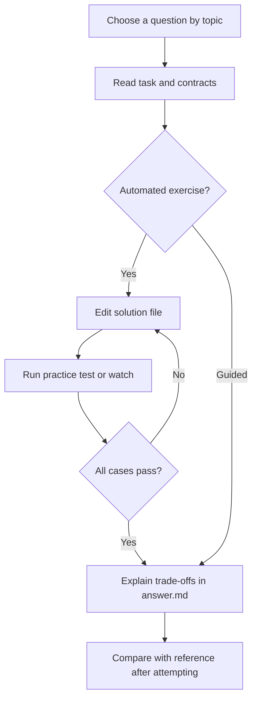

# Beginner Foundations

[All collections](../INDEX.md) | [Local practice guide](../README.md)

Search this file for a topic, or run `npm run practice:list -- "<topic words>"` from the repository root. Old IDs and old collection/ID commands still work.

### HTML and CSS

- [What is semantic HTML and why is it important?](semantic-html-and-why-is-it-important--t1-hc-01/README.md) - `t1-hc-01` | Beginner | guided
- [How do HTML forms work, and why should inputs always have associated labels?](html-forms-work-and-why-should-inputs-always-have-associated-labels--t1-hc-02/README.md) - `t1-hc-02` | Beginner | guided
- [How does CSS specificity work and what are the main selector types?](css-specificity-work-and-what-are-the-main-selector-types--t1-hc-03/README.md) - `t1-hc-03` | Beginner | guided
- [What is the CSS Box Model and what does box-sizing: border-box do?](the-css-box-model-and-what-does-box-sizing-border-box-do--t1-hc-04/README.md) - `t1-hc-04` | Beginner | guided
- [What is Flexbox and what are its core container and item properties?](flexbox-and-what-are-its-core-container-and-item-properties--t1-hc-05/README.md) - `t1-hc-05` | Beginner | guided
- [What is CSS Grid and when would you choose it over Flexbox?](css-grid-and-when-would-you-choose-it-over-flexbox--t1-hc-06/README.md) - `t1-hc-06` | Beginner | guided
- [How do you create a responsive web design using media queries?](you-create-a-responsive-web-design-using-media-queries--t1-hc-07/README.md) - `t1-hc-07` | Beginner | guided
- [What is the difference between px, rem, em, and % units in CSS?](the-difference-between-px-rem-em-and-units-in-css--t1-hc-08/README.md) - `t1-hc-08` | Beginner | guided
- [How do the different CSS position values work (static, relative, absolute, fixed, sticky)?](the-different-css-position-values-work-static-relative-absolute-fixed-sticky--t1-hc-09/README.md) - `t1-hc-09` | Beginner | guided
- [What are the most reliable modern ways to center an element in CSS?](the-most-reliable-modern-ways-to-center-an-element-in-css--t1-hc-10/README.md) - `t1-hc-10` | Beginner | guided

### JavaScript Fundamentals

- [What is the difference between var, let, and const in JavaScript?](the-difference-between-var-let-and-const-in-javascript--t1-js-01/README.md) - `t1-js-01` | Beginner | guided
- [What are JavaScript data types and how does primitive vs reference comparison work?](javascript-data-types-and-how-does-primitive-vs-reference-comparison-work--t1-js-02/README.md) - `t1-js-02` | Beginner | guided
- [What is the difference between loose equality (==) and strict equality (===)?](the-difference-between-loose-equality-and-strict-equality--t1-js-03/README.md) - `t1-js-03` | Beginner | guided
- [How do if/else statements and switch statements differ in JavaScript?](if-else-statements-and-switch-statements-differ-in-javascript--t1-js-04/README.md) - `t1-js-04` | Beginner | guided
- [What are the differences between for, while, and for...of loops?](the-differences-between-for-while-and-for-of-loops--t1-js-05/README.md) - `t1-js-05` | Beginner | guided
- [What is the difference between a regular function and an arrow function?](the-difference-between-a-regular-function-and-an-arrow-function--t1-js-06/README.md) - `t1-js-06` | Beginner | guided
- [How do map, filter, and find work on JavaScript arrays?](map-filter-and-find-work-on-javascript-arrays--t1-js-07/README.md) - `t1-js-07` | Beginner | guided
- [How do you access, update, and destructure JavaScript object properties?](you-access-update-and-destructure-javascript-object-properties--t1-js-08/README.md) - `t1-js-08` | Beginner | guided
- [What is variable scope and what is a closure in simple terms?](variable-scope-and-what-is-a-closure-in-simple-terms--t1-js-09/README.md) - `t1-js-09` | Beginner | guided
- [What is hoisting in JavaScript?](hoisting-in-javascript--t1-js-10/README.md) - `t1-js-10` | Beginner | guided
- [What are Promises and how does async/await make handling them easier?](promises-and-how-does-async-await-make-handling-them-easier--t1-js-11/README.md) - `t1-js-11` | Beginner | guided
- [How does the JavaScript event loop work in simple terms?](the-javascript-event-loop-work-in-simple-terms--t1-js-12/README.md) - `t1-js-12` | Beginner | guided

### Node.js and API Fundamentals

- [What is Node.js and how does running JavaScript in Node differ from running it in a web browser?](node-js-and-how-does-running-javascript-in-node-differ-from-running-it-in-a--t1-node-01/README.md) - `t1-node-01` | Beginner | guided
- [What is meant by the "non-blocking, event-driven I/O" model in Node.js?](meant-by-the-non-blocking-event-driven-i-o-model-in-node-js--t1-node-02/README.md) - `t1-node-02` | Beginner | guided
- [What is a REST API and what are its core architectural principles?](a-rest-api-and-what-are-its-core-architectural-principles--t1-node-03/README.md) - `t1-node-03` | Beginner | guided
- [What are the main HTTP methods and how do their purposes differ?](the-main-http-methods-and-how-do-their-purposes-differ--t1-node-04/README.md) - `t1-node-04` | Beginner | guided
- [What are the most common HTTP status code ranges and their specific meanings?](the-most-common-http-status-code-ranges-and-their-specific-meanings--t1-node-05/README.md) - `t1-node-05` | Beginner | guided
- [How do you build a basic web server and define routes using Express.js?](you-build-a-basic-web-server-and-define-routes-using-express-js--t1-node-06/README.md) - `t1-node-06` | Beginner | guided
- [How do you extract data from req.params, req.query, and req.body in Express?](you-extract-data-from-req-params-req-query-and-req-body-in-express--t1-node-07/README.md) - `t1-node-07` | Beginner | guided
- [What is Express middleware and what is the role of the next() function?](express-middleware-and-what-is-the-role-of-the-next-function--t1-node-08/README.md) - `t1-node-08` | Beginner | guided
- [What are environment variables, process.env, and why must secret keys never be committed to Git?](environment-variables-process-env-and-why-must-secret-keys-never-be-committe--t1-node-09/README.md) - `t1-node-09` | Beginner | guided
- [What are the basic differences between Relational (SQL) and Document (NoSQL) databases for beginners?](the-basic-differences-between-relational-sql-and-document-nosql-databases-fo--t1-node-10/README.md) - `t1-node-10` | Beginner | guided

### React Fundamentals

- [What is React and why do engineers choose it over vanilla JavaScript for building UIs?](react-and-why-do-engineers-choose-it-over-vanilla-javascript-for-building-ui--t1-react-01/README.md) - `t1-react-01` | Beginner | guided
- [What is JSX and what are its key syntax rules in React?](jsx-and-what-are-its-key-syntax-rules-in-react--t1-react-02/README.md) - `t1-react-02` | Beginner | guided
- [What is the difference between props and state in React?](the-difference-between-props-and-state-in-react--t1-react-03/README.md) - `t1-react-03` | Beginner | guided
- [How does event handling work in React, and why should you pass a function reference instead of invoking it?](event-handling-work-in-react-and-why-should-you-pass-a-function-reference-in--t1-react-04/README.md) - `t1-react-04` | Beginner | guided
- [How do you conditionally render elements in React?](you-conditionally-render-elements-in-react--t1-react-05/README.md) - `t1-react-05` | Beginner | guided
- [How do you render lists in React, and why is the key prop strictly necessary?](you-render-lists-in-react-and-why-is-the-key-prop-strictly-necessary--t1-react-06/README.md) - `t1-react-06` | Beginner | guided
- [How does the useState hook work, and when should you use a functional state update?](the-usestate-hook-work-and-when-should-you-use-a-functional-state-update--t1-react-07/README.md) - `t1-react-07` | Beginner | guided
- [What is the useEffect hook, and how does its dependency array control execution?](the-useeffect-hook-and-how-does-its-dependency-array-control-execution--t1-react-08/README.md) - `t1-react-08` | Beginner | guided
- [What is a controlled component in React and how does it handle form inputs?](a-controlled-component-in-react-and-how-does-it-handle-form-inputs--t1-react-09/README.md) - `t1-react-09` | Beginner | guided
- [How does parent-to-child and child-to-parent communication work in React?](parent-to-child-and-child-to-parent-communication-work-in-react--t1-react-10/README.md) - `t1-react-10` | Beginner | guided
- [What are the main component lifecycle concepts in modern functional React?](the-main-component-lifecycle-concepts-in-modern-functional-react--t1-react-11/README.md) - `t1-react-11` | Beginner | guided

### Redux Toolkit Fundamentals

- [Why is state management useful in web applications and what problem does it solve?](why-is-state-management-useful-in-web-applications-and-what-problem-does-it--t1-rdx-01/README.md) - `t1-rdx-01` | Beginner | guided
- [What is the difference between local component state and global state?](the-difference-between-local-component-state-and-global-state--t1-rdx-02/README.md) - `t1-rdx-02` | Beginner | guided
- [What are the three core principles and concepts of Redux: Store, Actions, and Reducers?](the-three-core-principles-and-concepts-of-redux-store-actions-and-reducers--t1-rdx-03/README.md) - `t1-rdx-03` | Beginner | guided
- [What is createSlice in Redux Toolkit and how does it simplify Redux code?](createslice-in-redux-toolkit-and-how-does-it-simplify-redux-code--t1-rdx-04/README.md) - `t1-rdx-04` | Beginner | guided
- [How does Immer work inside Redux Toolkit reducers to allow "direct state mutation"?](immer-work-inside-redux-toolkit-reducers-to-allow-direct-state-mutation--t1-rdx-05/README.md) - `t1-rdx-05` | Beginner | guided
- [How do useSelector and useDispatch connect React components to the Redux store?](useselector-and-usedispatch-connect-react-components-to-the-redux-store--t1-rdx-06/README.md) - `t1-rdx-06` | Beginner | guided
- [How do you handle asynchronous operations like API calls using createAsyncThunk?](you-handle-asynchronous-operations-like-api-calls-using-createasyncthunk--t1-rdx-07/README.md) - `t1-rdx-07` | Beginner | guided
- [How do you configure the Redux store using configureStore and provide it to React?](you-configure-the-redux-store-using-configurestore-and-provide-it-to-react--t1-rdx-08/README.md) - `t1-rdx-08` | Beginner | guided
- [When is Redux useful and when is it unnecessary / overkill?](when-is-redux-useful-and-when-is-it-unnecessary-overkill--t1-rdx-09/README.md) - `t1-rdx-09` | Beginner | guided
- [How do action payloads work in Redux Toolkit and how do you pass parameters to actions?](action-payloads-work-in-redux-toolkit-and-how-do-you-pass-parameters-to-acti--t1-rdx-10/README.md) - `t1-rdx-10` | Beginner | guided

### TypeScript Fundamentals

- [What is TypeScript and what primary advantages does it offer over vanilla JavaScript?](typescript-and-what-primary-advantages-does-it-offer-over-vanilla-javascript--t1-ts-01/README.md) - `t1-ts-01` | Beginner | guided
- [What are the basic primitive types in TypeScript and how do type annotations work?](the-basic-primitive-types-in-typescript-and-how-do-type-annotations-work--t1-ts-02/README.md) - `t1-ts-02` | Beginner | guided
- [What is the difference between an interface and a type alias in TypeScript?](the-difference-between-an-interface-and-a-type-alias-in-typescript--t1-ts-03/README.md) - `t1-ts-03` | Beginner | guided
- [How do you type arrays and objects in TypeScript?](you-type-arrays-and-objects-in-typescript--t1-ts-04/README.md) - `t1-ts-04` | Beginner | guided
- [How do you type function parameters, return values, and functions that return nothing (void)?](you-type-function-parameters-return-values-and-functions-that-return-nothing--t1-ts-05/README.md) - `t1-ts-05` | Beginner | guided
- [How do optional properties (?) and optional chaining (?.) work in TypeScript?](optional-properties-and-optional-chaining-work-in-typescript--t1-ts-06/README.md) - `t1-ts-06` | Beginner | guided
- [What are union types and how do you narrow them using typeof guards?](union-types-and-how-do-you-narrow-them-using-typeof-guards--t1-ts-07/README.md) - `t1-ts-07` | Beginner | guided
- [What is the difference between any and unknown in TypeScript and why is unknown safer?](the-difference-between-any-and-unknown-in-typescript-and-why-is-unknown-safe--t1-ts-08/README.md) - `t1-ts-08` | Beginner | guided
- [What are literal types and how are they used to model exact state values?](literal-types-and-how-are-they-used-to-model-exact-state-values--t1-ts-09/README.md) - `t1-ts-09` | Beginner | guided
- [What are basic Generics in TypeScript and why are they useful?](basic-generics-in-typescript-and-why-are-they-useful--t1-ts-10/README.md) - `t1-ts-10` | Beginner | guided

## Practice workflow

Choose a question, read its README and visible cases, and edit its solution or answer file.

Mermaid renders in supported Markdown viewers. In VS Code use a Mermaid-capable Markdown preview; all instructions also remain available as text.
