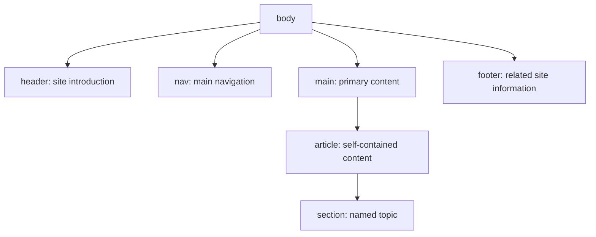

# What is semantic HTML and why is it important?

Collection: beginner · ID: `t1-hc-01` · Mode: **guided**

## Task

What is semantic HTML and why is it important?

## Follow-up questions

- What is the difference between <section> and <article>?

## Work locally

Edit [answer.md](answer.md). Keep the original function names and input/output contracts.

This is a guided exercise. Review your answer against the rubric and reference; no automated correctness score is claimed. If code is supplied, edit and run it with the appropriate local tooling and add your own tests.

Full authored task data (including review files, telemetry, stages, requirements, hints, and examples where supplied) is in [exercise.json](exercise.json).

After your attempt, open [reference.md](reference.md) for the authored answer, rubric, follow-ups, and solution.

## Visual model: semantic page structure

Semantic elements describe the purpose of content. The nesting below is an example, not a required layout for every page.

