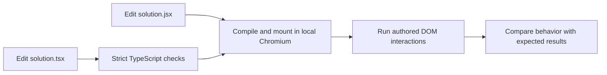
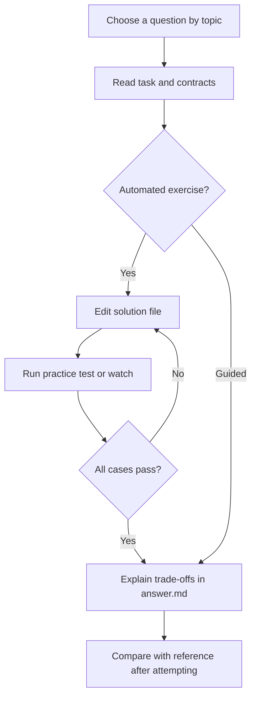

# Application Challenges

[All collections](../INDEX.md) | [Local practice guide](../README.md)

Search this file for a topic, or run `npm run practice:list -- "<topic words>"` from the repository root. Old IDs and old collection/ID commands still work.

### Databases

- [Flash Sale Cart Reservation PostgreSQL Transaction Deadlock](db-deadlock-inventory-reservation/README.md) - `db-deadlock-inventory-reservation` | Senior | guided
- [E-Commerce Order History Endpoint N+1 Query & Composite Index Optimization](db-n-plus-one-query-plan/README.md) - `db-n-plus-one-query-plan` | Senior | guided
- [Financial Ledger Wallet Balance Anomaly & Isolation Levels](db-isolation-levels-phantom-read/README.md) - `db-isolation-levels-phantom-read` | Senior | guided
- [CRM Million-Row Activity Log OFFSET Pagination Degradation](db-keyset-pagination-performance/README.md) - `db-keyset-pagination-performance` | Senior | guided
- [50M-Row User Schema Column Rename Zero-Downtime Migration](db-zero-downtime-migration/README.md) - `db-zero-downtime-migration` | Senior | guided
- [Connection Storm: Autoscaling Makes Checkout Worse](incident-db-connection-storm/README.md) - `incident-db-connection-storm` | Senior | guided
- [Migration Lock: A Small DDL Change Stops Orders](incident-migration-lock/README.md) - `incident-migration-lock` | Staff/Principal | guided
- [E-commerce: Stop Overselling the Last Item](commerce-inventory-reservations/README.md) - `commerce-inventory-reservations` | Senior | javascript

### Engineering Operations

- [Production Incident: Node.js Container OOMKilled Memory Leak](ops-production-memory-leak-debug/README.md) - `ops-production-memory-leak-debug` | Senior | guided
- [Production Incident: Cloud Provider IAM & Stripe Key Leak in CI Logs](ops-secrets-leak-incident/README.md) - `ops-secrets-leak-incident` | Senior | guided
- [Canary Deployment 5xx Spike & Automated Rollback Analysis](ops-canary-rollback-metrics/README.md) - `ops-canary-rollback-metrics` | Senior | guided
- [OpenTelemetry Trace Bottleneck Analysis in Microservice Mesh](ops-distributed-tracing-bottleneck/README.md) - `ops-distributed-tracing-bottleneck` | Senior | guided
- [Lead Engineer Interview: 45-Minute Outage Facilitation & Blameless Post-Mortem](interview-lead-incident-postmortem/README.md) - `interview-lead-incident-postmortem` | Staff/Principal | guided
- [Zero-Downtime Database Secret Rotation with HashiCorp Vault](ops-secrets-rotation-vault/README.md) - `ops-secrets-rotation-vault` | Senior | guided
- [Cache Stampede: The Five-Minute Expiry Cliff](incident-cache-stampede/README.md) - `incident-cache-stampede` | Senior | guided
- [Restart Cascade: A Database Blip Kills Every Pod](incident-kubernetes-probes/README.md) - `incident-kubernetes-probes` | Mid-Level | guided

### Integrations

- [Stripe Payment Webhook Replay & Duplicate Credit Crediting](integ-webhook-idempotency-replay/README.md) - `integ-webhook-idempotency-replay` | Senior | guided
- [Resilient Multi-Provider WhatsApp & SMS Fallback Orchestrator](integ-whatsapp-sms-fallback/README.md) - `integ-whatsapp-sms-fallback` | Senior | guided
- [Bi-Directional CRM Sync Out-of-Order Customer Data Rollback](integ-crm-sync-out-of-order/README.md) - `integ-crm-sync-out-of-order` | Senior | guided
- [Third-Party Shipping API Retry Storm & Thundering Herd Incident](integ-exponential-backoff-jitter/README.md) - `integ-exponential-backoff-jitter` | Senior | guided
- [Automated Nightly Payment Gateway Reconciliation & Variance Ledger](integ-payment-reconciliation-ledger/README.md) - `integ-payment-reconciliation-ledger` | Senior | guided
- [Payment Timeout: Did the Customer Already Pay?](incident-payment-ambiguity/README.md) - `incident-payment-ambiguity` | Senior | guided
- [Consumer Backlog: One Poison Event Blocks Fulfillment](incident-kafka-poison-message/README.md) - `incident-kafka-poison-message` | Senior | guided
- [E-commerce: Reconcile Duplicate Payment Notifications](commerce-payment-reconciliation/README.md) - `commerce-payment-reconciliation` | Senior | javascript
- [SaaS: Repair Subscription Access After Delayed Updates](saas-subscription-entitlements/README.md) - `saas-subscription-entitlements` | Senior | javascript
- [Collaboration: Deduplicate and Order Retried Messages](collab-message-ordering/README.md) - `collab-message-ordering` | Senior | javascript
- [Collaboration: Resume a Conversation After Disconnection](collab-reconnect-cursor/README.md) - `collab-reconnect-cursor` | Senior | javascript
- [Collaboration: Keep Read Receipts Monotonic Across Devices](collab-read-receipts/README.md) - `collab-read-receipts` | Senior | javascript
- [Collaboration: Expire Presence Without Disconnecting Other Tabs](collab-presence-expiry/README.md) - `collab-presence-expiry` | Senior | javascript
- [Collaboration: Authorize Channel Reads and Sends](collab-channel-permissions/README.md) - `collab-channel-permissions` | Senior | javascript
- [Collaboration: Deduplicate Notifications and Respect Preferences](collab-notification-delivery/README.md) - `collab-notification-delivery` | Senior | javascript
- [Collaboration: Reject Stale Meeting Signaling After Reconnect](collab-meeting-signaling/README.md) - `collab-meeting-signaling` | Senior | javascript
- [Collaboration: Page Chat History Without Gaps or Repeats](collab-history-pagination/README.md) - `collab-history-pagination` | Senior | javascript

### JavaScript

- [Flash-Sale Batch Processor Microtask Queue Starvation](js-event-loop-microtasks/README.md) - `js-event-loop-microtasks` | Senior | guided
- [SSE Connection Manager Request Context Closure Leak](js-closures-memory-leak/README.md) - `js-closures-memory-leak` | Senior | guided
- [Multi-Tab Wallet Checkout Balance Debit Race Condition](js-promise-race-condition/README.md) - `js-promise-race-condition` | Senior | guided
- [Background Reconciliation Pipeline Unhandled Rejection Crash](js-async-error-propagation/README.md) - `js-async-error-propagation` | Senior | guided
- [High-Throughput Metrics Aggregator Garbage Collection Latency Spikes](js-perf-object-allocation/README.md) - `js-perf-object-allocation` | Senior | guided
- [Frontend: Find Missing Number](frontend-find-missing-number/README.md) - `frontend-find-missing-number` | Beginner | frontend-js
- [Frontend: Max SubArray](frontend-max-subarray/README.md) - `frontend-max-subarray` | Beginner | frontend-js
- [Frontend: Make Counter](frontend-make-counter/README.md) - `frontend-make-counter` | Beginner | frontend-js
- [Frontend: Power of Two](frontend-power-of-two/README.md) - `frontend-power-of-two` | Beginner | frontend-js
- [Frontend: sum()](frontend-sum/README.md) - `frontend-sum` | Beginner | frontend-js
- [Frontend: Get Result By Path](frontend-get-result-by-path/README.md) - `frontend-get-result-by-path` | Beginner | frontend-js
- [Frontend: Find smallest number](frontend-find-smallest-number/README.md) - `frontend-find-smallest-number` | Beginner | frontend-js
- [Frontend: Power of Three](frontend-power-of-three/README.md) - `frontend-power-of-three` | Beginner | frontend-js
- [Frontend: Count Negative](frontend-count-negative/README.md) - `frontend-count-negative` | Beginner | frontend-js
- [Frontend: Find largest number](frontend-find-largest-number/README.md) - `frontend-find-largest-number` | Beginner | frontend-js
- [Frontend: Loop A to Z](frontend-loop-a-to-z/README.md) - `frontend-loop-a-to-z` | Beginner | frontend-js
- [Frontend: Custom Sort](frontend-custom-sort/README.md) - `frontend-custom-sort` | Beginner | frontend-js
- [Frontend: implement curry()](frontend-implement-curry/README.md) - `frontend-implement-curry` | Beginner | frontend-js
- [Frontend: once(fn)](frontend-oncefn/README.md) - `frontend-oncefn` | Beginner | frontend-js
- [Frontend: groupBy(arr, key)](frontend-groupbyarr-key/README.md) - `frontend-groupbyarr-key` | Beginner | frontend-js
- [Frontend: Remove Duplicates from Array](frontend-remove-duplicates-from-array/README.md) - `frontend-remove-duplicates-from-array` | Beginner | frontend-js
- [Frontend: Voting Eligibility](frontend-voting-eligibility/README.md) - `frontend-voting-eligibility` | Beginner | frontend-js
- [Frontend: Validate Palindrome](frontend-validate-palindrome/README.md) - `frontend-validate-palindrome` | Beginner | frontend-js
- [Frontend: Implement a Stack](frontend-implement-a-stack/README.md) - `frontend-implement-a-stack` | Beginner | frontend-js
- [Frontend: Power of Four](frontend-power-of-four/README.md) - `frontend-power-of-four` | Beginner | frontend-js
- [Frontend: Count even numbers](frontend-count-even-numbers/README.md) - `frontend-count-even-numbers` | Beginner | frontend-js
- [Frontend: Capitalize Words](frontend-capitalize-words/README.md) - `frontend-capitalize-words` | Beginner | frontend-js
- [Frontend: Count Vowels](frontend-count-vowels/README.md) - `frontend-count-vowels` | Beginner | frontend-js
- [Frontend: Sum of all numbers in an array](frontend-sum-of-all-numbers-in-an-array/README.md) - `frontend-sum-of-all-numbers-in-an-array` | Beginner | frontend-js
- [Frontend: Anagram Checker](frontend-anagram-checker/README.md) - `frontend-anagram-checker` | Beginner | frontend-js
- [Frontend: findMaxNumber](frontend-findmaxnumber/README.md) - `frontend-findmaxnumber` | Beginner | frontend-js
- [Frontend: Factorial of a number](frontend-factorial-of-a-number/README.md) - `frontend-factorial-of-a-number` | Beginner | frontend-js
- [Frontend: Fibonacci Series](frontend-fibonacci-series/README.md) - `frontend-fibonacci-series` | Beginner | frontend-js
- [Frontend: Secret Code Shuffler](frontend-secret-code-shuffler/README.md) - `frontend-secret-code-shuffler` | Beginner | frontend-js
- [Frontend: Flatten Nested Array](frontend-flatten-nested-array/README.md) - `frontend-flatten-nested-array` | Beginner | frontend-js
- [Frontend: shuffle()](frontend-shuffle/README.md) - `frontend-shuffle` | Beginner | frontend-js
- [Frontend: Largest number formed](frontend-largest-number-formed/README.md) - `frontend-largest-number-formed` | Beginner | frontend-js
- [Frontend: Array Chunking](frontend-array-chunking/README.md) - `frontend-array-chunking` | Beginner | frontend-js
- [Frontend: Sum of n natural numbers](frontend-sum-of-n-natural-numbers/README.md) - `frontend-sum-of-n-natural-numbers` | Beginner | frontend-js
- [Frontend: Array.prototype.reduce](frontend-arrayprototypereduce/README.md) - `frontend-arrayprototypereduce` | Beginner | frontend-js
- [Frontend: ReverseWords](frontend-reversewords/README.md) - `frontend-reversewords` | Beginner | frontend-js
- [Frontend: Flatten Nested Objects](frontend-flatten-nested-objects/README.md) - `frontend-flatten-nested-objects` | Mid-Level | frontend-js
- [Frontend: Flatten Deep Object](frontend-flatten-deep-object/README.md) - `frontend-flatten-deep-object` | Mid-Level | frontend-js
- [Frontend: Compress String with Limited Repetition](frontend-compress-string-with-limited-repetition/README.md) - `frontend-compress-string-with-limited-repetition` | Mid-Level | frontend-js
- [Frontend: Rate Limiter](frontend-rate-limiter/README.md) - `frontend-rate-limiter` | Mid-Level | frontend-js
- [Frontend: JSON.stringify](frontend-jsonstringify/README.md) - `frontend-jsonstringify` | Mid-Level | frontend-js
- [Frontend: Word Search](frontend-word-search/README.md) - `frontend-word-search` | Mid-Level | frontend-js
- [Frontend: Topological Sort (DFS)](frontend-topological-sort-dfs/README.md) - `frontend-topological-sort-dfs` | Mid-Level | frontend-js
- [Frontend: Detect Cycle in an Undirected Connected Graph (DFS)](frontend-detect-cycle-in-an-undirected-connected-graph-dfs/README.md) - `frontend-detect-cycle-in-an-undirected-connected-graph-dfs` | Mid-Level | frontend-js
- [Frontend: Throttle](frontend-throttle/README.md) - `frontend-throttle` | Mid-Level | frontend-js
- [Frontend: PromiseAll With Concurrency Limit](frontend-promiseall-with-concurrency-limit/README.md) - `frontend-promiseall-with-concurrency-limit` | Mid-Level | frontend-js
- [Frontend: Priority Queue](frontend-priority-queue/README.md) - `frontend-priority-queue` | Mid-Level | frontend-js
- [Frontend: Memoization](frontend-memoization/README.md) - `frontend-memoization` | Mid-Level | frontend-js
- [Frontend: Sum of Consecutive Integers](frontend-sum-of-consecutive-integers/README.md) - `frontend-sum-of-consecutive-integers` | Mid-Level | frontend-js
- [Frontend: Deep Clone Object](frontend-deep-clone-object/README.md) - `frontend-deep-clone-object` | Mid-Level | frontend-js
- [Frontend: Debounce](frontend-debounce/README.md) - `frontend-debounce` | Mid-Level | frontend-js
- [Frontend: Spiral Matrix Pathfinder](frontend-spiral-matrix-pathfinder/README.md) - `frontend-spiral-matrix-pathfinder` | Mid-Level | frontend-js
- [Frontend: Lazy Evaluation](frontend-lazy-evaluation/README.md) - `frontend-lazy-evaluation` | Mid-Level | frontend-js
- [Frontend: Longest Substring No Repeats](frontend-longest-substring-no-repeats/README.md) - `frontend-longest-substring-no-repeats` | Mid-Level | frontend-js
- [Frontend: Concurrency Limited Task Scheduler](frontend-concurrency-limited-task-scheduler/README.md) - `frontend-concurrency-limited-task-scheduler` | Mid-Level | frontend-js
- [Frontend: Find the Single Element in a Sorted Array](frontend-find-the-single-element-in-a-sorted-array/README.md) - `frontend-find-the-single-element-in-a-sorted-array` | Mid-Level | frontend-js
- [Frontend: Event Emitter](frontend-event-emitter/README.md) - `frontend-event-emitter` | Mid-Level | frontend-js
- [Frontend: List Format](frontend-list-format/README.md) - `frontend-list-format` | Mid-Level | frontend-js
- [Frontend: Map Async Limit](frontend-map-async-limit/README.md) - `frontend-map-async-limit` | Mid-Level | frontend-js
- [Frontend: Deep Omit](frontend-deep-omit/README.md) - `frontend-deep-omit` | Mid-Level | frontend-js
- [Frontend: Shortest Distance from Source (BFS)](frontend-shortest-distance-from-source-bfs/README.md) - `frontend-shortest-distance-from-source-bfs` | Mid-Level | frontend-js
- [Frontend: Topological Sort (BFS)](frontend-topological-sort-bfs/README.md) - `frontend-topological-sort-bfs` | Mid-Level | frontend-js
- [Frontend: Sum of Subarray Minimum](frontend-sum-of-subarray-minimum/README.md) - `frontend-sum-of-subarray-minimum` | Mid-Level | frontend-js
- [Frontend: Search Rotated Array](frontend-search-rotated-array/README.md) - `frontend-search-rotated-array` | Mid-Level | frontend-js
- [Frontend: Combination Sum](frontend-combination-sum/README.md) - `frontend-combination-sum` | Mid-Level | frontend-js
- [Frontend: Implement Promise Race](frontend-implement-promise-race/README.md) - `frontend-implement-promise-race` | Mid-Level | frontend-js
- [Frontend: Reverse Words in a String](frontend-reverse-words-in-a-string/README.md) - `frontend-reverse-words-in-a-string` | Mid-Level | frontend-js
- [Frontend: Oranges Rotting](frontend-oranges-rotting/README.md) - `frontend-oranges-rotting` | Mid-Level | frontend-js
- [Frontend: Object.assign()](frontend-objectassign/README.md) - `frontend-objectassign` | Mid-Level | frontend-js
- [Frontend: Merge Array](frontend-merge-array/README.md) - `frontend-merge-array` | Mid-Level | frontend-js
- [Frontend: pyramid pattern](frontend-pyramid-pattern/README.md) - `frontend-pyramid-pattern` | Mid-Level | frontend-js
- [Frontend: Search in a 2D Sorted Matrix](frontend-search-in-a-2d-sorted-matrix/README.md) - `frontend-search-in-a-2d-sorted-matrix` | Mid-Level | frontend-js
- [Frontend: Detect data type in JS](frontend-detect-data-type-in-js/README.md) - `frontend-detect-data-type-in-js` | Mid-Level | frontend-js
- [Frontend: Prim's MST Algorithm](frontend-prims-mst-algorithm/README.md) - `frontend-prims-mst-algorithm` | Senior | frontend-js
- [Frontend: Longest Valid Parentheses](frontend-longest-valid-parentheses/README.md) - `frontend-longest-valid-parentheses` | Senior | frontend-js
- [Frontend: Chinese Remainder Theorem](frontend-chinese-remainder-theorem/README.md) - `frontend-chinese-remainder-theorem` | Senior | frontend-js
- [Frontend: Kruskal's MST Algorithm](frontend-kruskals-mst-algorithm/README.md) - `frontend-kruskals-mst-algorithm` | Senior | frontend-js
- [Frontend: Implement LRUCache](frontend-implement-lrucache/README.md) - `frontend-implement-lrucache` | Senior | frontend-js
- [Frontend: Implement a Queue using Stack](frontend-implement-a-queue-using-stack/README.md) - `frontend-implement-a-queue-using-stack` | Senior | frontend-js
- [Frontend: Median of Two Sorted Arrays](frontend-median-of-two-sorted-arrays/README.md) - `frontend-median-of-two-sorted-arrays` | Senior | frontend-js
- [Frontend: Create Task Scheduler With Dependencies](frontend-create-task-scheduler-with-dependencies/README.md) - `frontend-create-task-scheduler-with-dependencies` | Senior | frontend-js
- [Frontend: All Pairs Shortest Path (Floyd-Warshall Algorithm)](frontend-all-pairs-shortest-path-floyd-warshall-algorithm/README.md) - `frontend-all-pairs-shortest-path-floyd-warshall-algorithm` | Senior | frontend-js
- [Frontend: Shortest Distance from Source (Bellman-Ford Algorithm)](frontend-shortest-distance-from-source-bellman-ford-algorithm/README.md) - `frontend-shortest-distance-from-source-bellman-ford-algorithm` | Senior | frontend-js
- [Frontend: Sliding Window Maximum](frontend-sliding-window-maximum/README.md) - `frontend-sliding-window-maximum` | Senior | frontend-js
- [Frontend: Worker Pool](frontend-worker-pool/README.md) - `frontend-worker-pool` | Senior | frontend-js
- [Frontend: First Missing Positive](frontend-first-missing-positive/README.md) - `frontend-first-missing-positive` | Senior | frontend-js
- [Frontend: Design Autocomplete](frontend-design-autocomplete/README.md) - `frontend-design-autocomplete` | Senior | frontend-js
- [Frontend: Shortest Distance from Source (Dijkstra's Algorithm)](frontend-shortest-distance-from-source-dijkstras-algorithm/README.md) - `frontend-shortest-distance-from-source-dijkstras-algorithm` | Senior | frontend-js
- [Frontend: Fibonacci Modulo (Pisano Period)](frontend-fibonacci-modulo-pisano-period/README.md) - `frontend-fibonacci-modulo-pisano-period` | Senior | frontend-js
- [Frontend: Implement Garbage Collector](frontend-implement-garbage-collector/README.md) - `frontend-implement-garbage-collector` | Senior | frontend-js

### Next.js

- [Secret Key Leakage Across Next.js Server-Client Boundary](nextjs-server-client-boundary/README.md) - `nextjs-server-client-boundary` | Senior | guided
- [Multi-Timezone Scheduling Hydration Mismatch & Layout Shift](nextjs-hydration-mismatch-clock/README.md) - `nextjs-hydration-mismatch-clock` | Senior | guided
- [Product Catalog High-Traffic ISR Cache Stampede / Dog-Piling](nextjs-isr-cache-stampede/README.md) - `nextjs-isr-cache-stampede` | Senior | guided
- [Edge Middleware JWT Validation Infinite Redirect Loop](nextjs-auth-middleware-session/README.md) - `nextjs-auth-middleware-session` | Senior | guided
- [AI Streaming Assistant Suspense & Localized Error Boundary Fallback](nextjs-stream-suspense-error-boundary/README.md) - `nextjs-stream-suspense-error-boundary` | Senior | guided
- [Normalize searchParams pagination without coercion surprises](next-lab-query-pagination/README.md) - `next-lab-query-pagination` | Beginner | frontend-js
- [Validate a post-login return path](next-lab-safe-return-path/README.md) - `next-lab-safe-return-path` | Beginner | frontend-js
- [Build a catch-all path from validated segments](next-lab-catch-all-segments/README.md) - `next-lab-catch-all-segments` | Beginner | frontend-js
- [Update URL filters while preserving unrelated query values](next-lab-query-filter-state/README.md) - `next-lab-query-filter-state` | Beginner | frontend-js
- [Project a browser-safe configuration DTO](next-lab-public-config-dto/README.md) - `next-lab-public-config-dto` | Beginner | frontend-js
- [Apply a deterministic metadata title template](next-lab-metadata-title-policy/README.md) - `next-lab-metadata-title-policy` | Beginner | frontend-js
- [Repair the App Router root layout](next-lab-root-layout/README.md) - `next-lab-root-layout` | Beginner | guided
- [Move interactivity into a small Client Component](next-lab-client-island/README.md) - `next-lab-client-island` | Beginner | guided
- [Migrate dynamic route params from 15 compatibility to 16](next-lab-async-route-params/README.md) - `next-lab-async-route-params` | Beginner | guided
- [Read and validate server searchParams](next-lab-async-search-params/README.md) - `next-lab-async-search-params` | Beginner | guided
- [Read request cookies on the server](next-lab-async-cookies/README.md) - `next-lab-async-cookies` | Beginner | guided
- [Replace a non-serializable event prop across the boundary](next-lab-client-prop-contract/README.md) - `next-lab-client-prop-contract` | Beginner | guided
- [Terminate a missing resource with notFound](next-lab-not-found-control-flow/README.md) - `next-lab-not-found-control-flow` | Beginner | guided
- [Build a retryable route error boundary](next-lab-error-boundary/README.md) - `next-lab-error-boundary` | Beginner | guided
- [Place Suspense before the slow work](next-lab-suspense-loading/README.md) - `next-lab-suspense-loading` | Beginner | guided
- [Preserve accessible client navigation with Link](next-lab-link-navigation/README.md) - `next-lab-link-navigation` | Beginner | guided
- [Match generateStaticParams to the dynamic segment](next-lab-generate-static-params/README.md) - `next-lab-generate-static-params` | Beginner | guided
- [Keep metadata exports in a Server Component](next-lab-metadata-server-boundary/README.md) - `next-lab-metadata-server-boundary` | Beginner | guided
- [Reserve image space and constrain remote sources](next-lab-image-dimensions/README.md) - `next-lab-image-dimensions` | Beginner | guided
- [Load a font once in the root layout](next-lab-font-ownership/README.md) - `next-lab-font-ownership` | Beginner | guided
- [Keep Pages Router SSR props serializable and public](next-lab-pages-ssr-dto/README.md) - `next-lab-pages-ssr-dto` | Beginner | guided
- [Choose Pages Router fallback and revalidation explicitly](next-lab-pages-static-paths/README.md) - `next-lab-pages-static-paths` | Beginner | guided
- [Partition a shared cache key by tenant and locale](next-lab-tenant-cache-key/README.md) - `next-lab-tenant-cache-key` | Mid-Level | frontend-js
- [Deduplicate cache invalidation tags without losing order](next-lab-invalidation-tags/README.md) - `next-lab-invalidation-tags` | Mid-Level | frontend-js
- [Model cache freshness at exact time boundaries](next-lab-cache-freshness-model/README.md) - `next-lab-cache-freshness-model` | Mid-Level | frontend-js
- [Choose distinct visible routes within a prefetch budget](next-lab-prefetch-budget/README.md) - `next-lab-prefetch-budget` | Mid-Level | frontend-js
- [Ignore stale mutation results in an optimistic UI](next-lab-optimistic-result-owner/README.md) - `next-lab-optimistic-result-owner` | Mid-Level | frontend-js
- [Validate a Server Action payload before mutation](next-lab-action-field-validation/README.md) - `next-lab-action-field-validation` | Mid-Level | frontend-js
- [Deduplicate a bounded webhook event batch](next-lab-duplicate-webhook-events/README.md) - `next-lab-duplicate-webhook-events` | Mid-Level | frontend-js
- [Check upload count, size and MIME type](next-lab-upload-admission/README.md) - `next-lab-upload-admission` | Mid-Level | frontend-js
- [Scope a component style without global collisions](next-lab-scoped-css/README.md) - `next-lab-scoped-css` | Mid-Level | guided
- [Detect colliding URLs hidden by route groups](next-lab-route-group-collision/README.md) - `next-lab-route-group-collision` | Mid-Level | guided
- [Provide a hard-navigation fallback for a parallel slot](next-lab-parallel-slot-default/README.md) - `next-lab-parallel-slot-default` | Mid-Level | guided
- [Close a route modal using navigation semantics](next-lab-intercepted-modal/README.md) - `next-lab-intercepted-modal` | Mid-Level | guided
- [Contain a client useSearchParams read with Suspense](next-lab-client-search-suspense/README.md) - `next-lab-client-search-suspense` | Mid-Level | guided
- [Compose server-fetched content through a client slot](next-lab-server-content-slot/README.md) - `next-lab-server-content-slot` | Mid-Level | guided
- [Remove the Server Component HTTP round trip to its own API](next-lab-server-data-direct/README.md) - `next-lab-server-data-direct` | Mid-Level | guided
- [Start independent server reads before awaiting them](next-lab-parallel-data/README.md) - `next-lab-parallel-data` | Mid-Level | guided
- [Separate React request memoization from persistent caching](next-lab-request-memoization/README.md) - `next-lab-request-memoization` | Mid-Level | guided
- [Make Next.js 15 fetch freshness explicit](next-lab-fetch-cache-default/README.md) - `next-lab-fetch-cache-default` | Mid-Level | guided
- [Keep a personalized GET handler out of shared caches](next-lab-get-handler-caching/README.md) - `next-lab-get-handler-caching` | Mid-Level | guided
- [Set a deliberate ISR window without contradictory fetch options](next-lab-isr-revalidate/README.md) - `next-lab-isr-revalidate` | Mid-Level | guided
- [Adopt Cache Components as an explicit rendering change](next-lab-cache-components-opt-in/README.md) - `next-lab-cache-components-opt-in` | Mid-Level | guided
- [Keep request reads outside a shared use cache scope](next-lab-cached-function-arguments/README.md) - `next-lab-cached-function-arguments` | Mid-Level | guided
- [Place cacheLife inside the cached function](next-lab-cache-life-scope/README.md) - `next-lab-cache-life-scope` | Mid-Level | guided
- [Assign the same tags that later invalidation targets](next-lab-cache-tag-assignment/README.md) - `next-lab-cache-tag-assignment` | Mid-Level | guided
- [Choose stale-while-revalidate rather than accidental immediate expiry](next-lab-revalidate-tag-max/README.md) - `next-lab-revalidate-tag-max` | Mid-Level | guided
- [Move updateTag out of a Route Handler](next-lab-update-tag-context/README.md) - `next-lab-update-tag-context` | Mid-Level | guided
- [Distinguish router.refresh from server data invalidation](next-lab-router-refresh-vs-data/README.md) - `next-lab-router-refresh-vs-data` | Mid-Level | guided
- [Authorize every exported Server Action invocation](next-lab-server-action-auth/README.md) - `next-lab-server-action-auth` | Mid-Level | guided
- [Return validation state through React 19 useActionState](next-lab-use-action-state/README.md) - `next-lab-use-action-state` | Mid-Level | guided
- [Place useFormStatus inside the form it observes](next-lab-form-status-parent/README.md) - `next-lab-form-status-parent` | Mid-Level | guided
- [Preserve HTTP semantics in a Pages API route](next-lab-pages-api-methods/README.md) - `next-lab-pages-api-methods` | Mid-Level | guided
- [Migrate a route while App and Pages routers coexist](next-lab-router-coexistence/README.md) - `next-lab-router-coexistence` | Mid-Level | guided
- [Admit a locale before loading a server dictionary](next-lab-locale-admission/README.md) - `next-lab-locale-admission` | Mid-Level | guided
- [Reject server-only requirements from a static export plan](next-lab-static-export-boundaries/README.md) - `next-lab-static-export-boundaries` | Mid-Level | guided
- [Publish canonical public sitemap entries without exposing private resources](next-lab-sitemap-private-routes/README.md) - `next-lab-sitemap-private-routes` | Mid-Level | guided
- [Authorize tenant-scoped resource operations](next-lab-authorization-matrix/README.md) - `next-lab-authorization-matrix` | Senior | frontend-js
- [Classify public and protected paths using segment boundaries](next-lab-proxy-path-classifier/README.md) - `next-lab-proxy-path-classifier` | Senior | frontend-js
- [Bound retries by attempts, deadline and idempotency](next-lab-retry-budget/README.md) - `next-lab-retry-budget` | Senior | frontend-js
- [Audit Next.js 15-to-16 migration blockers](next-lab-migration-audit/README.md) - `next-lab-migration-audit` | Senior | frontend-js
- [Reject late stream chunks after cancellation](next-lab-stream-event-reducer/README.md) - `next-lab-stream-event-reducer` | Senior | frontend-js
- [Prevent shared caching of authenticated responses](next-lab-private-response-policy/README.md) - `next-lab-private-response-policy` | Senior | frontend-js
- [Keep optimistic presentation separate from authoritative state](next-lab-optimistic-state/README.md) - `next-lab-optimistic-state` | Senior | guided
- [Do not swallow redirect control flow in a catch block](next-lab-redirect-catch/README.md) - `next-lab-redirect-catch` | Senior | guided
- [Validate JSON Route Handler requests without leaking exceptions](next-lab-route-handler-validation/README.md) - `next-lab-route-handler-validation` | Senior | guided
- [Verify a webhook signature over its original bytes](next-lab-webhook-raw-body/README.md) - `next-lab-webhook-raw-body` | Senior | guided
- [Preserve a streaming response through the deployment proxy](next-lab-stream-buffering/README.md) - `next-lab-stream-buffering` | Senior | guided
- [Rename Middleware to Proxy without changing routing intent](next-lab-proxy-migration/README.md) - `next-lab-proxy-migration` | Senior | guided
- [Keep authorization when a Proxy matcher excludes an action path](next-lab-matcher-security/README.md) - `next-lab-matcher-security` | Senior | guided
- [Choose a runtime compatible with a native database driver](next-lab-runtime-driver/README.md) - `next-lab-runtime-driver` | Senior | guided
- [Keep ssr:false inside a client boundary](next-lab-lazy-browser-library/README.md) - `next-lab-lazy-browser-library` | Senior | guided
- [Migrate a critical image loading hint with measured intent](next-lab-image-preload-16/README.md) - `next-lab-image-preload-16` | Senior | guided
- [Audit a custom Webpack hook before a Turbopack build](next-lab-turbopack-webpack-config/README.md) - `next-lab-turbopack-webpack-config` | Senior | guided
- [Preserve lint as an explicit quality gate after next lint removal](next-lab-eslint-cli-migration/README.md) - `next-lab-eslint-cli-migration` | Senior | guided
- [Defer per-request randomness under Cache Components](next-lab-request-time-randomness/README.md) - `next-lab-request-time-randomness` | Senior | guided
- [Diagnose slow metadata without forcing every page fully dynamic](next-lab-streaming-metadata/README.md) - `next-lab-streaming-metadata` | Senior | guided
- [Await the generated image id during the 16 migration](next-lab-async-image-id/README.md) - `next-lab-async-image-id` | Senior | guided
- [Bound an upstream request and propagate failure deliberately](next-lab-bounded-upstream-fetch/README.md) - `next-lab-bounded-upstream-fetch` | Senior | guided
- [Reject a cross-tenant cache read before lookup](next-lab-tenant-cache-poisoning/README.md) - `next-lab-tenant-cache-poisoning` | Senior | guided
- [Plan nonce-based CSP without assuming static HTML can vary per request](next-lab-csp-nonce/README.md) - `next-lab-csp-nonce` | Senior | guided
- [Authenticate draft-mode activation and constrain its destination](next-lab-draft-mode-entry/README.md) - `next-lab-draft-mode-entry` | Senior | guided
- [Load server instrumentation in its supported runtime](next-lab-instrumentation-runtime/README.md) - `next-lab-instrumentation-runtime` | Senior | guided
- [Use after for bounded telemetry rather than durable fulfillment](next-lab-after-not-a-queue/README.md) - `next-lab-after-not-a-queue` | Senior | guided
- [Choose a real-server test for async Server Component behavior](next-lab-async-rsc-test-strategy/README.md) - `next-lab-async-rsc-test-strategy` | Senior | guided
- [Ship a standalone deployment with its required static assets](next-lab-standalone-output/README.md) - `next-lab-standalone-output` | Senior | guided
- [Adopt modern partial prefetching without losing the initial UI](next-lab-partial-prefetching/README.md) - `next-lab-partial-prefetching` | Senior | guided
- [Distinguish build-time public environment values from runtime secrets](next-lab-public-env-freeze/README.md) - `next-lab-public-env-freeze` | Senior | guided
- [Adopt React Compiler with dependency and purity checks](next-lab-react-compiler-adoption/README.md) - `next-lab-react-compiler-adoption` | Senior | guided
- [Constrain reverse-proxy action origins and payload limits](next-lab-server-action-origins/README.md) - `next-lab-server-action-origins` | Senior | guided
- [Architect an isolated multi-tenant Next.js SaaS](next-lab-tenant-platform/README.md) - `next-lab-tenant-platform` | Staff/Principal | guided
- [Design cross-instance cache consistency and invalidation](next-lab-distributed-cache/README.md) - `next-lab-distributed-cache` | Staff/Principal | guided
- [Separate a cached storefront from authoritative checkout](next-lab-commerce-consistency/README.md) - `next-lab-commerce-consistency` | Staff/Principal | guided
- [Plan a reversible Next.js 15-to-16 production migration](next-lab-migration-program/README.md) - `next-lab-migration-program` | Staff/Principal | guided
- [Design a streaming path through CDN, proxy and server](next-lab-streaming-edge-path/README.md) - `next-lab-streaming-edge-path` | Staff/Principal | guided
- [Design an auditable RSC data-exposure boundary](next-lab-rsc-data-boundary/README.md) - `next-lab-rsc-data-boundary` | Staff/Principal | guided
- [Plan regional rendering around data residency and latency](next-lab-regional-data-residency/README.md) - `next-lab-regional-data-residency` | Staff/Principal | guided
- [Design a Next.js backend-for-frontend with bounded ownership](next-lab-bff-contract/README.md) - `next-lab-bff-contract` | Staff/Principal | guided
- [Protect the origin during cold-cache and invalidation storms](next-lab-cache-stampede/README.md) - `next-lab-cache-stampede` | Staff/Principal | guided
- [Design session verification, rotation and account switching](next-lab-authentication-lifecycle/README.md) - `next-lab-authentication-lifecycle` | Staff/Principal | guided
- [Handle rolling-deployment client/server version skew](next-lab-deployment-skew/README.md) - `next-lab-deployment-skew` | Staff/Principal | guided
- [Build an actionable Next.js latency and reliability SLO](next-lab-observability-slo/README.md) - `next-lab-observability-slo` | Staff/Principal | guided
- [Design CMS publishing with draft isolation and bounded freshness](next-lab-cms-publishing/README.md) - `next-lab-cms-publishing` | Staff/Principal | guided
- [Control build cost for a million-page catalog](next-lab-large-catalog-build/README.md) - `next-lab-large-catalog-build` | Staff/Principal | guided
- [Combine a server-rendered dashboard with live client updates](next-lab-realtime-dashboard/README.md) - `next-lab-realtime-dashboard` | Staff/Principal | guided
- [Define Server Action ownership and throughput boundaries](next-lab-server-action-capacity/README.md) - `next-lab-server-action-capacity` | Staff/Principal | guided
- [Design URL-driven search with safe caching and indexing lag](next-lab-search-architecture/README.md) - `next-lab-search-architecture` | Staff/Principal | guided
- [Partition route failures without hiding data integrity errors](next-lab-failure-isolation/README.md) - `next-lab-failure-isolation` | Staff/Principal | guided
- [Reduce JavaScript and prefetch cost without weakening features](next-lab-frontend-delivery-budget/README.md) - `next-lab-frontend-delivery-budget` | Staff/Principal | guided
- [Design a versioned Next.js regression and release matrix](next-lab-test-pyramid-versions/README.md) - `next-lab-test-pyramid-versions` | Staff/Principal | guided

### Node.js

- [Auth Gateway Event-Loop Freezing on CPU-Intensive Hashing](nodejs-event-loop-blocking-crypto/README.md) - `nodejs-event-loop-blocking-crypto` | Senior | guided
- [Express Asynchronous Error Swallowing & Hanging Socket Leak](nodejs-express-error-middleware/README.md) - `nodejs-express-error-middleware` | Senior | guided
- [Distributed Sliding Window Rate Limiter with Redis Race Conditions](nodejs-rate-limiting-redis/README.md) - `nodejs-rate-limiting-redis` | Senior | guided
- [Multi-Gigabyte Financial Audit CSV Export Out-of-Memory (OOM) Crash](nodejs-stream-backpressure/README.md) - `nodejs-stream-backpressure` | Senior | guided
- [Kubernetes Rolling Deployment Background Transaction Data Loss](nodejs-graceful-shutdown-worker/README.md) - `nodejs-graceful-shutdown-worker` | Senior | guided
- [High-Throughput REST Ingestion & Zod Schema Validation Guard](node-rest-api-validation-zod/README.md) - `node-rest-api-validation-zod` | Senior | guided
- [E-commerce: Resume a Catalog Import Without Corrupting Prices](commerce-resumable-catalog-import/README.md) - `commerce-resumable-catalog-import` | Senior | javascript

### React

- [Order-Book Live Ticker Stale Closure Hook Bug](react-stale-closure-interval/README.md) - `react-stale-closure-interval` | Senior | guided
- [10,000-Row Logistics Inventory Table Cascading Re-Render Freeze](react-rerender-cascade-table/README.md) - `react-rerender-cascade-table` | Senior | guided
- [Customer Support CRM Search Out-of-Order Response Overwrite](react-race-condition-autocomplete/README.md) - `react-race-condition-autocomplete` | Senior | guided
- [Accessible ARIA 1.2 Enterprise Multi-Select Combobox](react-accessible-combobox/README.md) - `react-accessible-combobox` | Senior | guided
- [E-Commerce Cart Optimistic Mutation Hook with Rollback](react-custom-hook-optimistic-mutation/README.md) - `react-custom-hook-optimistic-mutation` | Senior | guided
- [Enterprise Loan Management Dashboard (React & Redux Toolkit)](enterprise-loan-management/README.md) - `enterprise-loan-management` | Senior | guided
- [React UI: Account Password Feedback](react-ui-password-feedback/README.md) - `react-ui-password-feedback` | Beginner | react
- [React UI: Web Address Inspector](react-ui-web-address/README.md) - `react-ui-web-address` | Beginner | react
- [React UI: Team Tag Editor](react-ui-tag-editor/README.md) - `react-ui-tag-editor` | Beginner | react
- [React UI: Project Completion Meter](react-ui-project-progress/README.md) - `react-ui-project-progress` | Beginner | react
- [React UI: Monthly Loan Estimator](react-ui-loan-estimator/README.md) - `react-ui-loan-estimator` | Beginner | react
- [React UI: Expandable Support Answers](react-ui-help-panels/README.md) - `react-ui-help-panels` | Beginner | react
- [React UI: Scoped Appearance Switch](react-ui-theme-switch/README.md) - `react-ui-theme-switch` | Beginner | react
- [React UI: Searchable Kitchen Cards](react-ui-recipe-browser/README.md) - `react-ui-recipe-browser` | Beginner | react
- [Frontend: Back To Top](frontend-back-to-top/README.md) - `frontend-back-to-top` | Beginner | react
- [Frontend: Copy to Clipboard](frontend-copy-to-clipboard/README.md) - `frontend-copy-to-clipboard` | Beginner | react
- [Frontend: Contact Form](frontend-contact-form/README.md) - `frontend-contact-form` | Beginner | react
- [Frontend: Array to Zigzag String Converter](frontend-array-to-zigzag-string-converter/README.md) - `frontend-array-to-zigzag-string-converter` | Beginner | react
- [Frontend: Auto Save Text](frontend-auto-save-text/README.md) - `frontend-auto-save-text` | Beginner | react
- [Frontend: Counter Using React](frontend-counter-using-react/README.md) - `frontend-counter-using-react` | Beginner | react
- [Frontend: Tooltip](frontend-tooltip/README.md) - `frontend-tooltip` | Beginner | react
- [Frontend: Guess the number](frontend-guess-the-number/README.md) - `frontend-guess-the-number` | Beginner | react
- [Frontend: Toggle button with custom hook](frontend-toggle-button-with-custom-hook/README.md) - `frontend-toggle-button-with-custom-hook` | Beginner | react
- [Frontend: Leap year](frontend-leap-year/README.md) - `frontend-leap-year` | Beginner | react
- [Frontend: Blog Post](frontend-blog-post/README.md) - `frontend-blog-post` | Beginner | react
- [Frontend: Even or odd](frontend-even-or-odd/README.md) - `frontend-even-or-odd` | Beginner | react
- [Frontend: Read More](frontend-read-more/README.md) - `frontend-read-more` | Beginner | react
- [Frontend: Acronym Generator](frontend-acronym-generator/README.md) - `frontend-acronym-generator` | Beginner | react
- [Frontend: Character Counter](frontend-character-counter/README.md) - `frontend-character-counter` | Beginner | react
- [Frontend: Dynamic Greeting App](frontend-dynamic-greeting-app/README.md) - `frontend-dynamic-greeting-app` | Beginner | react
- [Frontend: Get Weekday](frontend-get-weekday/README.md) - `frontend-get-weekday` | Beginner | react
- [Frontend: Focus Input](frontend-focus-input/README.md) - `frontend-focus-input` | Beginner | react
- [Frontend: Authentication](frontend-authentication/README.md) - `frontend-authentication` | Beginner | react
- [Frontend: Navbar](frontend-navbar/README.md) - `frontend-navbar` | Beginner | react
- [Frontend: Color Explorer](frontend-color-explorer/README.md) - `frontend-color-explorer` | Beginner | react
- [Frontend: Confirmation Modal](frontend-confirmation-modal/README.md) - `frontend-confirmation-modal` | Beginner | react
- [Frontend: Toggle password](frontend-toggle-password/README.md) - `frontend-toggle-password` | Beginner | react
- [Frontend: Tab Switcher](frontend-tab-switcher/README.md) - `frontend-tab-switcher` | Beginner | react
- [Frontend: usePreviousHook](frontend-useprevioushook/README.md) - `frontend-useprevioushook` | Beginner | react
- [Frontend: Holy Grail](frontend-holy-grail/README.md) - `frontend-holy-grail` | Beginner | react
- [Frontend: User profile](frontend-user-profile/README.md) - `frontend-user-profile` | Beginner | react
- [Frontend: Age calculator](frontend-age-calculator/README.md) - `frontend-age-calculator` | Beginner | react
- [Frontend: Frequently Asked Questions](frontend-frequently-asked-questions/README.md) - `frontend-frequently-asked-questions` | Beginner | react
- [Frontend: Asterisk Field Validation](frontend-asterisk-field-validation/README.md) - `frontend-asterisk-field-validation` | Beginner | react
- [Frontend: Sidebar](frontend-sidebar/README.md) - `frontend-sidebar` | Beginner | react
- [Frontend: Todo List](frontend-todo-list/README.md) - `frontend-todo-list` | Mid-Level | react
- [Frontend: Todo List II](frontend-todo-list-ii/README.md) - `frontend-todo-list-ii` | Mid-Level | react
- [Frontend: Billing Counter](frontend-billing-counter/README.md) - `frontend-billing-counter` | Mid-Level | react
- [Frontend: Resizable Split Pane](frontend-resizable-split-pane/README.md) - `frontend-resizable-split-pane` | Mid-Level | react
- [Frontend: Kanban Board](frontend-kanban-board/README.md) - `frontend-kanban-board` | Mid-Level | react
- [Frontend: Tabs Component](frontend-tabs-component/README.md) - `frontend-tabs-component` | Mid-Level | react
- [Frontend: Drag And Drop II](frontend-drag-and-drop-ii/README.md) - `frontend-drag-and-drop-ii` | Mid-Level | react
- [Frontend: Image Carousel](frontend-image-carousel/README.md) - `frontend-image-carousel` | Mid-Level | react
- [Frontend: Paginated Article Bookmark Viewer](frontend-paginated-article-bookmark-viewer/README.md) - `frontend-paginated-article-bookmark-viewer` | Mid-Level | react
- [Frontend: Price Range Slider](frontend-price-range-slider/README.md) - `frontend-price-range-slider` | Mid-Level | react
- [Frontend: Transfer List](frontend-transfer-list/README.md) - `frontend-transfer-list` | Mid-Level | react
- [Frontend: Star Rating](frontend-star-rating/README.md) - `frontend-star-rating` | Mid-Level | react
- [Frontend: Expense Tracker](frontend-expense-tracker/README.md) - `frontend-expense-tracker` | Mid-Level | react
- [Frontend: Social Share](frontend-social-share/README.md) - `frontend-social-share` | Mid-Level | react
- [Frontend: Sortable List](frontend-sortable-list/README.md) - `frontend-sortable-list` | Mid-Level | react
- [Frontend: Word Counter](frontend-word-counter/README.md) - `frontend-word-counter` | Mid-Level | react
- [Frontend: Dice Roller](frontend-dice-roller/README.md) - `frontend-dice-roller` | Mid-Level | react
- [Frontend: Draw Circles](frontend-draw-circles/README.md) - `frontend-draw-circles` | Mid-Level | react
- [Frontend: Grid Lights II](frontend-grid-lights-ii/README.md) - `frontend-grid-lights-ii` | Mid-Level | react
- [Frontend: Pin Items](frontend-pin-items/README.md) - `frontend-pin-items` | Mid-Level | react
- [Frontend: Notification Bell](frontend-notification-bell/README.md) - `frontend-notification-bell` | Mid-Level | react
- [Frontend: Emoji Replacer](frontend-emoji-replacer/README.md) - `frontend-emoji-replacer` | Mid-Level | react
- [Frontend: Searchable Dropdown](frontend-searchable-dropdown/README.md) - `frontend-searchable-dropdown` | Mid-Level | react
- [Frontend: Grid Lights](frontend-grid-lights/README.md) - `frontend-grid-lights` | Mid-Level | react
- [Frontend: Pawn Moves](frontend-pawn-moves/README.md) - `frontend-pawn-moves` | Mid-Level | react
- [Frontend: Cinema Hall](frontend-cinema-hall/README.md) - `frontend-cinema-hall` | Mid-Level | react
- [Frontend: Reusable Toast](frontend-reusable-toast/README.md) - `frontend-reusable-toast` | Mid-Level | react
- [Frontend: Product Rating Heatmap](frontend-product-rating-heatmap/README.md) - `frontend-product-rating-heatmap` | Mid-Level | react
- [Frontend: Slugify a String](frontend-slugify-a-string/README.md) - `frontend-slugify-a-string` | Mid-Level | react
- [Frontend: List Sorter](frontend-list-sorter/README.md) - `frontend-list-sorter` | Mid-Level | react
- [Frontend: Knight Moves](frontend-knight-moves/README.md) - `frontend-knight-moves` | Mid-Level | react
- [Frontend: Queen Moves](frontend-queen-moves/README.md) - `frontend-queen-moves` | Mid-Level | react
- [Frontend: BMI Calculator](frontend-bmi-calculator/README.md) - `frontend-bmi-calculator` | Mid-Level | react
- [Frontend: Traffic Lights](frontend-traffic-lights/README.md) - `frontend-traffic-lights` | Mid-Level | react
- [Frontend: Cards Carousel](frontend-cards-carousel/README.md) - `frontend-cards-carousel` | Mid-Level | react
- [Frontend: Rock Paper Scissor](frontend-rock-paper-scissor/README.md) - `frontend-rock-paper-scissor` | Mid-Level | react
- [Frontend: Undo Redo](frontend-undo-redo/README.md) - `frontend-undo-redo` | Mid-Level | react
- [Frontend: Color Code Game](frontend-color-code-game/README.md) - `frontend-color-code-game` | Mid-Level | react
- [Frontend: Stopwatch](frontend-stopwatch/README.md) - `frontend-stopwatch` | Mid-Level | react
- [Frontend: Rook Moves](frontend-rook-moves/README.md) - `frontend-rook-moves` | Mid-Level | react
- [Frontend: Modal In React](frontend-modal-in-react/README.md) - `frontend-modal-in-react` | Mid-Level | react
- [Frontend: Image Gallery](frontend-image-gallery/README.md) - `frontend-image-gallery` | Mid-Level | react
- [Frontend: Typewriter Message](frontend-typewriter-message/README.md) - `frontend-typewriter-message` | Mid-Level | react
- [Frontend: Generate Password](frontend-generate-password/README.md) - `frontend-generate-password` | Mid-Level | react
- [Frontend: Tic Tac Toe](frontend-tic-tac-toe/README.md) - `frontend-tic-tac-toe` | Mid-Level | react
- [Frontend: Temperature Convertor](frontend-temperature-convertor/README.md) - `frontend-temperature-convertor` | Mid-Level | react
- [Frontend: Multiselect dropdown](frontend-multiselect-dropdown/README.md) - `frontend-multiselect-dropdown` | Mid-Level | react
- [Frontend: Captcha Generator](frontend-captcha-generator/README.md) - `frontend-captcha-generator` | Mid-Level | react
- [Frontend: Confetti Animation](frontend-confetti-animation/README.md) - `frontend-confetti-animation` | Mid-Level | react
- [Frontend: Lucky Number](frontend-lucky-number/README.md) - `frontend-lucky-number` | Mid-Level | react
- [Frontend: Calculator](frontend-calculator/README.md) - `frontend-calculator` | Mid-Level | react
- [Frontend: Markdown Editor](frontend-markdown-editor/README.md) - `frontend-markdown-editor` | Mid-Level | react
- [Frontend: Animated Loading Skeleton](frontend-animated-loading-skeleton/README.md) - `frontend-animated-loading-skeleton` | Mid-Level | react
- [Frontend: Auto Save Form](frontend-auto-save-form/README.md) - `frontend-auto-save-form` | Mid-Level | react
- [Frontend: Drag and Drop](frontend-drag-and-drop/README.md) - `frontend-drag-and-drop` | Mid-Level | react
- [Frontend: Progress Bar II](frontend-progress-bar-ii/README.md) - `frontend-progress-bar-ii` | Mid-Level | react
- [Frontend: JSON Formatter and Validator](frontend-json-formatter-and-validator/README.md) - `frontend-json-formatter-and-validator` | Mid-Level | react
- [Frontend: Quiz App](frontend-quiz-app/README.md) - `frontend-quiz-app` | Mid-Level | react
- [Frontend: King Moves](frontend-king-moves/README.md) - `frontend-king-moves` | Mid-Level | react
- [Frontend: Bishop Moves](frontend-bishop-moves/README.md) - `frontend-bishop-moves` | Mid-Level | react
- [Frontend: Pagination](frontend-pagination/README.md) - `frontend-pagination` | Senior | react
- [Frontend: Nested Checkbox](frontend-nested-checkbox/README.md) - `frontend-nested-checkbox` | Senior | react
- [Frontend: File Explorer](frontend-file-explorer/README.md) - `frontend-file-explorer` | Senior | react
- [Frontend: StickyNotes Component](frontend-stickynotes-component/README.md) - `frontend-stickynotes-component` | Senior | react
- [Frontend: 24 Game](frontend-24-game/README.md) - `frontend-24-game` | Senior | react
- [Frontend: OTP Input Component](frontend-otp-input-component/README.md) - `frontend-otp-input-component` | Senior | react
- [Frontend: Event Management](frontend-event-management/README.md) - `frontend-event-management` | Senior | react
- [Frontend: Tree Navigation](frontend-tree-navigation/README.md) - `frontend-tree-navigation` | Senior | react
- [Frontend: Product Cart with Discounts](frontend-product-cart-with-discounts/README.md) - `frontend-product-cart-with-discounts` | Senior | react
- [Frontend: Data Table](frontend-data-table/README.md) - `frontend-data-table` | Senior | react
- [Frontend: Match Pair Game](frontend-match-pair-game/README.md) - `frontend-match-pair-game` | Senior | react
- [Frontend: Nested Comments](frontend-nested-comments/README.md) - `frontend-nested-comments` | Senior | react
- [Frontend: Rick And Morty Characters Viewer](frontend-rick-and-morty-characters-viewer/README.md) - `frontend-rick-and-morty-characters-viewer` | Senior | react
- [Frontend: Product Store](frontend-product-store/README.md) - `frontend-product-store` | Senior | react

### Security

- [Code Review PR #412: Marketplace Payout Split & Transfer Engine](review-pr-payment-split/README.md) - `review-pr-payment-split` | Senior | guided
- [Code Review PR #589: Distributed Redis Session Invalidation](review-pr-session-revocation/README.md) - `review-pr-session-revocation` | Senior | guided
- [Custom Webhook Dispatcher AWS Metadata SSRF Vulnerability](sec-ssrf-webhook-metadata/README.md) - `sec-ssrf-webhook-metadata` | Senior | guided
- [Tenant Isolation: A CDN Serves Another Customer’s Invoice](incident-tenant-cache-leak/README.md) - `incident-tenant-cache-leak` | Staff/Principal | guided
- [SaaS: Close a Cross-Tenant Invoice Access Bug](saas-tenant-authorization/README.md) - `saas-tenant-authorization` | Senior | javascript
- [SaaS: Record Useful Audit History Without Leaking Secrets](saas-safe-audit-history/README.md) - `saas-safe-audit-history` | Senior | javascript

### System Design

- [Global Multi-Channel Notification Platform (50M Events/Day)](sysdesign-scalable-notification-engine/README.md) - `sysdesign-scalable-notification-engine` | Staff/Principal | guided
- [High-Volume Idempotent Checkout & Order Processing System](sysdesign-idempotent-checkout-service/README.md) - `sysdesign-idempotent-checkout-service` | Staff/Principal | guided
- [Real-Time Multi-Tenant CRM Analytics & Aggregation Engine](sysdesign-multi-tenant-crm-analytics/README.md) - `sysdesign-multi-tenant-crm-analytics` | Staff/Principal | guided
- [Distributed Cron & Delayed Job Scheduler (At-Least-Once Delivery)](sysdesign-distributed-job-scheduler/README.md) - `sysdesign-distributed-job-scheduler` | Senior | guided
- [Staff Architect Interview: Legacy Monolith Modernization to Event-Driven Architecture](interview-staff-architect-modernization/README.md) - `interview-staff-architect-modernization` | Staff/Principal | guided
- [E-Commerce Real-Time Full-Text Search & Faceted Filtering](sysdesign-distributed-search-engine/README.md) - `sysdesign-distributed-search-engine` | Staff/Principal | guided
- [Regional Failover: The Replica Is Ninety Seconds Behind](incident-regional-failover/README.md) - `incident-regional-failover` | Staff/Principal | guided

### TypeScript

- [Multi-Gateway Webhook Event Normalization & Exhaustive Narrowing](ts-discriminated-unions-events/README.md) - `ts-discriminated-unions-events` | Senior | guided
- [Type-Safe RPC/REST Client with Path Parameter Inference](ts-generics-api-client/README.md) - `ts-generics-api-client` | Senior | guided
- [Enterprise Multi-Tenant RBAC Authorization Type Narrowing](ts-type-narrowing-rbac/README.md) - `ts-type-narrowing-rbac` | Senior | guided
- [Deep Readonly State Container with Lens-Based Immutability](ts-deep-immutability-state/README.md) - `ts-deep-immutability-state` | Senior | guided
- [React + TypeScript: Password Strength](react-ts-password-strength/README.md) - `react-ts-password-strength` | Beginner | react
- [React + TypeScript: URL Validator](react-ts-url-validator/README.md) - `react-ts-url-validator` | Beginner | react
- [React + TypeScript: Chips Input](react-ts-chips-input/README.md) - `react-ts-chips-input` | Beginner | react
- [React + TypeScript: Progress Bar](react-ts-progress-bar/README.md) - `react-ts-progress-bar` | Beginner | react
- [React + TypeScript: Mortgage Calculator](react-ts-mortgage-calculator/README.md) - `react-ts-mortgage-calculator` | Beginner | react
- [React + TypeScript: Accordion](react-ts-accordion/README.md) - `react-ts-accordion` | Beginner | react
- [React + TypeScript: Dark Mode](react-ts-dark-mode/README.md) - `react-ts-dark-mode` | Beginner | react
- [React + TypeScript: Filter Recipes](react-ts-filter-recipes/README.md) - `react-ts-filter-recipes` | Beginner | react
- [React + TypeScript: Back To Top](react-ts-back-to-top/README.md) - `react-ts-back-to-top` | Beginner | react
- [React + TypeScript: Copy to Clipboard](react-ts-copy-to-clipboard/README.md) - `react-ts-copy-to-clipboard` | Beginner | react
- [React + TypeScript: Contact Form](react-ts-contact-form/README.md) - `react-ts-contact-form` | Beginner | react
- [React + TypeScript: Array to Zigzag String Converter](react-ts-array-to-zigzag-string-converter/README.md) - `react-ts-array-to-zigzag-string-converter` | Beginner | react
- [React + TypeScript: Auto Save Text](react-ts-auto-save-text/README.md) - `react-ts-auto-save-text` | Beginner | react
- [React + TypeScript: Counter Using React](react-ts-counter-using-react/README.md) - `react-ts-counter-using-react` | Beginner | react
- [React + TypeScript: Tooltip](react-ts-tooltip/README.md) - `react-ts-tooltip` | Beginner | react
- [React + TypeScript: Guess the number](react-ts-guess-the-number/README.md) - `react-ts-guess-the-number` | Beginner | react
- [React + TypeScript: Toggle button with custom hook](react-ts-toggle-button-with-custom-hook/README.md) - `react-ts-toggle-button-with-custom-hook` | Beginner | react
- [React + TypeScript: Leap year](react-ts-leap-year/README.md) - `react-ts-leap-year` | Beginner | react
- [React + TypeScript: Blog Post](react-ts-blog-post/README.md) - `react-ts-blog-post` | Beginner | react
- [React + TypeScript: Even or odd](react-ts-even-or-odd/README.md) - `react-ts-even-or-odd` | Beginner | react
- [React + TypeScript: Read More](react-ts-read-more/README.md) - `react-ts-read-more` | Beginner | react
- [React + TypeScript: Acronym Generator](react-ts-acronym-generator/README.md) - `react-ts-acronym-generator` | Beginner | react
- [React + TypeScript: Character Counter](react-ts-character-counter/README.md) - `react-ts-character-counter` | Beginner | react
- [React + TypeScript: Dynamic Greeting App](react-ts-dynamic-greeting-app/README.md) - `react-ts-dynamic-greeting-app` | Beginner | react
- [React + TypeScript: Get Weekday](react-ts-get-weekday/README.md) - `react-ts-get-weekday` | Beginner | react
- [React + TypeScript: Focus Input](react-ts-focus-input/README.md) - `react-ts-focus-input` | Beginner | react
- [React + TypeScript: Authentication](react-ts-authentication/README.md) - `react-ts-authentication` | Beginner | react
- [React + TypeScript: Navbar](react-ts-navbar/README.md) - `react-ts-navbar` | Beginner | react
- [React + TypeScript: Color Explorer](react-ts-color-explorer/README.md) - `react-ts-color-explorer` | Beginner | react
- [React + TypeScript: Confirmation Modal](react-ts-confirmation-modal/README.md) - `react-ts-confirmation-modal` | Beginner | react
- [React + TypeScript: Toggle password](react-ts-toggle-password/README.md) - `react-ts-toggle-password` | Beginner | react
- [React + TypeScript: Tab Switcher](react-ts-tab-switcher/README.md) - `react-ts-tab-switcher` | Beginner | react
- [React + TypeScript: usePreviousHook](react-ts-useprevioushook/README.md) - `react-ts-useprevioushook` | Beginner | react
- [React + TypeScript: Holy Grail](react-ts-holy-grail/README.md) - `react-ts-holy-grail` | Beginner | react
- [React + TypeScript: User profile](react-ts-user-profile/README.md) - `react-ts-user-profile` | Beginner | react
- [React + TypeScript: Age calculator](react-ts-age-calculator/README.md) - `react-ts-age-calculator` | Beginner | react
- [React + TypeScript: Frequently Asked Questions](react-ts-frequently-asked-questions/README.md) - `react-ts-frequently-asked-questions` | Beginner | react
- [React + TypeScript: Asterisk Field Validation](react-ts-asterisk-field-validation/README.md) - `react-ts-asterisk-field-validation` | Beginner | react
- [React + TypeScript: Sidebar](react-ts-sidebar/README.md) - `react-ts-sidebar` | Beginner | react
- [React + TypeScript: Todo List](react-ts-todo-list/README.md) - `react-ts-todo-list` | Mid-Level | react
- [React + TypeScript: Todo List II](react-ts-todo-list-ii/README.md) - `react-ts-todo-list-ii` | Mid-Level | react
- [React + TypeScript: Billing Counter](react-ts-billing-counter/README.md) - `react-ts-billing-counter` | Mid-Level | react
- [React + TypeScript: Resizable Split Pane](react-ts-resizable-split-pane/README.md) - `react-ts-resizable-split-pane` | Mid-Level | react
- [React + TypeScript: Kanban Board](react-ts-kanban-board/README.md) - `react-ts-kanban-board` | Mid-Level | react
- [React + TypeScript: Tabs Component](react-ts-tabs-component/README.md) - `react-ts-tabs-component` | Mid-Level | react
- [React + TypeScript: Drag And Drop II](react-ts-drag-and-drop-ii/README.md) - `react-ts-drag-and-drop-ii` | Mid-Level | react
- [React + TypeScript: Image Carousel](react-ts-image-carousel/README.md) - `react-ts-image-carousel` | Mid-Level | react
- [React + TypeScript: Paginated Article Bookmark Viewer](react-ts-paginated-article-bookmark-viewer/README.md) - `react-ts-paginated-article-bookmark-viewer` | Mid-Level | react
- [React + TypeScript: Price Range Slider](react-ts-price-range-slider/README.md) - `react-ts-price-range-slider` | Mid-Level | react
- [React + TypeScript: Transfer List](react-ts-transfer-list/README.md) - `react-ts-transfer-list` | Mid-Level | react
- [React + TypeScript: Star Rating](react-ts-star-rating/README.md) - `react-ts-star-rating` | Mid-Level | react
- [React + TypeScript: Expense Tracker](react-ts-expense-tracker/README.md) - `react-ts-expense-tracker` | Mid-Level | react
- [React + TypeScript: Social Share](react-ts-social-share/README.md) - `react-ts-social-share` | Mid-Level | react
- [React + TypeScript: Sortable List](react-ts-sortable-list/README.md) - `react-ts-sortable-list` | Mid-Level | react
- [React + TypeScript: Word Counter](react-ts-word-counter/README.md) - `react-ts-word-counter` | Mid-Level | react
- [React + TypeScript: Dice Roller](react-ts-dice-roller/README.md) - `react-ts-dice-roller` | Mid-Level | react
- [React + TypeScript: Draw Circles](react-ts-draw-circles/README.md) - `react-ts-draw-circles` | Mid-Level | react
- [React + TypeScript: Grid Lights II](react-ts-grid-lights-ii/README.md) - `react-ts-grid-lights-ii` | Mid-Level | react
- [React + TypeScript: Pin Items](react-ts-pin-items/README.md) - `react-ts-pin-items` | Mid-Level | react
- [React + TypeScript: Notification Bell](react-ts-notification-bell/README.md) - `react-ts-notification-bell` | Mid-Level | react
- [React + TypeScript: Emoji Replacer](react-ts-emoji-replacer/README.md) - `react-ts-emoji-replacer` | Mid-Level | react
- [React + TypeScript: Searchable Dropdown](react-ts-searchable-dropdown/README.md) - `react-ts-searchable-dropdown` | Mid-Level | react
- [React + TypeScript: Grid Lights](react-ts-grid-lights/README.md) - `react-ts-grid-lights` | Mid-Level | react
- [React + TypeScript: Pawn Moves](react-ts-pawn-moves/README.md) - `react-ts-pawn-moves` | Mid-Level | react
- [React + TypeScript: Cinema Hall](react-ts-cinema-hall/README.md) - `react-ts-cinema-hall` | Mid-Level | react
- [React + TypeScript: Reusable Toast](react-ts-reusable-toast/README.md) - `react-ts-reusable-toast` | Mid-Level | react
- [React + TypeScript: Product Rating Heatmap](react-ts-product-rating-heatmap/README.md) - `react-ts-product-rating-heatmap` | Mid-Level | react
- [React + TypeScript: Slugify a String](react-ts-slugify-a-string/README.md) - `react-ts-slugify-a-string` | Mid-Level | react
- [React + TypeScript: List Sorter](react-ts-list-sorter/README.md) - `react-ts-list-sorter` | Mid-Level | react
- [React + TypeScript: Knight Moves](react-ts-knight-moves/README.md) - `react-ts-knight-moves` | Mid-Level | react
- [React + TypeScript: Queen Moves](react-ts-queen-moves/README.md) - `react-ts-queen-moves` | Mid-Level | react
- [React + TypeScript: BMI Calculator](react-ts-bmi-calculator/README.md) - `react-ts-bmi-calculator` | Mid-Level | react
- [React + TypeScript: Traffic Lights](react-ts-traffic-lights/README.md) - `react-ts-traffic-lights` | Mid-Level | react
- [React + TypeScript: Cards Carousel](react-ts-cards-carousel/README.md) - `react-ts-cards-carousel` | Mid-Level | react
- [React + TypeScript: Rock Paper Scissor](react-ts-rock-paper-scissor/README.md) - `react-ts-rock-paper-scissor` | Mid-Level | react
- [React + TypeScript: Undo Redo](react-ts-undo-redo/README.md) - `react-ts-undo-redo` | Mid-Level | react
- [React + TypeScript: Color Code Game](react-ts-color-code-game/README.md) - `react-ts-color-code-game` | Mid-Level | react
- [React + TypeScript: Stopwatch](react-ts-stopwatch/README.md) - `react-ts-stopwatch` | Mid-Level | react
- [React + TypeScript: Rook Moves](react-ts-rook-moves/README.md) - `react-ts-rook-moves` | Mid-Level | react
- [React + TypeScript: Modal In React](react-ts-modal-in-react/README.md) - `react-ts-modal-in-react` | Mid-Level | react
- [React + TypeScript: Image Gallery](react-ts-image-gallery/README.md) - `react-ts-image-gallery` | Mid-Level | react
- [React + TypeScript: Typewriter Message](react-ts-typewriter-message/README.md) - `react-ts-typewriter-message` | Mid-Level | react
- [React + TypeScript: Generate Password](react-ts-generate-password/README.md) - `react-ts-generate-password` | Mid-Level | react
- [React + TypeScript: Tic Tac Toe](react-ts-tic-tac-toe/README.md) - `react-ts-tic-tac-toe` | Mid-Level | react
- [React + TypeScript: Temperature Convertor](react-ts-temperature-convertor/README.md) - `react-ts-temperature-convertor` | Mid-Level | react
- [React + TypeScript: Multiselect dropdown](react-ts-multiselect-dropdown/README.md) - `react-ts-multiselect-dropdown` | Mid-Level | react
- [React + TypeScript: Captcha Generator](react-ts-captcha-generator/README.md) - `react-ts-captcha-generator` | Mid-Level | react
- [React + TypeScript: Confetti Animation](react-ts-confetti-animation/README.md) - `react-ts-confetti-animation` | Mid-Level | react
- [React + TypeScript: Lucky Number](react-ts-lucky-number/README.md) - `react-ts-lucky-number` | Mid-Level | react
- [React + TypeScript: Calculator](react-ts-calculator/README.md) - `react-ts-calculator` | Mid-Level | react
- [React + TypeScript: Markdown Editor](react-ts-markdown-editor/README.md) - `react-ts-markdown-editor` | Mid-Level | react
- [React + TypeScript: Animated Loading Skeleton](react-ts-animated-loading-skeleton/README.md) - `react-ts-animated-loading-skeleton` | Mid-Level | react
- [React + TypeScript: Auto Save Form](react-ts-auto-save-form/README.md) - `react-ts-auto-save-form` | Mid-Level | react
- [React + TypeScript: Drag and Drop](react-ts-drag-and-drop/README.md) - `react-ts-drag-and-drop` | Mid-Level | react
- [React + TypeScript: Progress Bar II](react-ts-progress-bar-ii/README.md) - `react-ts-progress-bar-ii` | Mid-Level | react
- [React + TypeScript: JSON Formatter and Validator](react-ts-json-formatter-and-validator/README.md) - `react-ts-json-formatter-and-validator` | Mid-Level | react
- [React + TypeScript: Quiz App](react-ts-quiz-app/README.md) - `react-ts-quiz-app` | Mid-Level | react
- [React + TypeScript: King Moves](react-ts-king-moves/README.md) - `react-ts-king-moves` | Mid-Level | react
- [React + TypeScript: Bishop Moves](react-ts-bishop-moves/README.md) - `react-ts-bishop-moves` | Mid-Level | react
- [React + TypeScript: Pagination](react-ts-pagination/README.md) - `react-ts-pagination` | Senior | react
- [React + TypeScript: Nested Checkbox](react-ts-nested-checkbox/README.md) - `react-ts-nested-checkbox` | Senior | react
- [React + TypeScript: File Explorer](react-ts-file-explorer/README.md) - `react-ts-file-explorer` | Senior | react
- [React + TypeScript: StickyNotes Component](react-ts-stickynotes-component/README.md) - `react-ts-stickynotes-component` | Senior | react
- [React + TypeScript: 24 Game](react-ts-24-game/README.md) - `react-ts-24-game` | Senior | react
- [React + TypeScript: OTP Input Component](react-ts-otp-input-component/README.md) - `react-ts-otp-input-component` | Senior | react
- [React + TypeScript: Event Management](react-ts-event-management/README.md) - `react-ts-event-management` | Senior | react
- [React + TypeScript: Tree Navigation](react-ts-tree-navigation/README.md) - `react-ts-tree-navigation` | Senior | react
- [React + TypeScript: Product Cart with Discounts](react-ts-product-cart-with-discounts/README.md) - `react-ts-product-cart-with-discounts` | Senior | react
- [React + TypeScript: Data Table](react-ts-data-table/README.md) - `react-ts-data-table` | Senior | react
- [React + TypeScript: Match Pair Game](react-ts-match-pair-game/README.md) - `react-ts-match-pair-game` | Senior | react
- [React + TypeScript: Nested Comments](react-ts-nested-comments/README.md) - `react-ts-nested-comments` | Senior | react
- [React + TypeScript: Rick And Morty Characters Viewer](react-ts-rick-and-morty-characters-viewer/README.md) - `react-ts-rick-and-morty-characters-viewer` | Senior | react
- [React + TypeScript: Product Store](react-ts-product-store/README.md) - `react-ts-product-store` | Senior | react

## React exercise model

React JSX and React + TypeScript copies have separate solution files. TSX adds strict checking before the same DOM behavior tests.

## Practice workflow

Choose a question, read its README and visible cases, and edit its solution or answer file.

Mermaid renders in supported Markdown viewers. In VS Code use a Mermaid-capable Markdown preview; all instructions also remain available as text.
