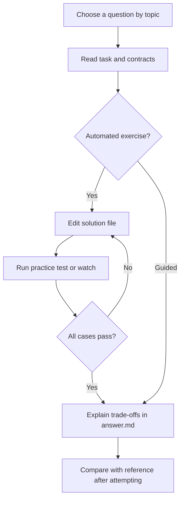

# Standalone Coding Problems

[All collections](../INDEX.md) | [Local practice guide](../README.md)

Search this file for a topic, or run `npm run practice:list -- "<topic words>"` from the repository root. Old IDs and old collection/ID commands still work.

### Async & Concurrency

- [Advanced Debounce with Leading & Trailing Options](js-debounce-options/README.md) - `js-debounce-options` | Senior | javascript
- [Async Promise Concurrency Pool (Worker Throttler)](js-promise-concurrency-pool/README.md) - `js-promise-concurrency-pool` | Senior | javascript

### Remote Service / Sandboxing

- [Python Token Bucket Distributed Rate Limiter](py-token-bucket-limiter/README.md) - `py-token-bucket-limiter` | Senior | python

### SQL Aggregations & Joins

- [Monthly User Cohort Retention & Churn Analysis](sql-monthly-cohort-retention/README.md) - `sql-monthly-cohort-retention` | Senior | practice-sql

### Type System

- [Deep Nested Object Path Keys Union Type](ts-deep-flatten-keys/README.md) - `ts-deep-flatten-keys` | Senior | javascript

### Window Functions

- [Top 2 Revenue Products Per Category (Window Functions)](sql-top-n-per-category/README.md) - `sql-top-n-per-category` | Senior | practice-sql

## Practice workflow

Choose a question, read its README and visible cases, and edit its solution or answer file.

Mermaid renders in supported Markdown viewers. In VS Code use a Mermaid-capable Markdown preview; all instructions also remain available as text.
