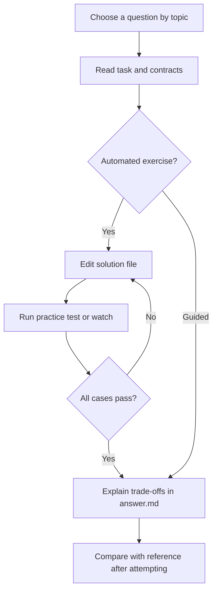

# Loan Dashboard Debugging

[All collections](../INDEX.md) | [Local practice guide](../README.md)

Search this file for a topic, or run `npm run practice:list -- "<topic words>"` from the repository root. Old IDs and old collection/ID commands still work.

### loan

- [Keep the newest search result](bug-1-race-condition/README.md) - `bug-1-race-condition` | Mixed | loan
- [Admit distinct queries, suppress duplicate in-flight work](bug-2-duplicate-api-calls/README.md) - `bug-2-duplicate-api-calls` | Mixed | loan
- [Roll back the correct optimistic approval](bug-3-optimistic-update-failure/README.md) - `bug-3-optimistic-update-failure` | Mixed | loan
- [Reset pagination when the query changes](bug-4-incorrect-pagination/README.md) - `bug-4-incorrect-pagination` | Mixed | loan
- [Sort loans without mutating Redux state](bug-5-redux-state-mutation/README.md) - `bug-5-redux-state-mutation` | Mixed | loan
- [Keep selector results stable for unrelated updates](bug-6-excessive-re-renders/README.md) - `bug-6-excessive-re-renders` | Mixed | loan
- [Read current filters when a refresh actually runs](bug-7-stale-closure/README.md) - `bug-7-stale-closure` | Mixed | loan
- [Leave loading and support retry after a failure](bug-8-failed-request-recovery/README.md) - `bug-8-failed-request-recovery` | Mixed | loan

## Practice workflow

Choose a question, read its README and visible cases, and edit its solution or answer file.

Mermaid renders in supported Markdown viewers. In VS Code use a Mermaid-capable Markdown preview; all instructions also remain available as text.
