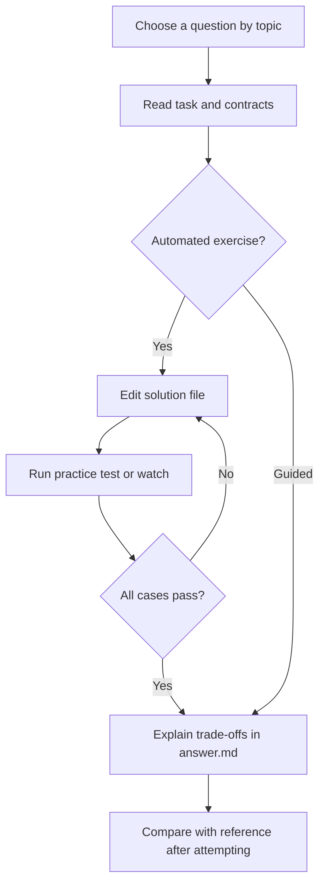

# SQL and PostgreSQL

[All collections](../INDEX.md) | [Local practice guide](../README.md)

Search this file for a topic, or run `npm run practice:list -- "<topic words>"` from the repository root. Old IDs and old collection/ID commands still work.

### Backup, Recovery, and Replication

- [PostgreSQL Read Replicas and Replication Lag](postgresql-read-replicas-and-replication-lag--sql-t2-27/README.md) - `sql-t2-27` | Intermediate | guided
- [Production Incident: Replication Lag Spike & Disk Exhaustion on Primary](production-incident-replication-lag-spike-disk-exhaustion-on-primary--sql-tier4-003/README.md) - `sql-tier4-003` | Senior/Staff | guided
- [Point-In-Time Recovery (PITR) Disaster Recovery Architecture](point-in-time-recovery-pitr-disaster-recovery-architecture--sql-tier4-006/README.md) - `sql-tier4-006` | Senior/Staff | guided
- [PostgreSQL Logical Decoding and Change Data Capture (CDC) Architecture](postgresql-logical-decoding-and-change-data-capture-cdc-architecture--sql-tier4-018/README.md) - `sql-tier4-018` | Senior/Staff | guided
- [High-Availability Failover Architectures: Patroni, Raft Quorum, and Split-Brain Defense](high-availability-failover-architectures-patroni-raft-quorum-and-split-brain--sql-tier4-022/README.md) - `sql-tier4-022` | Senior/Staff | guided
- [Production Incident: Replica WAL Replay Lag Induced by Long Standby Queries](production-incident-replica-wal-replay-lag-induced-by-long-standby-queries--sql-tier4-026/README.md) - `sql-tier4-026` | Senior/Staff | guided
- [PostgreSQL Disaster Post-Mortem: Dropped Table Recovery Without Backup Restore](postgresql-disaster-post-mortem-dropped-table-recovery-without-backup-restor--sql-tier4-030/README.md) - `sql-tier4-030` | Senior/Staff | guided

### Database Design and Normalization

- [Relational Database Keys: Primary Keys vs. Foreign Keys](relational-database-keys-primary-keys-vs-foreign-keys--sql-t1-16/README.md) - `sql-t1-16` | Beginner | guided
- [First Normal Form (1NF) Fundamentals](first-normal-form-1nf-fundamentals--sql-t1-17/README.md) - `sql-t1-17` | Beginner | guided
- [Second Normal Form (2NF) and Composite Keys](second-normal-form-2nf-and-composite-keys--sql-t1-18/README.md) - `sql-t1-18` | Beginner | guided
- [Third Normal Form (3NF) and Transitive Dependencies](third-normal-form-3nf-and-transitive-dependencies--sql-t1-19/README.md) - `sql-t1-19` | Beginner | guided
- [Database Constraints: NOT NULL, UNIQUE, and CHECK](database-constraints-not-null-unique-and-check--sql-t1-25/README.md) - `sql-t1-25` | Beginner | guided
- [Surrogate Keys vs. Natural Keys](surrogate-keys-vs-natural-keys--sql-t2-11/README.md) - `sql-t2-11` | Intermediate | guided
- [Foreign Key Cascade Behaviors: CASCADE, SET NULL, and RESTRICT](foreign-key-cascade-behaviors-cascade-set-null-and-restrict--sql-t2-13/README.md) - `sql-t2-13` | Intermediate | guided
- [Database Normalization vs. Denormalization Trade-offs](database-normalization-vs-denormalization-trade-offs--sql-t2-15/README.md) - `sql-t2-15` | Intermediate | guided
- [Soft Deletes vs. Hard Deletes: Architecture and Query Traps](soft-deletes-vs-hard-deletes-architecture-and-query-traps--sql-t2-29/README.md) - `sql-t2-29` | Intermediate | guided
- [PostgreSQL Foreign Data Wrappers (postgres_fdw) and Pushdown](postgresql-foreign-data-wrappers-postgres-fdw-and-pushdown--sql-tier3-021/README.md) - `sql-tier3-021` | Advanced | guided
- [Multi-Tenant Database Architectures: Trade-Off Analysis at Scale](multi-tenant-database-architectures-trade-off-analysis-at-scale--sql-tier4-010/README.md) - `sql-tier4-010` | Senior/Staff | guided
- [PostgreSQL Foreign Keys with ON DELETE CASCADE: Lock Cascade Hazards](postgresql-foreign-keys-with-on-delete-cascade-lock-cascade-hazards--sql-tier4-028/README.md) - `sql-tier4-028` | Senior/Staff | guided

### Database Security and Permissions

- [SQL Injection Prevention: Parameterized Queries vs String Concatenation](sql-injection-prevention-parameterized-queries-vs-string-concatenation--sql-t1-26/README.md) - `sql-t1-26` | Beginner | guided
- [Row-Level Security (RLS) for Multi-Tenant Database Architecture](row-level-security-rls-for-multi-tenant-database-architecture--sql-tier3-011/README.md) - `sql-tier3-011` | Advanced | guided
- [Database Security: Role Inheritance, Schema search_path Poisoning, and SECURITY DEFINER](database-security-role-inheritance-schema-search-path-poisoning-and-security--sql-tier3-029/README.md) - `sql-tier3-029` | Advanced | guided
- [Database Security Hardening: SCRAM-SHA-256, Connection Quotas, and pgaudit](database-security-hardening-scram-sha-256-connection-quotas-and-pgaudit--sql-tier4-020/README.md) - `sql-tier4-020` | Senior/Staff | guided

### Filtering, Sorting, and Aggregation

- [Pattern Matching with LIKE and Wildcards](pattern-matching-with-like-and-wildcards--sql-t1-04/README.md) - `sql-t1-04` | Beginner | sql
- [Range Filtering with BETWEEN and Date Comparison](range-filtering-with-between-and-date-comparison--sql-t1-05/README.md) - `sql-t1-05` | Beginner | sql
- [Membership Filtering with the IN Operator](membership-filtering-with-the-in-operator--sql-t1-06/README.md) - `sql-t1-06` | Beginner | sql
- [Handling Missing Data with IS NULL and IS NOT NULL](handling-missing-data-with-is-null-and-is-not-null--sql-t1-07/README.md) - `sql-t1-07` | Beginner | sql
- [Aggregating Totals with COUNT, SUM, and AVG](aggregating-totals-with-count-sum-and-avg--sql-t1-08/README.md) - `sql-t1-08` | Beginner | sql
- [Grouping and Aggregating with GROUP BY](grouping-and-aggregating-with-group-by--sql-t1-09/README.md) - `sql-t1-09` | Beginner | sql
- [Filtering Grouped Aggregates with HAVING](filtering-grouped-aggregates-with-having--sql-t1-10/README.md) - `sql-t1-10` | Beginner | sql
- [Loan Approval Rates and Risk Categorization](loan-approval-rates-and-risk-categorization--sql-t1-14/README.md) - `sql-t1-14` | Beginner | sql
- [Conditional Aggregation with CASE WHEN](conditional-aggregation-with-case-when--sql-t1-15/README.md) - `sql-t1-15` | Beginner | sql

### Indexes and Query Planning

- [B-Tree Indexing Fundamentals](b-tree-indexing-fundamentals--sql-t1-24/README.md) - `sql-t1-24` | Beginner | guided
- [Composite and Foreign Key Indexing Basics](composite-and-foreign-key-indexing-basics--sql-t1-30/README.md) - `sql-t1-30` | Beginner | guided
- [Partial Indexes in PostgreSQL](partial-indexes-in-postgresql--sql-t2-16/README.md) - `sql-t2-16` | Intermediate | guided
- [Expression / Functional Indexes in PostgreSQL](expression-functional-indexes-in-postgresql--sql-t2-17/README.md) - `sql-t2-17` | Intermediate | guided
- [B-Tree Index Internals: Leaf Pages, Splits, and Fillfactor](b-tree-index-internals-leaf-pages-splits-and-fillfactor--sql-tier3-001/README.md) - `sql-tier3-001` | Advanced | guided
- [EXPLAIN (ANALYZE, BUFFERS): Plan Reading & Scan Types](analyze-buffers-plan-reading-scan-types--sql-tier3-002/README.md) - `sql-tier3-002` | Advanced | guided
- [GIN vs GiST vs BRIN Indexes: Architecture and Selection](gin-vs-gist-vs-brin-indexes-architecture-and-selection--sql-tier3-003/README.md) - `sql-tier3-003` | Advanced | guided
- [Partial Indexes and Expression Indexes: Advanced Query Optimization](partial-indexes-and-expression-indexes-advanced-query-optimization--sql-tier3-025/README.md) - `sql-tier3-025` | Advanced | sql
- [PostgreSQL NULLS FIRST / NULLS LAST Index Semantics](postgresql-nulls-first-nulls-last-index-semantics--sql-tier3-028/README.md) - `sql-tier3-028` | Advanced | guided
- [Corrupt Index Remediation and REINDEX CONCURRENTLY Failures](corrupt-index-remediation-and-reindex-concurrently-failures--sql-tier4-008/README.md) - `sql-tier4-008` | Senior/Staff | guided

### Isolation Levels and MVCC

- [PostgreSQL Read Committed vs. Repeatable Read Isolation Levels](postgresql-read-committed-vs-repeatable-read-isolation-levels--sql-t2-20/README.md) - `sql-t2-20` | Intermediate | guided
- [Understanding PostgreSQL MVCC: Tuple Headers and xmin / xmax](understanding-postgresql-mvcc-tuple-headers-and-xmin-xmax--sql-t2-23/README.md) - `sql-t2-23` | Intermediate | guided
- [PostgreSQL Autovacuum and Table Bloat](postgresql-autovacuum-and-table-bloat--sql-t2-24/README.md) - `sql-t2-24` | Intermediate | guided
- [PostgreSQL MVCC Internals: Heap Tuples, xmin, xmax, and Hints](postgresql-mvcc-internals-heap-tuples-xmin-xmax-and-hints--sql-tier3-004/README.md) - `sql-tier3-004` | Advanced | guided
- [PostgreSQL Transaction Isolation: Write Skew and Serializable Snapshot Isolation (SSI)](postgresql-transaction-isolation-write-skew-and-serializable-snapshot-isolat--sql-tier3-008/README.md) - `sql-tier3-008` | Advanced | guided

### JSONB and PostgreSQL-specific features

- [PostgreSQL JSONB vs JSON Storage and Operators](postgresql-jsonb-vs-json-storage-and-operators--sql-t2-18/README.md) - `sql-t2-18` | Intermediate | guided
- [PostgreSQL GIN (Generalized Inverted) Indexes on JSONB](postgresql-gin-generalized-inverted-indexes-on-jsonb--sql-t2-19/README.md) - `sql-t2-19` | Intermediate | guided
- [PostgreSQL JSONB: Operators, jsonb_path_query, and GIN Indexing](postgresql-jsonb-operators-jsonb-path-query-and-gin-indexing--sql-tier3-007/README.md) - `sql-tier3-007` | Advanced | guided

### Joins and Relationships

- [Basic INNER JOIN Across Two Relational Tables](basic-inner-join-across-two-relational-tables--sql-t1-11/README.md) - `sql-t1-11` | Beginner | sql
- [Finding Inactive Records with LEFT JOIN and IS NULL](finding-inactive-records-with-left-join-and-is-null--sql-t1-12/README.md) - `sql-t1-12` | Beginner | sql
- [Multi-Table Join: Order Items with Products and Customers](multi-table-join-order-items-with-products-and-customers--sql-t1-13/README.md) - `sql-t1-13` | Beginner | sql
- [FULL OUTER JOIN for Data Reconciliation](full-outer-join-for-data-reconciliation--sql-t2-08/README.md) - `sql-t2-08` | Intermediate | sql
- [Self-Joins for Hierarchical and Comparative Analysis](self-joins-for-hierarchical-and-comparative-analysis--sql-t2-10/README.md) - `sql-t2-10` | Intermediate | guided

### Locks and Deadlocks

- [Row-Level Locking with SELECT FOR UPDATE](row-level-locking-with-select-for-update--sql-t2-21/README.md) - `sql-t2-21` | Intermediate | guided
- [Database Deadlocks: Causes and Prevention](database-deadlocks-causes-and-prevention--sql-t2-26/README.md) - `sql-t2-26` | Intermediate | guided
- [Advisory Locks: Application-Level Distributed Locking in Postgres](advisory-locks-application-level-distributed-locking-in-postgres--sql-tier3-009/README.md) - `sql-tier3-009` | Advanced | guided
- [Advisory Locks vs FOR UPDATE SKIP LOCKED for Message Queues](advisory-locks-vs-for-update-skip-locked-for-message-queues--sql-tier3-018/README.md) - `sql-tier3-018` | Advanced | sql
- [Advisory Locks for Distributed Idempotency and Rate Limiting](advisory-locks-for-distributed-idempotency-and-rate-limiting--sql-tier3-030/README.md) - `sql-tier3-030` | Advanced | guided
- [Production Incident: Multi-Transaction Deadlock Graph & Lock Queue Analysis](production-incident-multi-transaction-deadlock-graph-lock-queue-analysis--sql-tier4-001/README.md) - `sql-tier4-001` | Senior/Staff | guided
- [Production Incident: Cascading Lock Pileup Caused by Missing Foreign Key Index](production-incident-cascading-lock-pileup-caused-by-missing-foreign-key-inde--sql-tier4-011/README.md) - `sql-tier4-011` | Senior/Staff | guided
- [Production Incident: Statement Timeout vs Lock Timeout Cascading Outage](production-incident-statement-timeout-vs-lock-timeout-cascading-outage--sql-tier4-021/README.md) - `sql-tier4-021` | Senior/Staff | guided
- [PostgreSQL Advisory Locks for Queue Worker Deadlock Prevention](postgresql-advisory-locks-for-queue-worker-deadlock-prevention--sql-tier4-025/README.md) - `sql-tier4-025` | Senior/Staff | sql

### Migrations and Schema Evolution

- [Zero-Downtime Schema Migrations: Safe Index Creation & Column Additions](zero-downtime-schema-migrations-safe-index-creation-column-additions--sql-tier3-017/README.md) - `sql-tier3-017` | Advanced | guided
- [Audit Logging with Trigger Functions and pg_trigger_depth](audit-logging-with-trigger-functions-and-pg-trigger-depth--sql-tier3-022/README.md) - `sql-tier3-022` | Advanced | guided
- [Zero-Downtime Column Rename and Type Migration in 24/7 Production](zero-downtime-column-rename-and-type-migration-in-24-7-production--sql-tier4-002/README.md) - `sql-tier4-002` | Senior/Staff | guided
- [Zero-Downtime NOT NULL Constraint Addition on 100-Million Row Tables](zero-downtime-not-null-constraint-addition-on-100-million-row-tables--sql-tier4-029/README.md) - `sql-tier4-029` | Senior/Staff | guided

### Partitioning and Large Tables

- [Declarative Partitioning: Range, List, and Hash Strategies](declarative-partitioning-range-list-and-hash-strategies--sql-tier3-006/README.md) - `sql-tier3-006` | Advanced | guided
- [High-Throughput TimescaleDB / Hypertable Architecture vs Native Partitioning](high-throughput-timescaledb-hypertable-architecture-vs-native-partitioning--sql-tier4-015/README.md) - `sql-tier4-015` | Senior/Staff | guided

### PostgreSQL Data Types

- [SQL Data Types: VARCHAR, CHAR, and TEXT in PostgreSQL](sql-data-types-varchar-char-and-text-in-postgresql--sql-t1-20/README.md) - `sql-t1-20` | Beginner | guided
- [Date and Time Types: TIMESTAMP vs. TIMESTAMPTZ](date-and-time-types-timestamp-vs-timestamptz--sql-t1-21/README.md) - `sql-t1-21` | Beginner | guided
- [Row Insertion and Returning Generated IDs with RETURNING](row-insertion-and-returning-generated-ids-with-returning--sql-t1-29/README.md) - `sql-t1-29` | Beginner | guided
- [UUIDv4 vs. BIGINT / ULID for Primary Keys](uuidv4-vs-bigint-ulid-for-primary-keys--sql-t2-12/README.md) - `sql-t2-12` | Intermediate | guided
- [PostgreSQL LISTEN and NOTIFY: Pub/Sub Architecture and Queue Hazards](postgresql-listen-and-notify-pub-sub-architecture-and-queue-hazards--sql-tier3-013/README.md) - `sql-tier3-013` | Advanced | guided
- [PostgreSQL Full-Text Search: tsvector, tsquery, and GIN Indexing](postgresql-full-text-search-tsvector-tsquery-and-gin-indexing--sql-tier3-019/README.md) - `sql-tier3-019` | Advanced | guided
- [Custom PostgreSQL Types: DOMAIN vs ENUM vs Composite Types](custom-postgresql-types-domain-vs-enum-vs-composite-types--sql-tier3-024/README.md) - `sql-tier3-024` | Advanced | guided
- [Array Data Types and High-Performance Containment Queries](array-data-types-and-high-performance-containment-queries--sql-tier3-027/README.md) - `sql-tier3-027` | Advanced | sql
- [High-Performance Unlogged Tables vs Temp Tables for Ephemeral Staging](high-performance-unlogged-tables-vs-temp-tables-for-ephemeral-staging--sql-tier4-019/README.md) - `sql-tier4-019` | Senior/Staff | guided

### Production Debugging

- [Autovacuum Tuning, Table Bloat, and Freeze Wraparound](autovacuum-tuning-table-bloat-and-freeze-wraparound--sql-tier3-005/README.md) - `sql-tier3-005` | Advanced | guided
- [PostgreSQL Extensions: pg_stat_statements and Performance Profiling](postgresql-extensions-pg-stat-statements-and-performance-profiling--sql-tier3-023/README.md) - `sql-tier3-023` | Advanced | guided
- [Zero-Downtime Table Bloat Remediation: pg_repack vs VACUUM FULL](zero-downtime-table-bloat-remediation-pg-repack-vs-vacuum-full--sql-tier4-004/README.md) - `sql-tier4-004` | Senior/Staff | guided
- [Production Incident: Stalled Autovacuum & Impending 2-Billion XID Wraparound](production-incident-stalled-autovacuum-impending-2-billion-xid-wraparound--sql-tier4-007/README.md) - `sql-tier4-007` | Senior/Staff | guided
- [Linux OOM Killer Tuning, overcommit_memory, and PostgreSQL Work_mem](linux-oom-killer-tuning-overcommit-memory-and-postgresql-work-mem--sql-tier4-013/README.md) - `sql-tier4-013` | Senior/Staff | guided

### Query Optimization

- [Keyset Pagination vs. OFFSET Pagination](keyset-pagination-vs-offset-pagination--sql-t2-25/README.md) - `sql-t2-25` | Intermediate | guided
- [Materialized Views and Concurrent Refresh in PostgreSQL](materialized-views-and-concurrent-refresh-in-postgresql--sql-t2-30/README.md) - `sql-t2-30` | Intermediate | guided
- [PgBouncer Connection Pooling: Session vs Transaction vs Statement Modes](pgbouncer-connection-pooling-session-vs-transaction-vs-statement-modes--sql-tier3-012/README.md) - `sql-tier3-012` | Advanced | guided
- [Materialized Views with REFRESH CONCURRENTLY](materialized-views-with-refresh-concurrently--sql-tier3-014/README.md) - `sql-tier3-014` | Advanced | guided
- [PostgreSQL Join Strategies: Nested Loop, Hash Join, and Merge Join](postgresql-join-strategies-nested-loop-hash-join-and-merge-join--sql-tier3-016/README.md) - `sql-tier3-016` | Advanced | guided
- [PostgreSQL JIT Compilation: Overhead, Thresholds, and OLTP Regressions](postgresql-jit-compilation-overhead-thresholds-and-oltp-regressions--sql-tier3-026/README.md) - `sql-tier3-026` | Advanced | guided
- [Checkpoint Tuning & WAL Generation Spikes: Eliminating I/O Spikes](checkpoint-tuning-wal-generation-spikes-eliminating-i-o-spikes--sql-tier4-005/README.md) - `sql-tier4-005` | Senior/Staff | guided
- [Atomic Distributed Rate Limiting & Token Bucket in Pure PostgreSQL](atomic-distributed-rate-limiting-token-bucket-in-pure-postgresql--sql-tier4-009/README.md) - `sql-tier4-009` | Senior/Staff | sql
- [Query Plan Regressions: Parameter Sniffing & Generic vs Custom Plans](query-plan-regressions-parameter-sniffing-generic-vs-custom-plans--sql-tier4-014/README.md) - `sql-tier4-014` | Senior/Staff | guided
- [Zero-Downtime Deduplication of 50 Million Records Under Live Write Load](zero-downtime-deduplication-of-50-million-records-under-live-write-load--sql-tier4-016/README.md) - `sql-tier4-016` | Senior/Staff | sql
- [Correlated Columns and Multi-Column Extended Statistics (CREATE STATISTICS)](correlated-columns-and-multi-column-extended-statistics-create-statistics--sql-tier4-017/README.md) - `sql-tier4-017` | Senior/Staff | guided
- [Heap-Only Tuple (HOT) Optimization Failures and Write Amplification](heap-only-tuple-hot-optimization-failures-and-write-amplification--sql-tier4-023/README.md) - `sql-tier4-023` | Senior/Staff | guided
- [PostgreSQL Memory Hierarchy: Shared Buffers, OS Page Cache, and Double Buffering](postgresql-memory-hierarchy-shared-buffers-os-page-cache-and-double-bufferin--sql-tier4-024/README.md) - `sql-tier4-024` | Senior/Staff | guided
- [Keyset Pagination vs Deep OFFSET: Eliminating O(N) Query Degradation](keyset-pagination-vs-deep-offset-eliminating-o-n-query-degradation--sql-tier4-027/README.md) - `sql-tier4-027` | Senior/Staff | sql

### SQL Fundamentals

- [Basic Column Projection and Row Limiting](basic-column-projection-and-row-limiting--sql-t1-01/README.md) - `sql-t1-01` | Beginner | sql
- [Filtering Active Catalog Products with WHERE](filtering-active-catalog-products-with-where--sql-t1-02/README.md) - `sql-t1-02` | Beginner | sql
- [Eliminating Duplicates with DISTINCT](eliminating-duplicates-with-distinct--sql-t1-03/README.md) - `sql-t1-03` | Beginner | sql
- [Understanding Database Views](understanding-database-views--sql-t1-27/README.md) - `sql-t1-27` | Beginner | guided
- [PostgreSQL Boolean Logic: COALESCE and NULLIF](postgresql-boolean-logic-coalesce-and-nullif--sql-t1-28/README.md) - `sql-t1-28` | Beginner | guided
- [Combining Result Sets with UNION and UNION ALL](combining-result-sets-with-union-and-union-all--sql-t2-09/README.md) - `sql-t2-09` | Intermediate | sql
- [SQL Upsert Patterns: INSERT ... ON CONFLICT DO UPDATE](sql-upsert-patterns-insert-on-conflict-do-update--sql-t2-28/README.md) - `sql-t2-28` | Intermediate | guided

### Subqueries and CTEs

- [Filtering Above-Average Values with Scalar Subqueries](filtering-above-average-values-with-scalar-subqueries--sql-t2-01/README.md) - `sql-t2-01` | Intermediate | sql
- [Correlated Subquery with EXISTS](correlated-subquery-with-exists--sql-t2-02/README.md) - `sql-t2-02` | Intermediate | sql
- [Common Table Expressions (CTEs) for Multi-Step Aggregations](common-table-expressions-ctes-for-multi-step-aggregations--sql-t2-03/README.md) - `sql-t2-03` | Intermediate | sql
- [Hierarchical Queries with Recursive CTEs (WITH RECURSIVE)](hierarchical-queries-with-recursive-ctes-with-recursive--sql-tier3-010/README.md) - `sql-tier3-010` | Advanced | sql
- [CTEs in PostgreSQL 12+: MATERIALIZED vs NOT MATERIALIZED](ctes-in-postgresql-12-materialized-vs-not-materialized--sql-tier3-020/README.md) - `sql-tier3-020` | Advanced | guided

### Transactions and ACID

- [ACID Properties in Relational Databases](acid-properties-in-relational-databases--sql-t1-22/README.md) - `sql-t1-22` | Beginner | guided
- [Transactions with BEGIN, COMMIT, and ROLLBACK](transactions-with-begin-commit-and-rollback--sql-t1-23/README.md) - `sql-t1-23` | Beginner | guided
- [The Transactional Outbox Pattern in Relational Databases](the-transactional-outbox-pattern-in-relational-databases--sql-t2-14/README.md) - `sql-t2-14` | Intermediate | guided
- [Optimistic Locking with Version Columns](optimistic-locking-with-version-columns--sql-t2-22/README.md) - `sql-t2-22` | Intermediate | guided
- [Two-Phase Commit (2PC) and Orphaned Prepared Transaction Disasters](two-phase-commit-2pc-and-orphaned-prepared-transaction-disasters--sql-tier4-012/README.md) - `sql-tier4-012` | Senior/Staff | guided

### Window Functions

- [Ranking Products Within Categories Using DENSE_RANK()](ranking-products-within-categories-using-dense-rank--sql-t2-04/README.md) - `sql-t2-04` | Intermediate | sql
- [Calculating Running Totals with Cumulative Window Aggregation](calculating-running-totals-with-cumulative-window-aggregation--sql-t2-05/README.md) - `sql-t2-05` | Intermediate | sql
- [Prior Period Comparison with LAG()](prior-period-comparison-with-lag--sql-t2-06/README.md) - `sql-t2-06` | Intermediate | sql
- [Top N Records Per Group Pattern](top-n-records-per-group-pattern--sql-t2-07/README.md) - `sql-t2-07` | Intermediate | sql
- [Window Frame Specifications: ROWS vs RANGE vs GROUPS](window-frame-specifications-rows-vs-range-vs-groups--sql-tier3-015/README.md) - `sql-tier3-015` | Advanced | sql

## Practice workflow

Choose a question, read its README and visible cases, and edit its solution or answer file.

Mermaid renders in supported Markdown viewers. In VS Code use a Mermaid-capable Markdown preview; all instructions also remain available as text.
