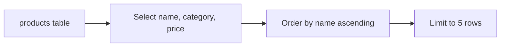

# Basic Column Projection and Row Limiting

Collection: sql · ID: `sql-t1-01` · Mode: **sql**

## Business context

The inventory operations team needs a quick glance at available catalog items to verify stock naming and retail pricing.

## Task

Write a query to retrieve the `name`, `category`, and `price` of all products from the `products` table, ordered alphabetically by `name`, limited to the first 5 records.

## Follow-up questions

- What happens if you omit the ORDER BY clause when using LIMIT in a relational database?

## Work locally

Edit [solution.sql](solution.sql) and record your reasoning in [answer.md](answer.md). Keep the original function names and input/output contracts.

Run from the repository root:

```sh
npm run practice:test -- sql/basic-column-projection-and-row-limiting--sql-t1-01
npm run practice:watch -- sql/basic-column-projection-and-row-limiting--sql-t1-01
```

Cases are visible in [test-cases.json](test-cases.json).

Full authored task data (including review files, telemetry, stages, requirements, hints, and examples where supplied) is in [exercise.json](exercise.json).

After your attempt, open [reference.md](reference.md) for the authored answer, rubric, follow-ups, and solution.

## Visual model: requested query result

Select the requested columns, order products by name, then return the first five rows. This describes the result contract, not the database engine's physical execution plan.


